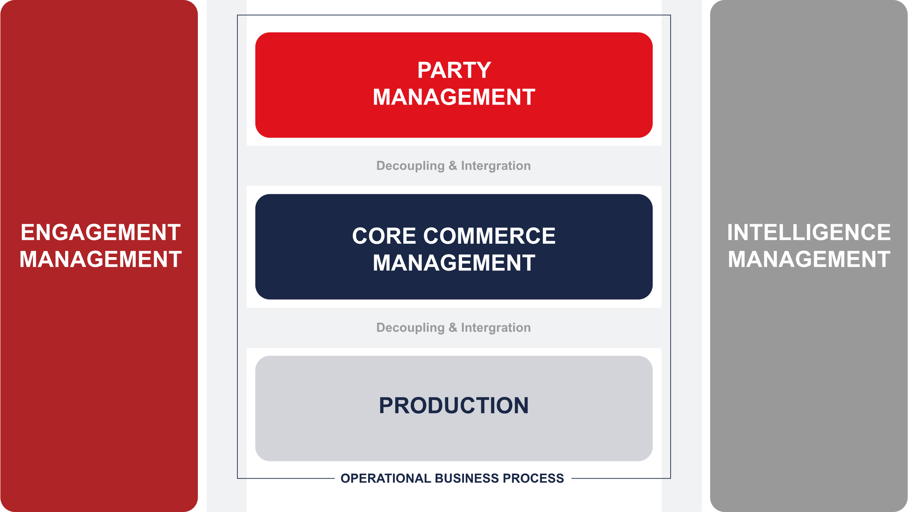
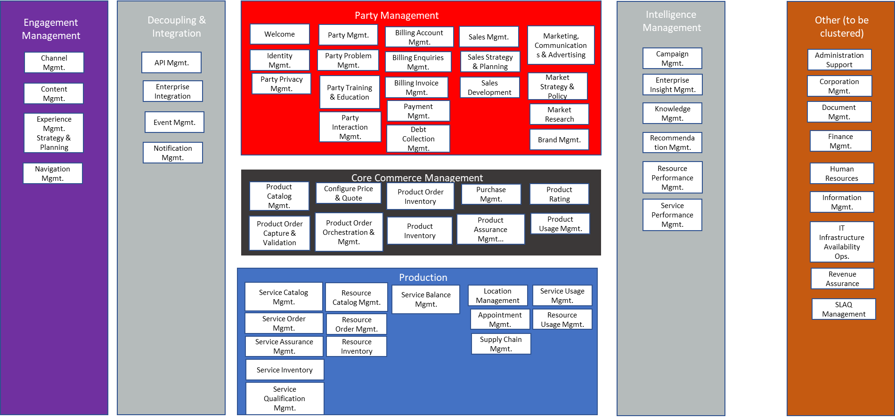

# 7. Case: A Telco

Few industries test this thesis like telecommunications. An operator bills millions of customers every month, charges in real time the consumption of every prepaid line, answers to a regulator that audits its complaints and its deadlines, and sells a catalog that changes faster than any development cycle. Its business support system, the BSS, is among the most complex that exist in a company. If the system of truth and the control layers work here, they work almost anywhere.

The operator in this chapter does not exist. I build it with what the industry has published, above all TM Forum, the association that brings together telecommunications operators and vendors and writes their standards. Two warnings about those sources. Several of its reports are sponsored by vendors that sell software to operators, and I declare the sponsorship the first time I cite each report. And almost everything that follows is what operators declare in interviews and surveys, not measurements of results.

## Where is the operator?

In the same place as many, according to TM Forum's report on artificial intelligence in billing. The report notes that fragmented legacy BSS landscapes persist within many operators, and lists what they drag along: high costs, operational inefficiency, customer experience restraints, limited business agility, rigid experiences for employees and customers, expensive, slow and complex customizations, and the difficulty of meeting new regulatory and security requirements without more customization.[^legado] Put in the terms of chapter 1, that landscape is the operator's business described once, with layers of customization on top, and changing only when someone opens a project; it makes no difference whether each piece is licensed, rented or custom-built. The report on order management adds three classic problems: orders that fall out along the way, what the industry calls *fallout*; the difficulty of changing an order already in flight; and the poor visibility the customer has.[^om2]

With a BSS like that, launching a new offer takes weeks. An African operator that published its results, Safaricom, said that before modernizing its converged billing on TM Forum standards it took four weeks or more to bring an offer to market, and around five days afterwards.[^safaricom]

## What does it ask the market?

The usual question would be which suite to buy: compare three or four similar ones, choose the one that best covers what the operator already does and sign for several years. The risk of that question is buying, under another name, the same dependency.

The question that fits in 2026 is broader: what suits it, buying a suite or building its BSS with agents under its control. To answer it fairly, both forms of solution have to be measured by the same yardstick, and that demands asking for capabilities instead of products: saying what the solution must achieve and how it is verified, without presupposing whether it is bought or built.

Standards do enormous work here. TM Forum describes an operator's architecture in its Open Digital Architecture, ODA, which it presents as an architecture framework, a common language and design principles, with open interfaces that expose the business capabilities.[^oda] An operator can write its requirements on that map, and any offer answers on the same map.

## What is not built with agents?

The core that rates and bills. TM Forum's billing report records that, in the current thinking of many experts in that industry, probabilistic AI left on its own is too risky for deterministic billing at scale: AI is based on probabilities and billing is a deterministic process, in which usage must always be rated at the correct rates.[^billing19] The same report says most experts are not, for now, suggesting that AI sit at the heart of the billing engine, and that its widely accepted role there is to assure that engine's performance and accuracy.[^billing11] A Telstra chief architect said it thinking of the network, and the idea carries over to billing: even if something has moved from a one in twenty to a one in a hundred chance of going wrong, that could still be a failure.⁠[^telstra]

That core belongs to the first control layer. What is rated, what is charged, what is billed, the balances and their adjustments live in the operator's system of truth, and the agents work around it. What they can do in billing is described by the same report: verify data and detect anomalies before and during billing, or check package descriptions against their rates.[^billing8]

In other words: at the heart of the telco, the core that rates and bills survives, or at least its promise of determinism survives, and what dies is the business frozen around it. It is what chapter 3 anticipated: what is still bought, when the rest is no longer bought, is the truth.

The report brings a formulation that could be in chapter 5. In describing what an outcome-based invoice should be like, it asks that it be auditable: that customers should be able to reconstruct the billable events from their own data.[^billing23] And a billing vendor, in a sponsored article in the same report, asks to be able to reproduce the calculation from recorded facts, and to preserve what an agent requested, what authorized it and what changed.[^logisense] It is the property of the traceable origin, and it is the condition for a third party to be able to verify afterwards.

## Where do the agents work?

Where the process is not deterministic. An architect at T Wholesale, of Deutsche Telekom, describes it for orders with invalid data: you can kick the order back to the customer or work internally on handling the exception, and in these cases agentic can be used very well.[^thon] And he also says where not: if a process is strongly deterministic, it does not make sense to use artificial intelligence. In a TM Forum demonstration with Telstra, agents chain small flows defined in advance to fulfill each customer's intent on the spot.[^keele] It is the pattern of chapter 3.

## What do operators ask for before letting an agent act?

The survey by TM Forum and the IBM Institute for Business Value of 130 operator leaders from North America, Europe, Asia and other regions, without Latin America, asked which conditions weigh most for letting AI operate without human intervention. The most cited: safeguards against service outages or customer harm, 51%; the ability to stop, pause or revert AI actions, 49%; testing and validation before deployment, 48%; data privacy and sovereignty, 43%; a log of all AI actions, 43%; and explainable decisions, 32%.[^trust31] Several fit the control layers: the log with truth, the ability to stop and revert with movement and its reversal, prior testing with measurement. Others, like privacy, fall outside this book's framework.

The same study brings the figure that impressed me most in all the material. 72% of respondents are confident they can operate their AI reliably. Only 18% can produce evidence a third party can review, and just 14% have both.[^trust6] Confidence currently runs ahead of proof, in the report's words.

That gap is close to this book's problem: confidence runs ahead of the evidence a third party can review. The survey measures the evidence about AI, not the truth of the records; I believe the two gaps have the same origin, but the survey does not prove it. The report reaches a neighboring conclusion: periodic attestations work when systems are deterministic and change little; in autonomous operations, systems are probabilistic and change all the time, and evidence has to become continuous.[^trust38] A BSS vendor, in a sponsored article in the same report, puts it almost in the words of chapter 5: today no one can hand a regulator, a partner or a customer a signed, independently verifiable record proving that the agent stayed inside its boundaries when it acted.[^tecnotree]

## What do the control layers look like at the operator?

**Truth.** The system of truth holds the rated usage, the balances, the charges, the invoices and the payments; the subscriber contracts, the orders and the installed base sold; the usage records, the complaints and their deadlines, the number portability and the consents the regulator requires. A suite licensed and operated by the operator meets this layer with its core of records; a rented one meets it halfway, because the core is operated by the vendor. A construction meets it with technology from a vendor that answers for it, and in both cases someone to attest is needed.

**Identity and authority.** Every agent that touches an order, a complaint or an adjustment has an identity and permissions of its own, and every act has an area that answers. 23% of the operators surveyed already had, in the last year, an incident of what the industry calls "excessive agency": an agent that did more than it should have.[^trust19]

**Movement.** The agents work in customer care, in order exceptions and in reconciliation, with autonomy granted by degrees. Full autonomy is rare: in billing and revenue assurance, only 4% of respondents report fully autonomous operations.[^trust12]

**Measurement.** Only one in four respondents says they verify their controls continuously and automatically.[^trust37]

**Judgment.** ODA, TM Forum's information model and its open interfaces are the starting point, and on that map a component should be replaceable without redoing the rest, although that is the least mature part of ODA (chapter 3).

And the two dimensions: people, because a BSS whose behavior nobody at the operator understands repeats the dependency the operator wanted to leave behind; and reversal, because an operator cannot stop billing or serving customers while it fixes an agent.

## What if the operator does not know how to develop?

It is the strongest objection I found, and it comes from TM Forum itself. Its chief analyst writes that the vast majority of operators have limited software development capabilities: they assemble, integrate and maintain what they buy from their vendors, and this "is unlikely to change in the AI era".[^newman10] The figures from another report go along with it: operators invest on average 1.3% of their revenues in research and development, and their vendors 16.7%, and for twenty or thirty years they outsourced that function to the vendors.[^idi] And the May 2026 study observes that, for now, it seems inevitable that operators will need more support from their vendors to bring AI into their architectures, though it warns there is no clear picture yet.[^rit47]

But the Forum does not say the same everywhere. On the same page as the first quote it admits that operators have not historically employed their own teams of developers, "but this is starting to change".[^newman10] In its survey of December 2025 and January 2026, 66% of respondents consider software engineering central and only 9% think it unlikely that this will change, though half of the respondents are themselves architects or software engineers. The large operators have built central developer teams since 2015, and Vodafone announced it would hire 7,000 in the United Kingdom by 2025.[^rit29] The two facts fit together: engineering being central to a company is not the same as having the team, and the survey itself separates out a quarter who say it will be, but who today have limited capabilities. That tail is the one I have in mind; how much it weighs in the total of operators is not measured. And those teams, as long as they change the system by project, are the custom development of chapter 1: they exist today, and they stay on the side of what dies.

I concede, for the sake of argument, the Forum's entire premise: that most operators are not going to develop software, not even with the help of artificial intelligence, even though the Forum itself admits that, in theory, low-code and generative AI give anyone the ability to write their own, and even though its own figures, the ones I just cited, point in another direction. My thesis does not need it to be false. What I deny is the consequence: that whoever does not develop has to depend on the application and the roadmap of whoever sells it to them.

Part of the Forum, when it speaks of agents, imagines that they write the code faster. Its study of operators' information technology calls agentic AI the third phase of the architecture function, and says it is poised to "increase massively the volume of software that a team of developers can output". Jio's digital factory, where the owners of each process describe what they want and agents produce the application, and the intent-based configuration Swisscom expects, look more like what I describe, and in that the Forum is ahead of many people.[^rit30] The difference is what comes out of the agent, and it is the boundary between the two readings of chapter 3, the agentic and the agentive. There, what comes out is an application someone deploys and maintains. Here, what comes out is a memory of the work, and when it fails, the agent does the work itself while it remakes it, without the operator having to fix code at three in the morning.[^fallback]

In the agentive reading, the one *AgencyDomains* describes, what repeats the agent crystallizes into Botlets, and the Botlets are its own: they are made by the agent that attends to the work, today by configuring a catalog piece, not by someone else for the agent to use. The organization decides what work has to exist and what doing it well means. It is what an Orange executive, quoted by the Forum itself, calls judgment, and which he says of the architecture function: when execution becomes cheap, what decides the outcome is who decides what to build, how and why.[^rit30] The operator's expert, who knows how a convergent plan is rated, how a portability complaint is resolved or why an order falls out, teaches that knowledge to the agent and validates that it learned. It is not that there is no vendor: every Capability, the know-how the agent learns from the expert, is created by a delivery practice that works with them. What changes is what it delivers: knowledge, and not applications.[^wingtraining]

And the operator brings its governance: who grants the permissions, who supervises, who defines the tests, who answers for each record and who decides what must exist. These are the people of the control layers of chapter 6, and in the fifth, the architecture team that judges what the agent shapes by what it does, not by what its code says.

The 1.3% figure measures, then, an input that stops being the scarce one. What becomes scarce is business knowledge and the capacity to govern whoever does the work. The first, I believe, the operator has, although part of it lives today in its vendors' customizations and is the first thing that would have to be recovered. The second it usually lacks, and it is not bought with a suite. The Forum's chief architect senses it: with autonomous systems, he says, software is managed the way people are managed, through delegation, limits, supervision and accountability.[^milham] And the same report as the first quote records, from its conversations with operators, that without a software culture, or without being in the process of building one, it is extremely difficult to be at the forefront of AI.[^newman10] I would put it another way: without a culture of governing the work, it is very difficult for the agents to work for the operator and not the other way around.

This is what I concede. Buying does not disappear: the operator keeps buying the core of truth of chapter 5, the reasoning of the models its agents use and the components regulation requires certifying, which the agent invokes and does not regenerate.[^certificado] And today the starting piece was written by someone else. The reference implementation of *AgencyDomains* operates in its first stage, in which the agent configures pieces from a catalog it did not write, and if that catalog belongs to a vendor, it creates a dependency.[^vergis] The difference from the suite is that the adopted piece can be replaced by the agent, and I believe without redoing the rest, although that is not measured either, and that there is no whole application whose roadmap belongs to someone else.

That the agent shapes and maintains its pieces without anyone programming them is not measured at any telco. Between December 2025 and January 2026, only 5% of the IT executives who answered that question, among the 216 surveyed from 111 operators, said they had agents integrated into their architecture and in production.[^rit38] This part of the thesis would be refuted by an operator that runs its BSS with agents and, a year on, has to pay someone, employee or contractor, to write or fix the code of custom pieces, beyond what the catalog already offers, every time its business changes: if changing a piece requires a person to program, the agentive reading is the agentic one under another name. It would also be refuted by an operator that, a year on, can only change its business when whoever maintains the catalog publishes the piece it needs: the dependency would have moved from the application to the catalog. No operator is yet in a position to prove either.

## What does the industry say against this?

Quite a lot, and forcefully. Amdocs, one of the largest BSS vendors and sponsor of two of the reports cited, offers specialized agents that collaborate in customer care, commerce, orders and assurance, with policy enforced at execution time and each agent as an auditable entity.[^amdocs] Several billing vendors hold that operators do not need high-risk transformations of their core and can layer agents on top of what they already have.[^ripreplace] A Globe Telecom executive estimates that 90% of what is needed to trust AI, in cybersecurity, privacy and data governance, is already covered by the usual practices.[^globe] The report warns that, for whoever builds more AI capabilities of their own, AI spending may appear higher than for whoever buys solutions with AI built in, and that in an agentic system token consumption can scale dramatically and unpredictably.⁠[^costo] And KPN's chief information officer recalls that bringing agents from pilots to scale means changing the whole IT stack of a telco.[^kpn]

This is what I concede. If a suite vendor offers auditable, governed agents with the core intact, it can meet the five control layers, and then buying is a legitimate answer. This book's argument does not prove that building suits better than buying. It proves something else: that, bought or built, the truth needs its contract and its two guarantors. And I do not know what it costs to operate with agents at scale: the ladder of chapter 3 says where that cost should come down, not by how much. Nobody knows yet, and the cost for whoever buys stays hidden inside the license.

There is evidence that would change my thesis, and it is worth naming. That the core of truth keeps being bought does not change it: it is part of it. What would change it is operators that build around that core with agents failing to reach the market faster, or to change their processes with less dependency, than those that buy suites with agents. If that happens, software as we know it will have survived better than this book believes. TM Forum's survey does not ask whether operators build with agents instead of buying. It asks something neighboring: among operators adopting its open architecture, 36% say they already bring more of their technology in-house and 55% expect that to matter little.[^insourcing] The measurement that matters, that of building with agents, is still missing.

[^legado]: TM Forum, *AI for billing, billing for AI*, September 2026, p. 4 (ISBN 978-1-969387-14-2). Report sponsored by Aria, Calvi, LogiSense, LotusFlare, Netcracker and CSG.
[^om2]: TM Forum, *How order management is evolving to embrace agentic AI*, 2026, pp. 2-3. Report sponsored by Amdocs.
[^safaricom]: TM Forum, *AI for billing, billing for AI*, 2026, p. 13. Statements by Mark Oyier, Safaricom; the operator's figures.
[^oda]: TM Forum, "Open Digital Architecture" page, in *AI for billing, billing for AI*, 2026, p. 48. TM Forum institutional text.
[^billing19]: TM Forum, *AI for billing, billing for AI*, 2026, p. 19. Analyst's text.
[^billing11]: TM Forum, *AI for billing, billing for AI*, 2026, p. 11. Analyst's text.
[^telstra]: TM Forum and IBM Institute for Business Value, *Trust and assurance: the key to scaling AI deployments*, July 2026, p. 18 (ISBN 978-1-969387-12-8). Statements by Mark Sanders, Telstra, about the network. Report sponsored by Amdocs, Blue Planet (Ciena), Cloudera, Persistent and Tecnotree; survey designed by IBM IBV.
[^billing8]: TM Forum, *AI for billing, billing for AI*, 2026, pp. 8 and 10. Analyst's text.
[^billing23]: TM Forum, *AI for billing, billing for AI*, 2026, p. 23. Analyst's text.
[^logisense]: LogiSense, sponsored article in TM Forum, *AI for billing, billing for AI*, 2026, p. 38.
[^thon]: TM Forum, *How order management is evolving to embrace agentic AI*, 2026, pp. 4-5. Statements by Karsten Thon, T Wholesale (Deutsche Telekom).
[^keele]: TM Forum, *How order management is evolving to embrace agentic AI*, 2026, p. 6. Statements by Richard Keele, Telstra, on the Catalyst *Agentic I2O*, a demonstration.
[^trust31]: TM Forum and IBM Institute for Business Value, *Trust and assurance*, 2026, p. 31. Survey of 130 operator leaders, without Latin America.
[^trust6]: TM Forum and IBM Institute for Business Value, *Trust and assurance*, 2026, pp. 6 and 44. On p. 35 the same figure appears as 73%.
[^trust38]: TM Forum and IBM Institute for Business Value, *Trust and assurance*, 2026, pp. 38 and 44. Analyst's text.
[^tecnotree]: Tecnotree, sponsored article in TM Forum and IBM Institute for Business Value, *Trust and assurance*, 2026, p. 60.
[^trust19]: TM Forum and IBM Institute for Business Value, *Trust and assurance*, 2026, p. 19.
[^trust12]: TM Forum and IBM Institute for Business Value, *Trust and assurance*, 2026, pp. 11-12.
[^trust37]: TM Forum and IBM Institute for Business Value, *Trust and assurance*, 2026, pp. 37-38.
[^amdocs]: Amdocs, sponsor's material in TM Forum, *How order management is evolving to embrace agentic AI*, 2026, p. 6, and in *Trust and assurance*, 2026, pp. 46-48.
[^ripreplace]: Netcracker and CSG, sponsored article in TM Forum, *AI for billing, billing for AI*, 2026, p. 45; also Calvi (p. 32) and LogiSense (p. 37).
[^globe]: TM Forum and IBM Institute for Business Value, *Trust and assurance*, 2026, p. 24. Statements by Anton Bonifacio, Globe Telecom.
[^costo]: TM Forum and IBM Institute for Business Value, *Trust and assurance*, 2026, pp. 15 and 19. Analyst's text.
[^kpn]: TM Forum, *AI for billing, billing for AI*, 2026, p. 26. Statements by Paul Bosch, KPN.
[^newman10]: TM Forum (Mark Newman), *Agentic AI and autonomy: CSPs set out their strategies*, September 2025, p. 10. Analyst's text. Report sponsored by Motive, Pega and Tecnotree, vendors whom this question affects.
[^idi]: TM Forum (Mark Newman and Dawn Bushaus), *Assessing CSPs' progress towards an Open Digital Architecture*, March 2025, pp. 36-37. Analysts' text. Report sponsored by Cerillion and Tecnotree.
[^rit47]: TM Forum (Mark Newman), *Reinventing IT for the AI era*, May 2026, p. 47 (ISBN 978-1-969387-09-8). Analyst's text. Report sponsored by Cerillion, Etiya and Tecnotree, vendors whom this question affects.
[^rit30]: TM Forum (Mark Newman), *Reinventing IT for the AI era*, May 2026, pp. 30-31 and 37. Analyst's text; Jio, according to its head of architecture; Swisscom, according to Mark Düsener; the quote on judgment is from Philippe Ensarguet, of Orange.
[^milham]: TM Forum (Dawn Bushaus), *Transformation 2.0: towards an AI-native Open Digital Architecture*, June 2026, p. 18 (ISBN 978-1-969387-10-4). Statement by Dave Milham, TM Forum chief architect. Report sponsored by Tecnotree.
[^vergis]: César Obach-Renner, *AgencyDomains: Agentive Architecture*, chapter 9, "Reference implementation": Vergis operates today in the first generation, in which the agent configures an existing piece without writing its body.
[^rit38]: TM Forum (Mark Newman), *Reinventing IT for the AI era*, May 2026, pp. 4, 6, 37 and 38. Survey of 216 IT executives from 111 operators, 8% from Central and South America.
[^insourcing]: TM Forum, *Assessing CSPs' progress towards an Open Digital Architecture*, March 2025, p. 24. Question to operators adopting that architecture; the report warns that its sample leans toward its supporters.
[^rit29]: TM Forum (Mark Newman), *Reinventing IT for the AI era*, May 2026, pp. 4 and 28-31. Survey of 216 IT executives from 111 operators, conducted in December 2025 and January 2026; more than half declare themselves architects or software engineers (p. 31).
[^fallback]: César Obach-Renner, *AgencyDomains: Agentive Architecture*, chapter 5, "Primitives", section "Botlets", "Fallback guarantee — the non-negotiable property". It is what the canon establishes; I know of no measurement at a telco.
[^certificado]: César Obach-Renner, *AgencyDomains: Agentive Architecture*, chapter 5, "Primitives", section "Capabilities": "Regulatory certification resides in the certified component, not in the Botlet".
