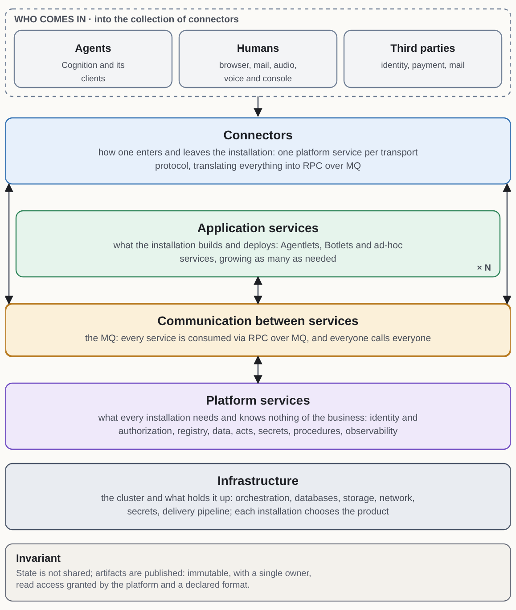
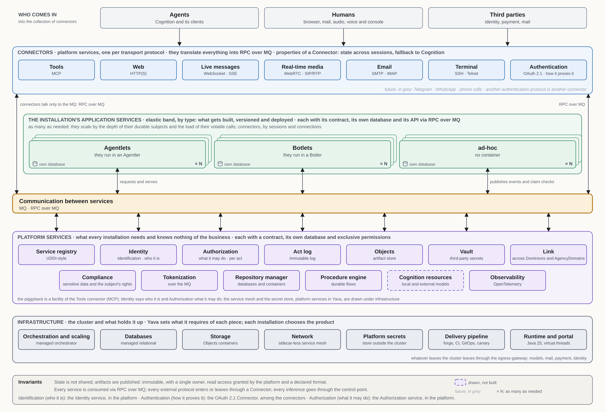
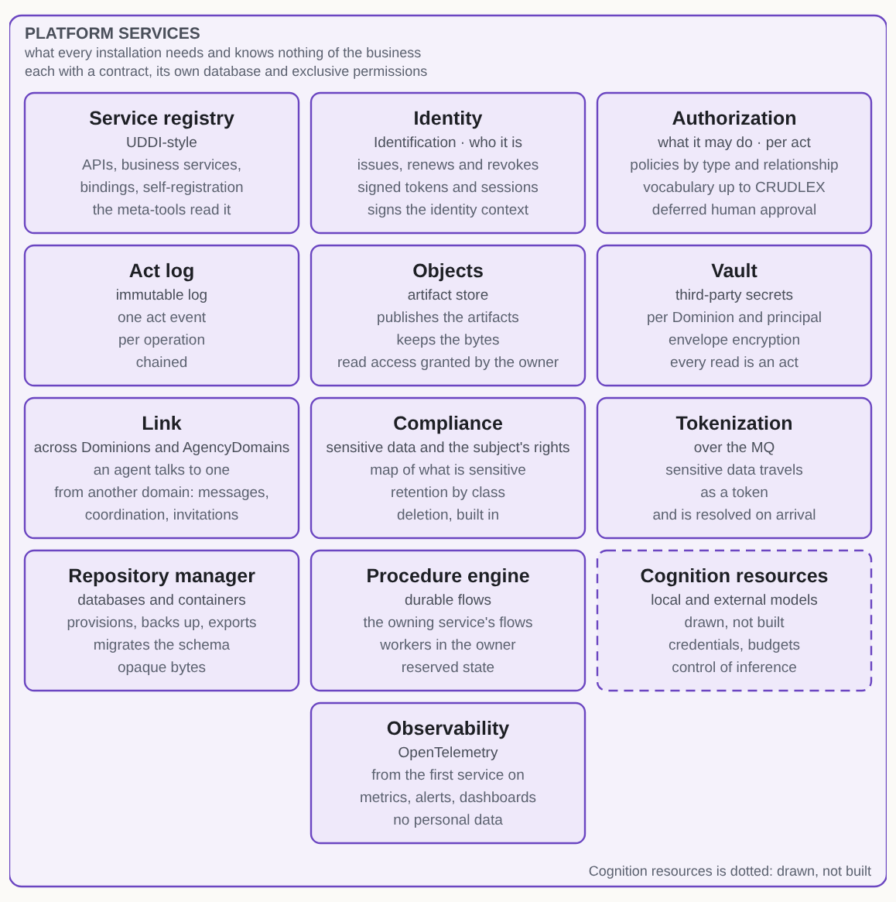
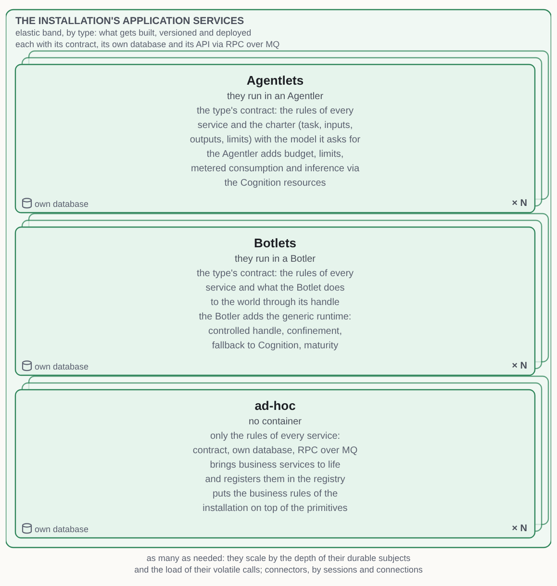
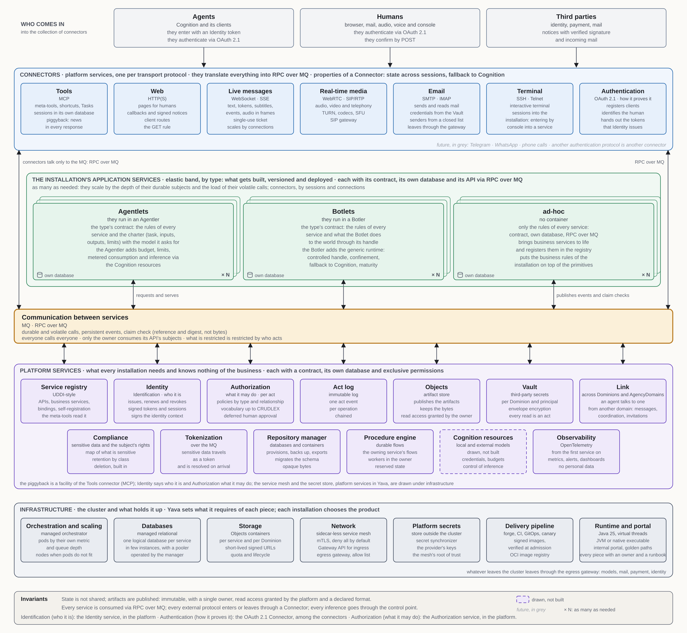
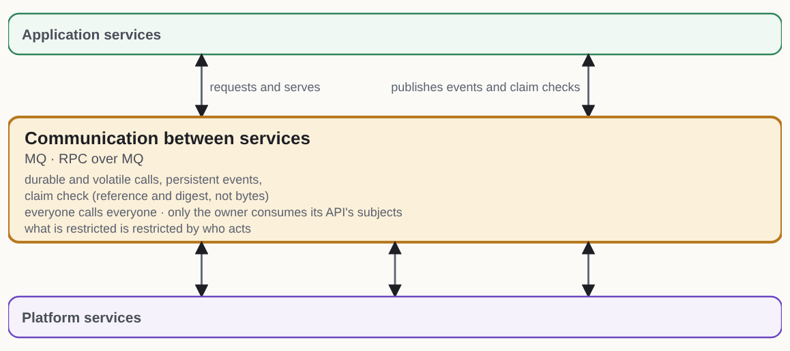
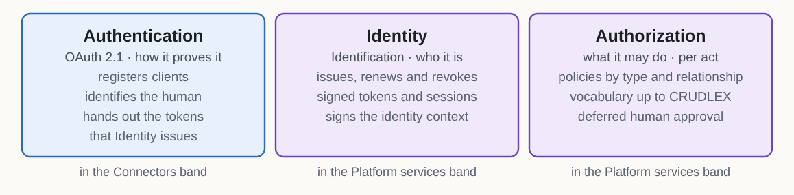
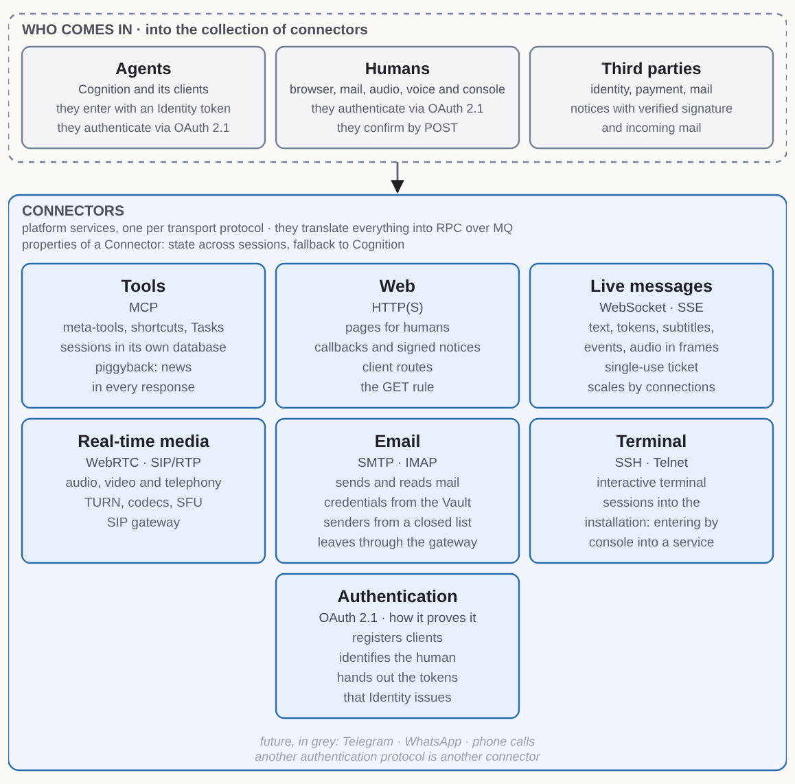
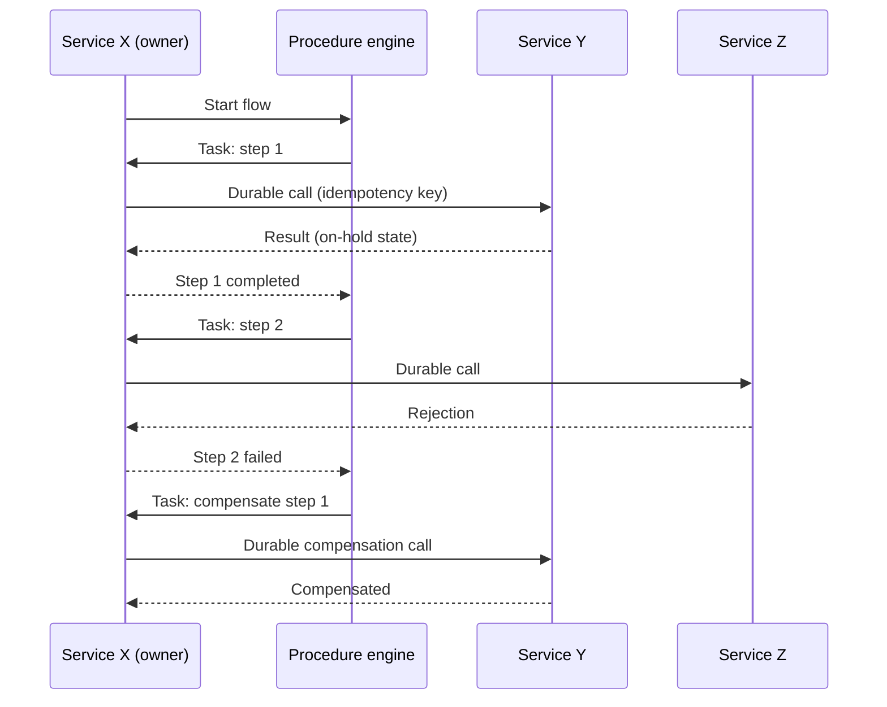
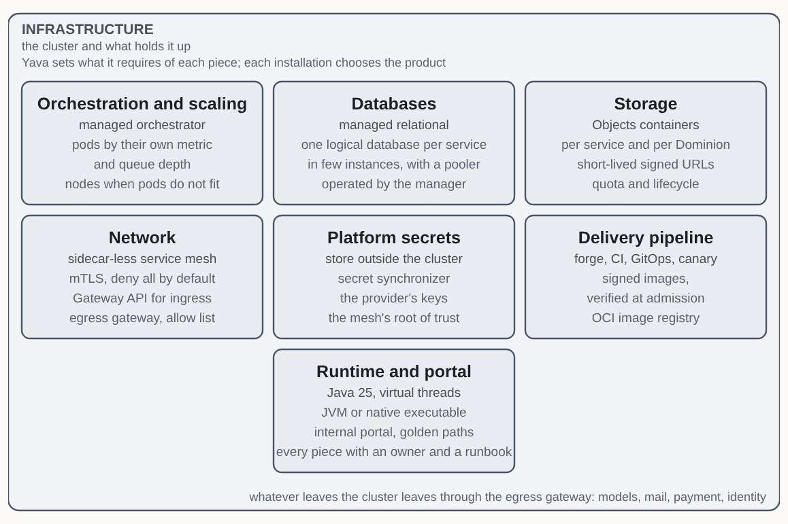

# Yava · Architecture of the deterministic part of the AgencyDomain

| | |
|---|---|
| **Version** | 1.4.4 |
| **Status** | Proposal for review by César Obach-Renner |
| **Name** | Yava (*Yet Another Vergis Architecture*) |
| **Authors** | César Obach-Renner and Simón Alero |
| **Reviews and decides** | César Obach-Renner |
| **Date** | 2026-11-06 |
| **License** | Documentation under GNU FDL v1.3 and code under AGPL-3.0, as the canon requires of the reference implementation |
| **Framework** | *AgencyDomains: Architecture of the Agentive World*, by César Obach-Renner (the canon) |
| **How to read it** | Naming conventions and degrees of certainty: Annex A |
| **Public edition** | The body, Annex A and the sources |
| **Scope** | The architecture that brings to life everything deterministic in an AgencyDomain. Out of scope: Cognition, project matters, construction guidelines and the concrete services built on top of it |

## What is Yava?

**Yava is the architecture that brings to life everything deterministic in an AgencyDomain.** The canon defines four layers (Interaction, Cognition, Autonomy and Access) and a cross-cutting Trust Infrastructure. Yava is not bounded by layer but by **nature**: it covers everything that runs as deterministic code, whatever layer it is in, and leaves out what does not.



*Figure 1 · Yava at a glance: whoever comes in lands on the Connectors, which translate everything into RPC over MQ; the installation's application services grow as many as needed; below the MQ, the platform services, and at the bottom the infrastructure.*



*Figure 2 · The platform in one view: at the top whoever comes in and the Connectors, in the middle the installation's application services (the ones that grow), the MQ as a line, and below them the platform services and the infrastructure. Each box carries its function and, beneath it, its technology.*

| Canon piece | Layer | Inside Yava? |
|---|---|---|
| **Botlets**, including presentation Botlets and operational facade Botlets | 3 (invoked from 1, 2 or by events) | Yes: persistent regime. Each Botlet is an application service of type Botlet, which runs in its container, the Botler |
| **Facets** | 1 | Yes: ephemeral regime |
| **Connectors** | 4 | Yes: platform services, one per transport protocol and one per authentication protocol. A Connector can declare the properties of the persistent regime (see “What is a Connector?”) |
| **Deterministic Trust Infrastructure** (policies, CRUDLEX, *append-only* log) | Cross-cutting | Yes. Its forms are in this document: the act event, the permission vocabulary and the authenticated approver. Its full construction comes after the first installation is up and running (SI-49) |
| **Botler** (the container of the Botlets) | 3 | Yes: it is the heart of Yava, the generic runtime that hosts the Botlets |
| **Agentlets** | 3 | Their hosting, yes: each Agentlet is an application service of type Agentlet, which runs in its container, the Agentler, with budget, limits and consumption. Their body, which is inference, no (SI-45) |
| **Cognition's interface to Layer 3**, over MCP | 2 → 3 | Yes: the Tools connector (MCP) |
| **Cognition, Capabilities, Pattern Recognition, Botlet generation** | 2 | No |
| **Validation with models** (hallucination detection and the like) | Cross-cutting | No |

**Two regimes of life.** The canon distinguishes pieces of different natures, and Yava supports both:

1. **Persistent regime**, for Botlets (in G1, configurations of proto-Botlets) and Connectors: state across sessions, a guaranteed fallback to Cognition, the 95/4/1 regeneration cycle and maturity phases. In a Connector, each of these is a property it declares in its contract.
2. **Ephemeral regime**, for Facets: instruments that Cognition invokes while it converses and releases when it is done; a flat catalog, with no fallback and no persistence. If a Facet fails, the agent falls back to text.

**Relationship with Vergis.** Vergis is the reference implementation of AgencyDomains, and today it implements a subset of what it must be. Yava is designed to become **the deterministic base of Vergis**: it is written generically, without coupling to any installation, even though its first installation is Soveria, which consolidates the products of Grupo Ultra.

**How the terms of this document correspond to the canon:**

| Yava term | Correspondence with the canon |
|---|---|
| Platform services | The Botler's substrate: the generic pieces that manage life cycle, isolation, identity, data and execution without knowing the domain |
| Connector | The canon's Layer 4 Connector: the platform service through which an external protocol enters or leaves the architecture, one per transport protocol and one per authentication protocol. A connector with a third party is a Connector of its protocol |
| Tools connector (MCP) | The Botler's MCP server: the interface through which Cognition commands Layer 3 |
| Meta-tools | The Botler's operation API toward Cognition |
| Application service | A deployable unit with its database and its API, of type Agentlet (runs in an Agentler), Botlet (runs in a Botler) or ad-hoc |
| Business service | An operation invocable by Cognition, implemented by an operational facade Botlet or by another application service |
| Dominion | Each agent's territory within the AgencyDomain, with the name the canon's glossary gives it |
| Operator | The human responsible for what an agent does |
| State and artifact | A service's live, private data, which only its owner touches; and finished, published data, which is the only thing shared between services |
| Service registry | Runtime registry of what exists and how to reach it; distinct from the canon's **catalog**, which is the repertoire of proto-Botlets and Capabilities |
| Procedure engine | Durable execution substrate on which deterministic flows run; it is not Layer 3 itself, which the canon distinguishes from static flow orchestrators |

---

## What does Yava start from?

Yava starts from its conformance with the canon and from four premises of its own. If any of them changes, the architecture is reviewed from that point. The conditions specific to each installation are in its deployment profile.

### What conformance does it declare with the canon?

**Yava is a conforming implementation of *AgencyDomains: Architecture of the Agentive World* (v1.2.1) in its deterministic scope.** It meets all the mandatory requirements (MUST) of the specification that apply to the deterministic part, and the canon is the norm: this document does not repeat it, and describes in each section how Yava meets what applies to it.

As the deterministic base of Vergis, Yava also meets the conformance requirements the canon sets for the **reference implementation** *(chapter 9, “Conformance”)*:

- publicly available, downloadable and executable;
- code under a free license with network copyleft (AGPL);
- documentation under a free license (GFDL);
- a generic Botler, with no domain specialization;
- at least one platform proto-Botlet operating in generation G1;
- a traceable derivation chain in its examples (use case, Botlets, proto-Botlets).

**Operating generation.** Yava operates in **G1**, like Vergis: Cognition **configures** proto-Botlets already forged from the catalog and does not write the body of their engines *(chapter 9, “Evolution frontier”, and chapter 5, §2)*. A new Botlet in G1 is a configuration of a proto-Botlet that has already reached production through the delivery pipeline. Generations G2 and G3, in which Cognition generates code, are the evolution frontier.

**How Yava reads the canon's scopes.** A Yava installation is an **AgencyDomain** with many agents. The **Dominion** is each agent's territory within it (see “What is a Dominion?”), and the **Account** is the owner of one or several agents. Yava follows the definition of the AgencyDomain as a scope with many agents, and not line 122 of `domains-spec.md`, which says that an agent is an AgencyDomain: it is an inconsistency in the canon, which its author has acknowledged and will correct.

Beyond the above, Yava meets these requirements of the canon within its scope:

- **portability:** each service exports what belongs to a Dominion or to a data subject as an artifact, in a documented format (see “How is a service's data backed up, restored and ported?”);
- **the agent's three times** (Preparation, Attention and Engineering): each operation declares its own in its contract, and the telemetry carries it;
- **the boundary with the outside:** every external protocol enters or leaves through a Connector, and the path of data toward third parties is traced (see “How is sensitive data handled?”).

**Caveat:** conformance is not yet complete. The gaps with the canon that remain open (between SI-42 and SI-54) are **pending nonconformities**, and while they exist, conformance is declared with that caveat. The conformance of the agent's life cycle is addressed in the reprise.

### What premises of its own does it have?

- **P1.** Yava must be **highly scalable, robust and secure** from the start.
- **P2.** **The platform scales automatically with demand**, within declared maximums of scale and cost.
- **P3.** **The service mesh is robust from day one.**
- **P4.** **All software is FOSS**, with its license validated piece by piece. P4 covers the software, not the operation: a managed service is accepted if it exposes a standard API and has a self-hostable FOSS equivalent. The same criterion applies to the forge and the CI.

The architecture decisions (medium-grained services, one database per service, RPC over MQ, the language, the external secret store) are not premises: each one lives in its section, with its justification and what was discarded.

---

## What does the state of the art say?

In 2026 the state of the art is not about splitting the system further, but about managing fewer, better-bounded services, on lighter infrastructure and with an internal platform that absorbs the complexity.

- **Consolidation.** The industry corrected the excess of fine-grained microservices. What matters is independent deployment and data with an owner, not the number of processes. *(Verified as a trend; the adoption figures in circulation contradict each other across secondary sources and should not be cited without going to the primary dataset of the CNCF survey.)*
- **Container orchestration as the base.** The vast majority of those who use containers orchestrate them in production with a standard orchestrator. *(Reported by media citing the CNCF 2025 survey.)*
- **Sidecar-less service mesh.** Separating L4 traffic (one proxy shared per node) from L7 (optional proxies where needed) so as to pay for L7 only where it is used, starting with mTLS and telemetry and adding advanced traffic management only where justified. *(Verified.)*
- **Platform engineering** with internal portals and golden paths, and **OpenTelemetry** as the telemetry standard. *(Verified as a trend; established knowledge.)*
- **Durable execution** for processes that cross services, with flow engines that store the state and deadlines of each execution. *(Verified as a category.)*

---

## What types of service are there?

The architecture distinguishes three types of service, which match the three layers of The Open Group's ArchiMate modeling standard: business, application and technology *(prior knowledge)*.

| Type | What it is | How it is accessed | Examples |
|---|---|---|---|
| **Platform service** | A shared infrastructure capability, with no business logic, on which application services depend. It can be a product or a piece built as part of Yava | Used by application services, connectors and operations | MQ, procedure engine, service registry, connectors (Tools, Web, Live messages, Real-time media, Email, Terminal and Authentication), Identity, Authorization, Objects, Vault, Link, Compliance, tokenization, repository manager, act log, secret store, observability, service mesh |
| **Application service** | A deployable piece with its own database and its API, which brings business services to life | Over RPC over MQ, from other services | Each service built on top of the architecture |
| **Business service** | A functional capability offered to agents | Through the meta-tools of the Tools connector (MCP), or as a shortcut (see “How does the Tools connector (MCP) work?”) | Send an email, read an inbox |

**Classification criterion:** a service is a **platform** service if every Yava installation needs it and it does not bring business services to life; it is an **application** service if it brings business services to life, or if only some installations need it. By that criterion, the service registry is a platform service. The Tools connector is also a platform service: it is the Botler's MCP server, the interface through which Cognition commands Layer 3, and every installation needs it. By the same criterion, Identity, the Authentication connector, Authorization, Objects, the Vault, the Link, Compliance, tokenization, the repository manager and the act log are platform services: any solution running on Yava needs them, and none of them knows what an agent's memory is or what a business rule of the installation is.



*Figure 3 · The thirteen in the platform band (Connectors are platform services too, in their own band): each with a contract, its own database and exclusive permissions, all hanging from the MQ; Cognition resources is dotted because it is drawn and not built.*

**How a concern is split between the platform and the application.** Three questions, in order:

| Question | If the answer is yes |
|---|---|
| Would any solution running on Yava need it? | It goes to Yava, as a platform service, facility or rule |
| Does doing it require knowing a concept of the installation (its memory, its territories, its business rules)? | It goes to the installation, as an application service |
| Does it have both faces? | It is split: Yava provides the primitive and its contract, and the installation puts the rule on top |

Where each piece runs is an operations decision of the installation, not of the architecture.

**A platform service built as part of Yava** exposes its API over RPC over MQ and follows the same rules as any service: its own database, contract and exclusive permissions.

An application service can bring several business services to life, and it **registers** them in the service registry when it comes up (see “How does the service registry work?”). ArchiMate calls the deployable piece an “application component” and the behavior it exposes an “application service”; this document uses “application service” for both. **When the document says just “service”, it means any service with an API over RPC over MQ, whether an application service or a platform service built as part of Yava.**

### What types of application service are there?

Each application service declares its **type**: what the team builds, versions and deploys through the delivery pipeline, and what is registered in the service registry and scales. The first two types are canon pieces that run inside a **container**, the runtime that hosts them; the container is not a type, but the place where each piece of the type lives.



*Figure 4 · The three types: what gets built and deployed is the Agentlet, the Botlet or the ad-hoc service; the Agentler and the Botler are the containers the first two run in. The stacked cards and the “× N” say they grow as many as needed; each with its own database.*

| Type | Runs in | What the type's contract covers | What the container provides |
|---|---|---|---|
| **Agentlet** | An **Agentler** | The rules of every service, and the Agentlet's charter (task, inputs, outputs and limits) with the model it requests | The per-execution budget, the resource limits, the measured consumption and inference through cognition resource management (see “How do Botlets and Agentlets run?”) |
| **Botlet** | A **Botler** | The rules of every service, and what the Botlet does in the world through its handle | The generic runtime of the canon's Botler: the controlled handle, confinement, the fallback to Cognition and the maturity phases |
| **ad-hoc** | No container | Only the rules of every service: contract, its own database and RPC over MQ | — |

**In G1, what arrives through the delivery pipeline as a Botlet is the forged proto-Botlet.** Each configuration of it that Cognition makes is also a Botlet, and is registered in the Botler without going through the pipeline (SI-42). This reading reconciles the rule of types with generation G1 and is **provisional**: it is decided in the reprise, when the Botler and the proto-Botlet are designed (SI-69). It does not affect the first version of an installation that has no Botlets.

The contracts of each type and of each container, and how the container reaches production, are a pending design (SI-69).

---

## What architecture is proposed per layer?



*Figure 5 · The whole architecture, with the scope of each piece: read it top to bottom following the arrows, and from the Connectors band to the MQ along the two side rails.*

| Layer | Architecture |
|---|---|
| Packaging | Signed container images, with SBOM |
| Image registry | The cloud provider's managed registry, accepted under P4 (it speaks the OCI distribution specification and has a FOSS exit) |
| Orchestration | Managed container orchestrator |
| Autoscaling | Pod autoscaling on each service's own metric, queue-depth scaling and node autoscaling (see P2) |
| Language and framework | Java 25 with an explicit service framework based on virtual threads; on the JVM or as a native executable (see “What languages does Yava use?”) |
| Forge | A forge that meets the minimums of the delivery pipeline, managed or self-hosted |
| CI | Pipelines in a FOSS format that run in the cluster; the forge only triggers them |
| Delivery pipeline | Per service: integration into `develop` with a mandatory integration review, canary from `develop` and promotion of the tested commit to `main` (see its section) |
| Deployment | GitOps over an environment repository |
| Progressive delivery | Canary with metrics analysis and automatic rollback |
| Health | Readiness against each service's own health; semantic health, in the canary analysis |
| Configuration and secrets | Declarative configuration and a secret synchronizer against the external secret store |
| Network | Sidecar-less service mesh (see its section) |
| Service registry | A UDDI-style platform service: service APIs, business services and bindings, with self-registration (see its section) |
| Connectors | One per transport protocol: Tools (MCP), Web (HTTP), Live messages (WebSocket · SSE), Real-time media (WebRTC · SIP/RTP), Email (SMTP/IMAP) and Terminal (SSH · Telnet); and one per authentication protocol, the first being Authentication (OAuth 2.1) (see “What is a Connector?”) |
| Tools connector (MCP) | Protocol server toward agents, with meta-tools, shortcuts, its own sessions and piggyback; it reads the registry (see its section) |
| Identity and authorization | Identification in Identity, a platform service that stores identities, issues, renews and revokes tokens and sessions, and signs the identity context; authentication in one Authentication connector per protocol, at the edge, the first being OAuth 2.1; authorization in Authorization, a platform service that decides what each party can do (see “How are callers authenticated and authorized?”) |
| Communication between services | RPC over MQ, with durable or volatile calls, persistent events and per-operation bindings resolved at runtime (see its section) |
| Communication between domains | The Link, a platform service for communication between agents of different Dominions and of different AgencyDomains (see its section) |
| Contracts | Each service's API described in AsyncAPI, with messages in Protobuf, and compatibility verified in the CI (see “How is a contract written?”) |
| Data | State is not shared; artifacts are published. One relational database per service, grouped in a few managed instances operated by the repository manager; outbox, inbox and idempotency in each service; connection *pooler* |
| Objects | A platform service that stores the services' artifacts and bytes, with read access granted by their owner (see “How does Objects work?”) |
| Sensitive data | A mark declared in the contract; Compliance, tokenization over the MQ, path traceability and deletion (see “How is sensitive data handled?”) |
| Act log | A platform service that stores the act event of each operation (see “What shape does the record of an act have?”) |
| Third-party secrets | The Vault, a platform service that safeguards users' credentials per Dominion and per principal (see its section) |
| Cognition resources | A platform service through which all inference passes, with its budgets and limits; drawn, not built (see “How do the services run?”) |
| Procedures | Platform procedure engine; flows in the owning service; steps that call the contracts of the others |
| Observability | OpenTelemetry from the first service, with a metrics and alerting system and a visualizer |
| Admission | Image signature verification when admitting pods |
| Platform | Internal portal and golden paths; each piece with an owner, runbook and update cadence |

What is required of each piece is in “What does Yava require of each piece?”, and the products are chosen by each installation, in its deployment profile.

### What is kept invariant?

- **State is not shared; artifacts are published.** No service accesses another's state, without exception. The only thing shared between services are **artifacts**, and only if they meet four premises (see “How is data organized?”):
  1. **immutable:** they are not edited; a change is a new version, with a different reference;
  2. **a single owner,** who decides its life cycle, who reads it and its deletion;
  3. **read access granted by the platform:** the owner declares who reads what, the platform enforces it and records it, and nobody lists or traverses what belongs to another;
  4. **format declared as a contract,** versioned like an API when it is not a standard.
- **Every service is consumed over RPC over MQ** (see “How do services communicate?”).
- **No accepted durable call is lost** even if the caller, the service or the connection goes down midway: it is persisted in the MQ, with its publish confirmation, before responding.
- **No intermediate state of a procedure is visible** to a reader: it exists only as reservation state until it is confirmed.
- **`main` is never ahead of production:** `main` is always the last commit that passed the canary.
- **No action with an effect is executed via GET,** and every confirmation requires a POST from an authenticated human (see “How are callers authenticated and authorized?”).
- **Every service that stores personal data knows how to delete it,** through its contract (see “How is sensitive data handled?”).

---

## How does a change reach production?

Each service has its own integration branch, **`develop`**, and its own production branch, **`main`**. Changes are integrated into `develop`, the canary runs from `develop`, and `main` advances only up to the commit that passed the canary. This way, integration is the forge's standard one and `main` is always exactly what is in production.

### What judgments does a change go through?

Three, each on a different object *(the models are chosen by each installation, in its profile)*:

1. **Design:** judged by the highest-capability model.
2. **Construction:** judged by the high-end model opposite to the one that built it, so that the review has different blind spots from the author.
3. **Integration:** judged by the **lowest-cost high-end model**, as a mandatory *check* before integrating into `develop`. It reviews what only appears on integration: the result of combining the change with what is already in `develop`, such as badly resolved conflicts, interactions with other recent changes, APIs that no longer match what other services expect, or undeclared boundaries crossed. It is **tied to the result of the integration**: if `develop` advanced and the change has to be combined again, it is judged again. Forges can automatically dismiss approvals when a PR receives new commits *(prior knowledge)*.

### What are the steps?

1. **Unit of change:** the PR, per service.
2. **Mandatory checks** of the PR: build, tests, contract compatibility verification and integration review. With all of them green, the PR is integrated into `develop` with the forge's standard integration.
3. **Services that own procedures:** the CI replays real histories from the procedure engine against the new code of the flows (see “What rules do flows follow?”). If the replay fails, the change does not proceed.
4. The CI builds the image of the `develop` commit, **signs** it and publishes it to the registry.
5. The environment repository is pointed at that image; the GitOps deployment converges and progressive delivery runs the **canary** with its analysis (metrics and semantic health).
6. If the canary **promotes**, the **promoter** advances `main` by *fast-forward* exactly to the tested commit and activates in the service registry the business service descriptions that the new version registered as pending. If it **aborts**, the canary is rolled back in production and the problem is fixed or reverted in `develop`; `main` was never touched.

### What needs care?

- **The promoter promotes the tested commit, not the tip of `develop`.** While a canary runs, more PRs can be integrated into `develop`; whatever arrived later waits for its own canary. The promoter is a small automation and the **only identity with permission to write to `main`**.
- **One `develop` per service**, simplest with one repository per service. A `develop` shared by several services would make one canary test several services together and would break independent deployment.
- **A broken `develop` blocks what comes behind it:** after an aborted canary, the changes integrated later cannot be promoted until `develop` is fixed. This is mitigated with frequent canaries, small changes and reverting quickly in `develop`.
- **Everything goes through `develop`, including emergencies:** nothing is integrated directly into `main`. An emergency goes through its canary, perhaps with a shorter analysis.

**Discarded:** an **in-house merge queue** that promotes before integrating, because it required building and maintaining a critical piece of our own, and `develop` with a promoter gives the same guarantee with standard integration; **integrating directly into `main` and promoting afterwards**, because `main` would be ahead of production during a canary that aborts, and its history would accumulate reverts; and an **integration review by a model different from the author's**, because the risk of shared blind spots is already covered by the cross judgment of the construction.

### How does a database schema change?

During a canary two versions of a service coexist on the same database, so every schema change follows the **expand, migrate and contract** pattern:

1. **Each version of a service is compatible with the schema of the previous one and of the next one.**
2. **The migration that adds runs before the canary,** as a step of the delivery pipeline executed by the repository manager (see “What does the Repository manager do?”), with schema compatibility verified in the CI against the previous version.
3. **The migration that removes is applied in a later version,** when no replica uses what was removed.
4. **No replica refuses to operate because of the schema version** within the same major version.

**Discarded:** migrating when each replica starts, because several replicas compete for the same migration and a canary that aborts leaves the schema halfway.

---
## How is data organized?

**State is not shared; artifacts are published.**

| Term | What it is | Who touches it |
|---|---|---|
| **State** | A service's live, private data, in its database | Only its owner. **No service accesses another's state, without exception** |
| **Artifact** | Finished, published data that meets the four premises | Whoever has been granted read access. **It is the only thing shared between services,** wherever it is stored; normally, in Objects |

**Each service has its own database, and no service reads or writes another's database**. What a service needs from another it obtains through that other service's API, by RPC over MQ, from the events that other service publishes, or from the artifacts that other service publishes and grants it read access to.

### What is an artifact?

Data that a service shares meets **four premises**:

1. **Immutable.** It is not edited; a change is a new version, with another reference. What is written live is the owner's state, and it becomes an artifact when closed.
2. **A single owner,** who decides its lifecycle, who reads it and its deletion. The deletion of an artifact is carried out by its owner, and readers tolerate “it no longer exists.”
3. **Read access granted by the platform.** The owner declares to Objects which services or roles read what; the platform enforces it and records it, and no one lists or browses what belongs to another.
4. **Format declared as a contract,** versioned like an API when it is not a standard (an image or a PDF are).

**The notice travels by *claim check*:** what travels over the MQ is the artifact's reference and fingerprint, not its bytes. For example, the raw transcript of a session: its owner closes it and publishes it in Objects, gives notice over the MQ with the reference, and each reader with permission downloads it with a short-lived read permission.

**The Repository manager is not an exception:** it operates each service's containers as opaque bytes (create, back up, restore, export, import), without reading or interpreting the data (see “What does the Repository manager do?”).

### What replaces shared state?

Six patterns, one for each way a component might want another's state:

| Pattern | What it is |
|---|---|
| **Live call** | Whoever needs the data asks the owner for it through its contract, with a durable or volatile call |
| **Event** | The owner publishes a fact; whoever needs it consumes it and stores it in its own state |
| **Procedure** | What would span several databases in one transaction is a procedure of the owning service, with compensations |
| **Signed data** | What would be verified by reading another's database is verified locally with data signed by its issuer (a token, the identity context) |
| **Artifact** | What would be shared as bytes is an artifact in Objects, with granted read access and notice by *claim check* |
| **Internal** | The relationship stops crossing components: the data is state of the same owner |

The copies a service keeps from others' events are its own state, and they follow the rule “no one decides with derived data” (see “What rules protect the boundaries between services?”). A service's read model is internal to it: it is not a copy in another service.

**Discarded:** a platform exception for backup, restore, export and import, because the Repository manager performs them on opaque bytes, without accessing state; and service-to-service exceptions for bulky data, which goes by *claim check*.

### Where do the databases live?

One **logical database per service**, with its own credentials, **grouped in a few instances** of the managed relational database, according to their criticality. Access isolation is total from day one; moving a database to its own instance later is an operation, not a redesign. Several databases in one instance share its CPU, its memory and its failure, so the instance is a shared piece in the cascading failures section. The Procedure engine has its own database, in a platform instance. The databases are provisioned and operated by the Repository manager.

**Discarded:** a **database instance per service from the start**, because it requires a high-availability instance per service; it is reserved for the database that needs it.

### How does a service isolate its Dominions within its database?

Isolation between Dominions is as mandatory as between services. It is **logical by default**: the Dominion's identity goes in every row and in every call, verified. There are two ways to apply it:

1. **The per-Dominion filter in the application,** which the service's library adds to every query based on the identity context.
2. **The database's row-level security,** with a working role that does not own the tables, so that a query without a filter does not see another Dominion's data.

The second also protects against a code error, and requires that the database and the *pooler* in transaction mode support it; the first does not depend on the database. Physical isolation (a database or a space per Dominion) is used only by declared exception.

### What patterns are mandatory in every service?

1. **Outbox, where there is a state change and a publication.** When a service changes its database **and** publishes something that depends on that change (a result, an event), it writes the message to a table in its database in the same transaction, and a publisher sends it to the MQ.
2. **Direct publication, where there is no own state.** Whoever only enqueues, without changing a database of its own, publishes directly to the MQ and waits for the publish acknowledgment, which ensures the message was persisted. *(Verified.)*
3. **Results by key.** Every durable call carries an idempotency key, and the service stores the result of each one by its key. This is what keeps a repeated call from executing twice and what allows its result to be queried later. **The same key with a different content fingerprint is a rejection, not a repetition.**
4. **Inbox for consumed events.** Each event a service consumes is recorded by its identifier before being processed, and a repeated one is discarded: the MQ delivers at least once.
5. **Invisible reservation states.** What is not yet confirmed in a multi-step operation exists in a state that no reader exposes as valid, and every reader respects those states.
6. **No credential material.** A service refuses to store credential material (passwords, tokens, keys) in its database: third-party credentials go to the Vault, and the platform's, to the secret store.

**Discarded:** feeding the outbox with **change data capture (CDC)** from the database, because the service's own publisher does not need logical decoding in the database.

### How are operations on the same Dominion ordered?

When operations on the same Dominion have to run one at a time, there are two ways:

1. **A per-Dominion lock in the service's own database,** taken within the operation's transaction. It works when order matters only within one service and the operations are short.
2. **Ordering by key in the MQ,** with the Dominion as the consumption partition key. It works when order matters in the message flow and not only in the write.

Each service declares which one it uses. Neither requires one service to wait for another.

### How is a service's data backed up, restored and ported?

1. **Backup and restore belong to the Repository manager,** on opaque bytes, and the unit of restore is the service. Restore is rehearsed.
2. **Each service exports a Dominion's or a data subject's data** through an operation of its API, in a neutral, documented format, and **publishes it as an artifact**. This is the portability the canon requires.
3. **A procedure composes the full export** of a Dominion or a data subject from each service's artifacts.
4. **Deletion reaches backups** as they expire (see “How is sensitive data handled?”).

**Discarded:** an export service that reads everyone, because it would read other services' state.

---

## How does Objects work?

**Objects** is the platform service where artifacts are published and where services store their bytes. It exposes **containers per service and per Dominion**, with quota, short-lived signed URLs and lifecycle (expiration and sweeping of what was left unreferenced).

### What rules does it follow?

1. **Bytes do not travel over the MQ.** What travels over the MQ is the reference and the fingerprint (*claim check*).
2. **The owner publishes an immutable artifact** with its declared format; a change is a new version, with another reference.
3. **The owner declares which services or roles read what.** Objects enforces it, records each read as an act (see “What shape does the record of an act have?”) and lets no one list or browse what belongs to another.
4. **Reading is with a short-lived permission,** issued to whoever has been granted read access.
5. **The owner decides deletion,** and the deletion of an artifact is carried out by the owner; readers tolerate “it no longer exists.”
6. **Each service has its own identity before Objects,** and an external client uploads and downloads with short-lived signed URLs, without passing the bytes through the service.

**Operation** is handled by the Repository manager, which treats each Objects container as one more type of repository: it provisions it, backs it up, exports it and deletes it on opaque bytes.

**Discarded:** having each service use cloud storage on its own with a common minimum, because each service's identity before the storage, the signed URLs and the granted read access belong to the platform, and they would be repeated in every service that stores bytes.

Its contract (how read access is declared, how an artifact is versioned and what travels in the notice) is a pending design (SI-58).

---

## What does the Repository manager do?

The **Repository manager** is the platform service that gives each service its data repositories (its databases and its Objects containers) and operates their life:

1. **provisioning them,** with their configuration and their credentials;
2. **backing them up and recovering them,** per service;
3. **exporting and importing them;**
4. **migrating their schema** as a step of the Delivery pipeline (see “How does a database schema change?”).

**The bytes are opaque:** the manager creates, backs up, restores, exports and imports without reading or interpreting the data. That is why it is not an exception to the state rule. What a service exports per Dominion or per data subject is not extracted by the manager: the owner publishes it as an artifact.

What the manager operates as infrastructure and what it asks of the owner through its contract is a pending design (SI-59).

---

## How is sensitive data handled?

Yava does not guess which data is sensitive, nor does it know what the installation stores: **it respects it where the service marked it**.

### How is sensitive data marked?

With **a single mark**, declared in each service's contract: a field of a message, or a value, is secret, personal or sensitive. The same mark serves five uses:

1. telemetry without secrets or personal data;
2. tokenization over the MQ;
3. the map of where sensitive data is, kept by Compliance;
4. deletion;
5. traceability of the data's path.

**What does not appear in telemetry:** logs, traces, health and errors carry no payloads, secrets or personal data. Payloads go by their fingerprint, errors by a code from a closed list, and what travels in headers is limited to identifiers.

### What does Compliance do?

**Compliance** is the platform service that keeps the **map of which sensitive data of which data subject is in which service**, and that coordinates the data subject's rights:

1. **Each service publishes an event** when it stores or deletes marked data, with references and not with the data.
2. **Each service that stores marked data implements the operations the law requires:** identifying a data subject's data, exporting it and deleting it, with its confirmation.
3. **Compliance invokes them** and keeps the record of each request.
4. **Retention is declared per data class,** and deletion on expiration is carried out by the owner. The closing of a Dominion is an event that each service consumes and confirms, and it deletes the Dominion's data end to end.

Personal data protection is, for the installation, an obligation with a fixed date, which its profile declares. The Compliance contract is a pending design (SI-62).

### What does tokenization do?

**Tokenization** is the platform service that replaces marked data with a token while it travels over the MQ, and returns it to whoever has permission to see it:

1. what is tokenized is stated by the mark;
2. the call library tokenizes on publishing and detokenizes on receiving, if authorization allows it;
3. the map between token and data lives in this service, and deleting it is part of deletion.

It also serves to tokenize personal data before sending it to an external cognition. Its cost per message and its behavior if it goes down are part of its design (SI-61).

**Discarded:** leaving tokenization to each installation, because the mark and the MQ already belong to the platform, and in-flight tokenization can only be placed where the messages travel.

### How do you know where a piece of data has been?

For marked data you can query **which services it passed through, which third parties it went out to and where it ended up**:

1. each message's trace (OpenTelemetry) carries the data's class, not the data;
2. outbound connectors record which class of data went out to which third party;
3. Compliance stores where it ended up.

### How is personal data deleted?

**Deletion at the data subject's request** is implemented by each service through its contract and orchestrated by Compliance: a deletion request that each service handles and confirms, within its deadline. The service deletes the content, reaches the backups as they expire and, for an artifact, carries out the deletion itself, while readers tolerate “it no longer exists.”

**The mechanism is built and tested, and left disabled** behind a switch. It is enabled once the mechanisms are implemented that guarantee it is used legitimately by the owner of the data to be deleted.

**The Act log does not contradict deletion** if it stores references and keyed fingerprints (one secret key per installation, which never leaves the service), and not plain fingerprints of the data: the plain fingerprint of a small piece of personal data, such as an email address or a name, can be reversed by brute force. What a service keeps after deletion (a tombstone without a fingerprint of the data, or a keyed fingerprint where an audit needs to prove what was deleted) is a pending design (SI-62).

---

## How do services communicate?

**Every service is consumed by RPC over MQ**: the caller sends a request and waits for its response, as in an ordinary call, but the transport is the MQ and not a direct connection. **Each service's API** is the set of operations it exposes this way, described in AsyncAPI with messages in Protobuf. A service talks to the MQ, to its own database, to the Procedure engine if it has procedures, to Objects for bytes, and to the platform (secrets and telemetry).



*Figure 6 · Everything goes through the MQ: application services request and serve, and publish events and claim checks; platform services hang from it with two-headed arrows, because everyone calls everyone.*

### What types of operation are there?

All the operations of an API are **RPC calls**. Each one declares whether it is **durable** or **volatile**, and in addition a service can publish **events**:

| | Durable call | Volatile call | Event |
|---|---|---|---|
| What it is | A call whose request is persisted before being handled | A call that is not persisted | A fact the service publishes without waiting for a response |
| When it is used | It changes state, or it may take longer than a volatile call's deadline | It asks for data needed instantly | To notify something to whoever wants to listen |
| If the service is not there | The request waits in the MQ and is handled when it comes back | The call exceeds its deadline and fails; it can be repeated without risk | The event stays persisted; each subscriber receives it when it comes back |
| Duplicates | Idempotency key as the message identifier, plus results by key | Not needed: it has no effects | Each subscriber's inbox |
| Subject | Per operation; can be redirected (bindings) | Per operation; can be redirected (bindings) | **Permanent**: never redirected |

A volatile call is not persisted because a late response is of no use to anyone: whoever asked needed to decide at that moment, the data could be stale on arrival, and losing it carries no risk because it is repeated without effects.

**Events:** they are persisted in the MQ, and **each subscriber has its own durable consumer**, which holds the events for it while it is down and delivers the pending ones when it comes back. A service does not know who listens to its events.

**Why an MQ with these three modes:** it allows, in a single system, the persistence of durable calls and events, the unpersisted request and response of volatile calls, subjects with wildcards, per-subject permissions and an autoscaler by queue depth. The minimums required of the MQ are in “What does Yava require of each piece?”.

**Discarded:** **HTTP communication between services**, because the durability of calls would have to be built into every calling service, with its own outbox and dispatcher, and the target service would not see its pending work to scale on it.

### What does a call look like?

For whoever writes a service, calling another is **a typed call**: you call, wait for the response with a deadline, and continue. That model is provided by a **common call library**, pure infrastructure, which encapsulates correlation, the return address, the deadline, the idempotency key, the current binding, result retrieval and the circuit breaker against unhealthy dependencies. Waiting blocks a virtual thread, not a real one, so thousands of calls can wait at once at almost no cost.

A durable call has **two outcomes**:

- **result**, if the response arrives within the deadline;
- **pending**, with its **ticket**, if the deadline expires or if the service is not serving: the request remains persisted and will be handled all the same.

A volatile call returns its response or fails when its deadline expires.

### How is the response to a durable call received?

In three ways, uniform for all:

1. **Synchronous:** if the result arrives within the deadline, in the same call.
2. **Ticket and later query:** the caller later queries the status or the result by its ticket.
3. **Ticket and notification:** the caller subscribes and receives a notice when the result is ready.

Rules:

- **The ticket is the idempotency key.** It carries no technical information: it identifies the request, and the service that implements the operation stores its result by key, regardless of which subject it arrived on.
- **Notification is never the only path.** It can be lost; the query by ticket is always available.
- **Every API offers two standard operations:** the query of status and result by key, and a results subject where each result is published.
- **Retention:** each result is kept for a period declared per service; after that period, the ticket responds “expired.”

### How long can a chain of waits be?

**Waits have depth one: a service handling a call does not, in turn, wait for the response to another durable call.** If A waits for B, which waits for C, A's time is the sum of all of them, and if C slows down, A and B are left waiting with it. The MQ guarantees that the request is not lost, but it does not remove the coupling of whoever waits.

If a service needs something from another to finish, it has two paths: **make the call without waiting for its result**, if it does not condition its own response, or **turn the operation into a procedure** (see its section), if it does. A volatile call to obtain data needed instantly is the only wait allowed within the handling of a call, provided the service queried does not, in turn, wait for a third. The steps of a procedure fall outside this rule, because their wait is managed by the engine.

### How are subjects named?

Each operation has a **default subject** derived from its description: `<installation>.<service>.<cmd|qry|evt>.<operation>.v<version>`, for durable calls, volatile calls and events respectively; the first segment is the installation's name.

A service **listens to all the operations of its API with wildcards**, for example `<installation>.<service>.cmd.*.v1`. The chosen MQ supports wildcards in subjects (`*` for one segment, `>` for one or more at the end), in the consumers of persistent streams and in permissions *(prior knowledge; verified in SI-13)*.

### How is an operation redirected?

The subject on which an operation reaches its service **is resolved at run time** and can be changed live, in the style of a per-operation WSDL *endpoint*, or of UDDI.

1. **A bindings table** stores only the exceptions: `operation → subject`. The key is the operation's identity, that is, the Java interface generated from its contract, with its version, plus the operation's name. Without an entry, the operation uses its default subject.
2. The table lives in the **Service registry**, which is the single place that answers what exists, how it is used and how it is reached. Each service keeps an in-memory copy, which the registry updates by publishing an event every time a binding changes.
3. **On each call**, the library looks up the operation in the in-memory copy and publishes on the subject bound at that instant. It is a local lookup, with no added latency.
4. **If the registry is unavailable**, each service continues with the last known binding.
5. **Events are never redirected:** their subject is permanent.

**Binding is routing only:** it changes the subject, never the service that implements the operation, so its results, its idempotency and its tickets are unaffected. Changing the service that implements an operation is a **contract migration**, a separate act that is designed when needed (SI-35).

**Conditions that do not depend on the case:**

- **If a service is going to serve the new subject**, its permission to consume it has to exist beforehand; for a breather, in which no one listens, it is not needed.
- **For a durable call, the new subject has to be captured by a persistent stream.** If it is, calls accumulate there even if no one listens; if not, the MQ has nowhere to store them and rejects the publication.

**Notes for operating it**, which depend on each case:

- **Redirecting to a subject no one listens to is legitimate:** it serves to give a saturated service a breather. Calls accumulate in the stream, and afterwards the service can listen to the new subject or the binding can return to the original subject.
- **What was waiting on the previous subject does not move:** whoever serves that subject decides whether to drain it before leaving it.
- **There is an instant of mixing:** the notice does not reach all replicas in the same millisecond, so for a moment some publish on the previous subject and others on the new one.
- **Bindings are a security-sensitive point:** whoever can change them can divert calls. Writing is restricted and audited, and each change follows requirement 8 of cascading failures, with its declared reversal.
- **Weighted distribution, if it is ever needed:** a binding could point to two subjects with a weight each, resolved by the call library.

**Discarded:** **subject mapping on the MQ server** as a redirection mechanism, because explicit per-operation bindings give an indirection that is visible and tied to the contract; weighted distribution remains an option of the call library.

### Who can talk to whom?

**All services can call all others and listen to everyone's events; each one serves only its own and registers only its own.** Once on the network, a service can use what others offer and act dynamically, without asking permission for each new dependency.

**Each service has its own identity in the MQ:**

- **It can publish** on the subjects of any service's operations and on the subjects of its own events.
- **It can subscribe** to any service's events and to the results of what it requested.
- **Only it consumes the subjects of its own API.** That anyone can request does not mean anyone can serve: if another service could consume someone else's queue, it could take the requests addressed to another and respond in its name.
- **Only it registers its API and the business services of its contract** in the Service registry (see “How does the service registry work?”).

**The exclusive permissions are generated from the contracts and the bindings:** the one to consume the subjects of each API, including the subjects to which an operation was redirected, and the one to register each API and each business service in the registry. The service mesh encrypts the connections to the MQ with mTLS, but it does not see which subject each message goes to: that is why the MQ's permissions are indispensable for those two exclusivities.

**What is restricted is restricted by who acts,** not by which service calls: each call carries the signed identity context (see “How does identity travel?”), and what a subject can do is decided by Authorization (see “How are callers authenticated and authorized?”).

**What is accepted:** the reach of a compromised service grows, because it could call any operation of any service, though not on behalf of a Dominion that no one delegated to it. Trust rests on the Delivery pipeline: the three judgments, the signed image and its verification at admission. **The dependency map is discovered instead of declared:** telemetry shows who calls whom, and the integration review reviews each new dependency.

**Self-discovery** is provided by the Service registry: any service can query which APIs the others offer.

**Discarded:** having an operation's contract declare a list of callers and having the MQ enforce it, because restricting callers within the architecture undermines the services' ability to act dynamically.

---

## How does identity travel?

The entry connector verifies the client's token, which Identity issued, and produces the **signed identity context** with Identity's signature (how, without adding a hop per call, is a pending design: SI-74). The context carries:

- the Dominion;
- the human principal;
- the client;
- the session;
- the effective permissions.

**The context travels in the headers of every message.** The call library verifies it on receipt and propagates it unchanged when calling; a service neither fabricates nor rewrites it. It is signed data: it is verified locally, without asking anyone on each call. That the MQ and the library carry and verify it at no appreciable cost is verified before building.

**What a service initiates on its own** (a background job, a procedure it triggers) carries its service identity, and acts on behalf of a Dominion only with a declared delegation.

**Every write stores the session** of the context it was made with. This is what allows quarantining what was written in a session the human did not authorize (see “How are callers authenticated and authorized?”).

**Discarded:** forwarding the client's token to every service, because it exposes it to all of them; and a short-lived per-call credential issued by Identity, because it adds a hop per call and puts Identity in the path of everything.

---

## What is a Dominion?

The **Dominion** is each agent's territory within the AgencyDomain. The canon names it in its glossary as the Domain an agent obtains; Yava uses the term for both ways of arriving at it, obtained or assigned. A Dominion has:

- **its identifier,** stable and revealing no personal data;
- **the human principals who open it,** with the roles the installation defines;
- **what passes through it:** the identity of each call, the data each service stores about it, the usage limits and the record of its acts.

**Canonical URIs.** The AgencyDomain, each agent (`{domain}/agents/{agent}`) and each tool have a canonical URI, which resolves to its Dominion. The scheme is the canon's; the proper names (the *handles*, the numbers) are set by the installation. The Service registry stores the URI of each tool.

**Limits,** in the Tools connector (MCP) and on writes, are applied per Dominion and per principal.

---

## How are callers authenticated and authorized?

Three roles, each in its own piece, with different questions:

| Role | What it answers | Where it lives |
|---|---|---|
| **Identification** | **Who** the caller is | **Identity**, platform service |
| **Authentication** | **How it proves** it is who it claims to be | **One Authentication connector per protocol**, at the edge; the first, **OAuth 2.1** |
| **Authorization** | **What** that who **can do** | **Authorization**, platform service |

The Authentication connector proves who arrives and asks Identity for its tokens and its session; the connectors and the services ask Authorization for the decision and enforce it; Authorization makes it. Authenticating with another protocol is another Authentication connector, and Identity and Authorization do not change.



*Figure 7 · Where each role lives: Authentication is a Connector (OAuth 2.1, the first one), in the Connectors band; Identification and Authorization are two platform services, Identity and Authorization.*

### What does Identity do?

It is a platform service, with its own database and its API over RPC over MQ:

1. **What it does:** stores the identities; issues, renews and revokes the tokens and sessions with which clients reach the connectors; and signs the identity context (see “How does identity travel?”).
2. **What it does not do:** it speaks no authentication protocol, which belongs to the Authentication connector; and it does not decide which Dominions a human opens, which it asks Authorization.
3. **How a token is validated:** tokens are signed, and the connector verifies them locally with the keys Identity publishes, without querying it on each request. Revocations arrive as events, and the connector keeps them in memory.
4. **What events it publishes:** the revocation of a token family.
5. **How it behaves if it goes down:** current tokens keep working; new logins and renewals fail.

**Discarded:** validating the token with a volatile call to Identity on each request, because it puts Identity in the path of everything and adds a hop per call. What it costs: a revocation takes effect when its event arrives, not exactly on the next request.

Its contract is a pending design (SI-74). Whether Identity and the Authentication connector are built or a FOSS product meeting their minimums is adopted is a pending decision (SI-72).

### What does the Authentication connector do?

It is the Connector through which a client or a human proves who they are, at the edge. There is **one per authentication protocol**; the first is **OAuth 2.1**, which speaks over HTTP:

1. **What it does:** registers clients, conducts the login of the human and of the client, and delivers the tokens Identity issues; it authenticates the approver of a deferred authorization.
2. **What it does not do:** it does not store identities, tokens or sessions, which belong to Identity; and it does not decide what anyone can do, which belongs to Authorization.
3. **How it behaves if it goes down:** current tokens keep working; new logins and renewals fail.

### What does Authorization do?

**Authorization** is the platform service that decides whether a subject may use an operation:

1. **Each service declares in its contract the permissions each operation requires,** with a class (create, read, update, delete, list or execute) from a vocabulary that can grow to CRUDLEX. The Service registry stores it.
2. **The query is volatile:** “may this subject perform this operation on this Dominion?”, with the identity context as the subject.
3. **Policies are per user type** (agent, human, service) and per relationship (who opens which Dominion, who is the operator of which agent). The installation's business rules are published in Authorization as relationships and policies.
4. **Authorization applies equally** to an invocation through the meta-tools and to a shortcut.

It is the pattern that separates the decision point from the enforcement point *(prior knowledge, not verified)*. Its contract, how it fails if it goes down and the FOSS products worth evaluating before building it are a pending design (SI-55); so are the boundary with the installation's service that stores its access rules (SI-57) and whether enabling a business service per Dominion is a registry field or an Authorization policy (SI-56).

### How does a human approve?

**Human approval is a deferred authorization:** an act waits until an authenticated human grants it. It follows the canon's rules:

1. **the approver, authenticated** by the Authentication connector;
2. **a deadline,** which aborts the act when it expires;
3. **the decision recorded** as an act event;
4. **batch approval,** recorded.

The decision and its record belong to Authorization; the wait of a long act can run on the Procedure engine; the notice to the human is composed by the application and carried by a connector. The confirmation is a POST from the authenticated approver.

### What happens if the human did not authorize something?

The human who sees something they did not do declares that **they did not authorize it**. This:

1. **revokes the session** in Authorization, which publishes the revocation as an event for the connectors and the owning services;
2. **quarantines what was written in that session:** each owning service stops showing it without deleting it, because every write stores its session (see “How does identity travel?”). Who lifts the quarantine is a pending design (SI-55).

It is a declaration **after the fact**. **Discarded:** requiring prior approval of every new session.

### What is an operator?

The **operator** is the human responsible for what an agent does. The architecture accounts for its existence and its generic lifecycle, and the installation builds its own rules on top:

1. an agent has **zero, one or several operators;**
2. the link has a generic lifecycle: an agent that **is born without an operator,** that gains one, that changes it, that loses it;
3. each transition is a recorded act;
4. Authorization knows who the operator of each agent is and uses it in its policies.

Its contract is a pending design (SI-68).

### What does privileged access control?

**Privileged access** is that of support staff who see or touch a Dominion's data. Every privileged access operation:

1. is a declared operation of the service's contract, never direct access to its database;
2. requires the human authenticated by the Authentication connector;
3. is recorded as an act event, with its reason;
4. if it lifts a protection (unsealing, granting access, reading a Dominion's data), requires **four eyes**.

Who the second person is while the platform has a single owner is a pending decision (SI-68).

### What is not done via GET?

1. **No action with an effect is executed via GET.**
2. **Every confirmation requires a POST** from a human authenticated by the Authentication connector.
3. **A link sent to a human only leads to a page;** the action is performed by the POST from that page.

The rule has no exceptions. The Web connector (HTTP) applies it to every route (see “How does the Web connector (HTTP) work?”).

---

## What shape does the record of an act have?

The **Act log** is the platform service that stores, chains and serves the record of each act. The canon requires it: immutable, chained, and with the fingerprint of the parameters and of the result instead of their content. Its contract and its minimums (how it serves, how it fails and what it retains) are a pending design (SI-73), and when it is built is addressed in the reprise.

**The act event** has a common shape, which each service publishes on a permanent subject:

- who acted (agent or service);
- on behalf of which principal and which Dominion;
- the session;
- the operation;
- the authorization (the permissions and the approval, if any);
- the result;
- the references to what was affected.

**By default it carries references and fingerprints, not personal data,** and therefore does not clash with deletion. The generator produces the act event of every operation that changes state. The view for the human of what their agent did is built by the installation on top.

This shape, and the Act log that stores it, are the part of the canon's Trust Infrastructure that is in this document; the rest remains in SI-49.

---
## How is a contract written?

Each service's API has two layers, each with its standard:

1. **The API description, in AsyncAPI:** the subjects, the operations, whether each one is durable or volatile (as an `x-` extension of the standard), their responses and **the events** the service publishes. AsyncAPI is to messaging what OpenAPI is to HTTP, and its version 3 incorporates request and reply *(prior knowledge)*. *(Apache-2.0 license measured.)*
2. **The message format, in Protobuf:** strict types for Java, well-defined evolution rules (each field has a fixed number and adding fields does not break consumers) and binary efficiency. *(BSD license measured.)*

**Why two formats.** Each one is complete in one half of the contract. Protobuf is complete in the data and in the shape of a call, but its service model is request and reply: it does not express events or delivery semantics. AsyncAPI is complete in messaging, events included, but has no type system of its own. Expressing everything in Protobuf would require inventing a format of our own.

**Discarded:** **JSON Schema as the internal message format**, because its Java code generation and its compatibility checking between versions are weaker; and **RPC tied to HTTP/2**, because Yava uses RPC over MQ, and from that RPC only its message IDL is adopted.

**The generator.** From each service's contract, a generator of our own produces:

- **the typed Java client** with which other services call it: each durable call returns a sealed type with its two outcomes (result, or pending with its ticket), so that the compiler forces handling both; each volatile call returns its response or throws an exception if its deadline expires; each event is listened to with a typed subscription;
- **the server's Java interface**, which the service implements without writing infrastructure: the library takes the message, deduplicates by key, opens the transaction, stores the result and publishes it together with the events, through the outbox;
- **the exclusive MQ permissions** (consumption and registration), **the MCP tool schemas** (JSON Schema, generated from Protobuf) and **the documentation**.

For whoever writes a service, calling another is a typed call and serving a call is implementing a method: the MQ, the outbox, deduplication and the headers do not appear in their code.

**What the contract also declares** for each service, for the generator and the platform to use:

- **its type** of application service (Agentlet, Botlet or ad-hoc);
- **the permissions each operation requires,** with its class (create, read, update, delete, list or execute);
- **the sensitivity mark** on each field that carries it (see “How is sensitive data handled?”);
- **the agent's time** in which each operation runs: Preparation, Attention or Engineering;
- **the format of each artifact** it publishes, versioned like an API when it is not a standard;
- **the business services it suggests as a shortcut,** with their reason (see “How does the Tools connector (MCP) work?”).

The generator also produces **the act event** of every operation that changes state (see “What shape does the record of an act have?”).

**What travels in each message:** the body in binary Protobuf and headers with the idempotency key (as the message identifier, for the MQ's deduplication), the return address and the correlation, the content fingerprint, the deadline, the signed identity context and the OpenTelemetry trace context, which carries the class of the marked data and the time of the operation. An artifact's bytes do not travel: its reference and its fingerprint do.

**How it is verified that a change does not break anything**, in CI:

- the compatibility of the Protobuf messages with their previous version *(tool with Apache-2.0 license measured)*;
- the compatibility of the AsyncAPI operations and events, for example that a durable call does not become volatile and that no event disappears *(prior knowledge; verified in SI-13)*;
- consumer-driven contracts, which verify that what the consumer expects matches what the provider delivers *(MIT licenses measured)*.

**Why binary serialization matters** *(magnitudes from prior knowledge, not measured in Yava)*: less CPU per message (under load, per-request CPU dominates), messages several times smaller on the network, less disk and less replication traffic in the persistent streams (replicated across three nodes), and more MQ capacity before growing. Caveats: in very small messages the headers weigh as much as the content, and toward agents it does not apply, because MCP speaks JSON and the connector converts once per request. **What it costs:** binary cannot be read at a glance, and this is offset with tools that decode it in logs, traces and queue inspection.

**Rules for every operation that may take part in a procedure:** it is idempotent with a key; its compensation is another operation of the same API; and if it is durable, its state and result can be queried by key.

---

## How does the service registry work?

The **service registry** is a **platform service**, built as part of Yava, in the style of UDDI: the single place that answers **what exists, how it is used and how to reach it**. It has its own database and its API over RPC on MQ, and it stores three things:

1. **The services' APIs:** which operations and events each one offers, with their schemas. This is what services use to discover each other.
2. **The business services:** which business service implements which operation, with its title, its description and its current or pending description. This is what the connectors use to offer them.
3. **The bindings:** which subject each operation reaches its service through, when it does not use its default subject (see “How is an operation redirected?”).

**Nobody queries the registry on every call.** Services and connectors keep an in-memory copy of what they need, which the registry updates by publishing an event every time something changes. So routing a call does not add a remote query, and the depth-one rule for waits is respected.

**If the registry goes down, everything keeps working** with the last known copy. New registrations are durable calls, so they wait in the MQ and are applied when the registry comes back. It is a critical shared piece, with high availability (see “How are cascading failures contained?”).

### How are APIs and business services registered?

**APIs and business services self-register**, without anyone administering the registry:

1. **Each contract describes the service's API and declares the business services it offers**, with their name, title, description, schemas and the operation of its API that each one implements.
2. **When it appears in the environment**, each service calls the registry's API, over RPC on MQ, and registers its API and the business services in its contract. **The descriptor it sends is generated from its contract**, with the same generator, so that it always matches what its API implements.
3. **Registering is idempotent and is repeated on every startup.** Several replicas can register the same thing without duplicating anything, and a lost registration is restored on the next startup.
4. **Whoever needs the registry reads it:** the services, to discover the others' APIs; and the connectors, to offer the business services and route each invocation.

**Simple names, unique in the registry.** Through `meta.catalog`, the agent sees names like those of any MCP server, for example:

```json
{
  "servicios": [
    { "id": "send_mail", "titulo": "Send an email", "modo": "durable" },
    { "id": "read_inbox", "titulo": "Read the inbox", "modo": "volatil" }
  ]
}
```

Just as tool names are unique within an MCP server, business service names are unique in the registry, and therefore in the Tools connector (MCP).

**Nobody can register someone else's business service**, and that requires no administration. It works like an office access card, which is generated automatically from each employee's contract:

- **Each service's registration permission is generated from its contract:** the registration subject is per business service (for example, `<installation>.catalog.cmd.register.send_mail`), and only the application service whose contract declares `send_mail` can publish on it. A service that tries to register a name its contract does not declare is rejected by the MQ, without reaching the registry. The same holds for the API: only the service that implements a contract can register it. *(That the MQ's permissions support this scheme is prior knowledge; it is verified in SI-13.)*
- **If two contracts declare the same name**, the automatic verification of the environment repository, where the permissions of the whole platform are gathered, rejects the second one before it is deployed.
- **Trust comes from the delivery pipeline:** to have an identity in the MQ, a service must have been deployed with its judgments, its signed image and signature verification at admission.

**Versions that coexist.** A business service **only evolves compatibly**: adding optional fields is allowed; removing fields or changing their meaning is not, and CI verifies it. An incompatible change is a new business service, with another name, and the previous one is retired explicitly. During a canary, the replicas of the new version register their description as **pending promotion**; the registry keeps offering the current description, and **the promoter activates the new one** when the canary promotes. If it aborts, the pending description was never offered. So an agent never sends a field that the replica serving it does not know.

**The registry does not depend on the service being alive.** If the application service goes down, its business services stay listed, because durable invocations wait in the MQ until it comes back. Retiring a business service is an explicit act.

### What else does it store about each business service?

Besides its name, its title, its description and the operation that implements it, the registry stores, generated from the contract:

1. **the permissions** it requires, with their class, which Authorization uses;
2. **its phase:** open, alpha, internal, or described without being enabled;
3. **the enabled Dominions,** when it is in pilot (whether this is a registry field or an Authorization policy is a pending design, SI-56);
4. **the text of its degraded mode,** what the agent receives when the service cannot respond;
5. **whether it is suggested as a shortcut,** and why;
6. **the canonical URI** of the tool (see “What is a Dominion?”).

`meta.catalog` lists only what is enabled for the calling Dominion. Application services also register **the skills** they offer, which Cognition requests through its meta-tool (SI-70).

---

## What is a Connector?

**Every external protocol comes in or goes out through a Connector, and no service speaks any protocol other than RPC over MQ.** “Connector” is the single term, the same as the canon's: the piece through which something external enters the architecture or leaves it, and which translates it into RPC calls over MQ. “Adapter” remains only as the name of the ports-and-adapters pattern. **Connector is a single concept:** a connector with a third party is a Connector for its protocol.



*Figure 8 · Agents, humans and third parties land on the collection of Connectors, not on any one in particular; there is one Connector per transport protocol, Tools (MCP), Web (HTTP(S)), Live messages (WebSocket · SSE), Real-time media (WebRTC · SIP/RTP), Email (SMTP · IMAP) and Terminal (SSH · Telnet), and one per authentication protocol, Authentication (OAuth 2.1); future ones, in grey.*

**There is one Connector per transport protocol, and one per authentication protocol; never per style or per medium.** They are platform services, and on top of them the application services put their business rules:

| Connector | Protocols | What it does | What the application puts on top |
|---|---|---|---|
| **Tools** | MCP | Meta-tools, shortcuts, sessions, Tasks and piggyback | The business services; coherence across an agent's sessions |
| **Web** | HTTP | Pages for humans, third-party returns and notifications, client routes | The installation's pages, the return from an identity provider, the notifications of a payment processor |
| **Live messages** | WebSocket, SSE | Text, tokens, subtitles, events and audio in frames | A companion that sends audio in frames |
| **Real-time media** | WebRTC, SIP/RTP | Audio, video and telephony | Voice and calls |
| **Email** | SMTP, IMAP | Sends and reads mail | The agents' mail, the humans' mailboxes and notifications to humans |
| **Terminal** | SSH, Telnet | Interactive terminal sessions | To be designed (SI-77) |
| **Authentication** | OAuth 2.1, the first one; another authentication protocol is another Connector | Proves who is arriving and hands them the tokens that Identity issues (see “How are callers authenticated and authorized?”) | None: identities and sessions belong to Identity, and what each one can do, to Authorization |

**What each Connector declares in its contract:**

1. **its locality,** and its offline availability: what it does when there is no network;
2. **the third party it talks to,** and the class of data it sends to it, which is traced (see “How is sensitive data handled?”);
3. **the credentials it uses:** the platform's, in the secret store, and third parties', in the Vault, as the “No credential material” pattern requires (see “What patterns are mandatory in every service?”);
4. **the third party's limits;**
5. **the properties of the persistent regime it has,** among those the canon attributes to the Layer 4 Connector: state across sessions, fallback to Cognition when it fails, the 95/4/1 regeneration cycle and maturity phases.

**What the Authentication connector and the Terminal connector (SSH · Telnet) declare:**

| Connector | Locality and offline | Third party and data | Credentials | Third party's limits | Persistent regime |
|---|---|---|---|---|---|
| **Authentication (OAuth 2.1)** | At the edge of the cluster; if it goes down, current tokens keep working and logins and renewals fail | The clients and humans who authenticate; their credentials, marked as sensitive | None of its own declared today; if its contract comes to federate with an external identity provider, its credentials follow the rule of “What patterns are mandatory in every service?” (the platform's, to the secret store; third parties' per Dominion, to the Vault) and SI-72 decides it | None: it does not talk to a third party | None: Identity keeps the state across sessions |
| **Terminal (SSH · Telnet)** | At the edge of the cluster | To be designed (SI-77); Telnet does not encrypt traffic in transit (SI-76) | How a terminal session is authenticated, to be designed (SI-75) | None: it does not talk to a third party | To be designed (SI-77) |

Everything that leaves the cluster leaves through the egress gateway, on its allow list.

**Discarded:** that an application service speak its own external protocol as a declared exception, because each exception repeats in one service what a Connector solves for all; and a single Connector for everything that streams live, because frame-based messages and real-time media require different pieces (TURN, codecs, SFU, SIP gateway) that messages do not use; and distinguishing as another class the Connector that talks to a particular third party, because a connector with a third party is a Connector for its protocol: what the canon says about the Layer 4 Connector are properties that a Connector declares.

---

## How does the Tools connector (MCP) work?

The Tools connector (MCP) is the only MCP server that agents use, as the canon requires: the Botler exposes MCP servers and Cognition is their client. Each name stays in its own plane: **Tools connector** is its role in the architecture; **MCP server** is its role in the protocol, facing the agents; and **connector** is also how users of clients such as Claude add it.

### What are its two planes?

1. **The MCP plane, exposed to agents:** the meta-tools, the shortcuts, MCP Tasks, the piggyback and notifications to agents. It is the connector plane proper: it translates each MCP interaction into RPC calls over MQ.
2. **The service plane, exposed to the architecture:** the Tools connector also has its own API over RPC on MQ, with its contract, its exclusive permissions and its own database, where it stores the MCP sessions and the ticket log. All the rules of a service apply to it, including the depth-one rule for waits. Its API is defined later (SI-37).

### What does the Tools connector do?

1. **It verifies the token** of the caller, which Identity issued when the Authentication connector authenticated it (OAuth 2.1): it verifies it locally, with the revocations received through events, and produces the signed identity context (see “How does identity travel?”).
2. **It authorizes each invocation by business service,** not by tool: it asks Authorization for the decision with what the contract requires and the identity context, and applies it the same way to a meta-tool as to a shortcut.
3. **It applies envelope sanity checks:** format and size of the request, existence of the service and the operation, a mandatory idempotency key on every durable call, content fingerprint and limits per Dominion and per principal. Every automatic limit or block is applied per Dominion and per principal, or by the client's real IP as delivered by a trusted proxy, and never blocks internal ranges or the addresses of the ingress itself.
4. **It translates** each invocation of a business service into an RPC call over MQ to the operation of the application service that implements it, according to the service registry, with the call library, and converts between MCP's JSON and the contract's Protobuf.
5. **It stores MCP sessions** and the task log in its own database, never only in a process's memory: the connector scales horizontally and a replica that restarts cannot lose sessions. **The session is bound to the principal** and to the token family that opened it: another principal of the same Dominion gets `404`, and a renewal by the same principal adopts the new family.
6. **It responds with the two outputs** of a durable call: the result if it arrives in time, or pending with its ticket. Since every durable call is persisted in the MQ before waiting, the agent gets a ticket even if the service is down, and the request is served when it comes back.
7. **It attaches the piggyback** to each response (see “What is the piggyback?”).

The connector contains no logic of any service and does not store their results, which live in each service by key, nor the record of business services, which lives in the registry: **the meta-tools read the registry** to list, describe and route. The connector knows no services by name.

### What are the meta-tools?

The MCP plane offers an **extension of MCP: five meta-tools**, tools that serve to access the installation's business services and skills:

| Meta-tool | What it does |
|---|---|
| `meta.catalog` | Lists the business services available to the caller, with their name, title, description and whether they are durable or volatile |
| `meta.contract` | Returns the contract of a business service: its input and output schemas in JSON Schema |
| `meta.request` | Invokes a business service by its name, with its arguments and its idempotency key |
| `meta.result` | Returns the status or the result of an invocation by its ticket |
| The skills meta-tool | Lists and delivers the skills the installation offers to Cognition. Its name and its form, in particular whether a skill is a business service with another form or an object of the registry's own, are a pending design (SI-70) |

The `meta.` prefix uses the dotted namespace that the MCP specification allows, and is **reserved**: no business service may be named with that prefix. MCP's naming rules allow letters, digits, underscore, hyphen and dot, between 1 and 128 characters. *(Verified.)*

### How are asynchronous results retrieved?

There are two paths, which coexist:

1. **`meta.result`**, one more tool, which any client can call.
2. **MCP Tasks**, for clients that support them: the client marks its call as a task, receives an identifier and polls with the protocol methods `tasks/get` and `tasks/result`. Status notifications are optional and the requester must not depend on them. *(Verified in the MCP specification of November 2025.)* Tasks are **experimental** and may change *(verified)*, which is why `meta.result` is always available.

In both cases, **the ticket and the task identifier are the idempotency key.** Since `tasks/get` and `meta.result` carry only that key, **the connector records which operation each ticket it issues corresponds to**, in its own store and for the result's retention period, and so it knows which service to ask.

### What are the shortcuts?

An application service can declare in its contract that one of its business services is suggested to be presented as a **shortcut**, with the reason why. The registry stores it, and the Tools connector publishes it as a **native tool**, dynamically, while it remains reachable through `meta.request`. The shortcut has the same name, the same authorization and the same routing through the registry as the invocation through the meta-tools, and its schema is produced by the generator from the contract. How many shortcuts MCP clients tolerate before their tool selection degrades is verified before building; the shortcuts' contract is a pending design (SI-71).

### What is the piggyback?

**Change detection is a platform feature, implicit in every MCP interaction:** the Tools connector attaches to every response, by *piggyback*, what is new since the session's last call. It relies on the **observable version** that each service publishes: a monotonic counter per Dominion, which each service publishes through an event.

**Its rules:**

1. **Any service can leave a note addressed to an agent,** if the recipient has permission to read what it says (Authorization decides).
2. **The note reaches all of that agent's open conversations,** except the one that caused it: no echo.
3. **Few and short per response,** with a “there are more, ask for them” notice if they piled up.
4. **It is delivered only once and counts as delivered when sent,** without detecting network failures: loss due to a network failure is very rare and is assumed negligible. As a fallback, what happened since a given moment can always be requested.

On top of the piggyback, an installation builds the coherence across the sessions that an agent holds in parallel with its human. **Discarded:** confirming the delivery of each note, because it would require per-session delivery state to cover a loss that the request for what happened already covers.

**How a client outside the cluster reads it:** the news reaches it in the piggyback of each response from the Tools connector; the observable version, if the client asks for it on its own, is answered by the Web connector (HTTP) from memory, authenticated with the MCP client's token, with a hard deadline and a default value. The query a client makes before each message about its agent's memory is a tool of the application service that stores that memory, not a Yava facility.

Its contract (how a note is left, how what happened since a given moment is requested and how the observable version is published) is a pending design (SI-63); so is the API of the connector's service plane, where it lives (SI-37).

### What requirements does the Tools connector have?

1. **Aligned timeouts** across the whole chain: the shortest one rules, and a value meant for short requests silently cuts long streams.
2. **Orderly draining:** each deployment or scale-down closes long connections; the deployment advances when the ingress load balancer sees the new backend as healthy, not only when the pod's readiness turns green *(the provider's mechanism is not verified)*.
3. **Balancing with long connections:** when replicas are added, the new ones stay empty and the old ones loaded; it is measured in the load test.
4. **Reconnection storm, solved on the server side**, because MCP clients belong to third parties: staggered session draining; paced reconnection with SSE's `retry` field *(reported by a mirror of the specification; the possibility of closing without ending the stream is verified)*; resumption with `Last-Event-ID`, with pending events in the connector's store *(verified)*; a 404 response to a lost session, which forces the client to start another *(verified)*; admission with `Retry-After` and low `maxUnavailable`.
5. **Observability** per tool, per Dominion and per principal.

---

## How does the Web connector (HTTP) work?

The **Web connector (HTTP)** receives three kinds of input:

1. **pages for humans;**
2. **returns and notifications from third parties,** such as the callback from an identity provider or the events from a payment processor;
3. **client routes.**

It routes them by RPC over MQ to their owner service, which composes the page or handles the notification. Its rules:

- **the GET rule:** no route executes an action with an effect over GET, and every confirmation is a POST from an authenticated human (see “What is not done via GET?”);
- **the human, authenticated** by the Authentication connector, with their Identity session;
- **the signature of every third-party notification, verified** before routing it;
- **a maintenance page** when the owner does not respond;
- **limits by the client’s real IP.**

**Discarded:** having each edge piece serve its own pages, because each would speak HTTP and repeat the GET rule. Whether the OAuth 2.1 Authentication connector serves its own pages, being itself an edge piece that speaks OAuth over HTTP, or all of them come in through the Web connector, is a pending design (SI-64).

---

## How do the connectors for live transmission work?

There are two, one per transport protocol:

1. **Live messages** (WebSocket and SSE): text, tokens, subtitles, events and audio in frames. It is bidirectional and each frame is a message. The client authenticates with a **single-use ticket** issued by an operation of the owner service’s API; the connection is drained and resumed on another node, and the connector scales by connections.
2. **Real-time media** (WebRTC and SIP/RTP): audio, video and telephony, with TURN to traverse NAT, codecs, jitter handling, an SFU for multi-party conversations and the SIP gateway.

**The connector terminates the connection and hands it to the owner service,** which applies the business rule. How the owner receives it (a live-process role of the same service, running from the same image with the same version) is a pending design (SI-65), together with the contract of the two connectors and their products.

---

## How does the Email connector (SMTP/IMAP) work?

The **Email connector (SMTP/IMAP)** sends and reads mail with the credentials held by the Vault, within the third party’s limits and with egress through the egress gateway. On top of it, application services apply their rules: agents’ mail, humans’ mailboxes and notifications to humans.

**How a human is notified:**

1. **the owner of the notification composes the text;**
2. **the connector transports it** without composing it;
3. **senders come from a closed list,** and there are limits per destination;
4. **a link only leads to a page** (see “What is not done via GET?”).

**Discarded:** having each installation implement its own notification port, because mail is a protocol every installation needs and its transport does not depend on the business rule.

Its contract is a pending design (SI-66).

---

## How does the Link work?

The **Link** is the platform service through which **an agent in one Dominion communicates with one in another**, both between Dominions of the same AgencyDomain and between AgencyDomains. It carries:

1. **messages** between agents;
2. **coordination,** when an agent dispatches work to agents in other Dominions;
3. **invitations.**

**Its rules:** delegation travels in the signed identity context; the receiver gives its consent; and each communication is recorded as an act. Business rules (who may write to whom, retention, per-plan limits) are set by the application that uses the Link.

**Discarded:** leaving communication between Dominions as a pattern each installation implements, because any solution running on Yava with agents in more than one domain needs it.

Its contract, including trust in the identity of an agent from another AgencyDomain, is a pending design (SI-67).

---

## How are procedures executed?

A **procedure** is an operation that changes state in **several services** and needs **compensations** if a later step fails. It is an orchestrated saga, and it is executed by a platform **procedure engine**.

### What qualifies as a procedure?

**Admission rule:** an operation enters the engine only if it crosses stateful services **and** needs compensation, and it declares why. Everything else goes through cheaper paths: a single-service operation with its local transaction, and a chain without compensation with outbox and events. This way, the engine’s load grows with the number of procedures, not with traffic.

### How does the engine work?

1. **A central server** keeps the history and the deadlines of each execution, in its own database. It contains no logic: it does not receive the flow definitions.
2. **The flow lives in the procedure’s owner service**, in Java, in its **engine *workers***, which exist only in services that own procedures. The *workers* open the connection to the server and ask it for work; the server dispatches tasks to them over that connection.
3. **Each step calls another service’s API by RPC over MQ**, like any call, with its idempotency key. The participating services do not know an engine exists, and changing the engine only touches the owner’s flow code.
4. **If a call is long**, the flow does not wait blocked: the owner service receives the result and delivers it to the flow as a signal.

It is an infrastructure dependency, like the MQ: the engine stores state and dispatches, but all decisions are in the flow code.

**Discarded:** an **engine embedded in each service**, with its state in its own database, which was the closest fit to a distributed architecture, because the distributed recovery of the alternatives evaluated is not FOSS; and **special engine contracts between services**, because they would force each participant to publish a second contract and to depend on the engine.

### What rules do flows follow?

1. **Versioning.** Every change to a flow marks its version in the code so that running executions follow the branch they started with, and **before deploying, CI replays real histories** against the new code. A change that does not pass the replay is not deployed.
2. **Compensations** with the saga support of the engine’s Java SDK, which accumulates them and runs them in reverse order. **Every compensation carries unlimited retries**, with an alert when it accumulates too many attempts. What is irreversible goes last.
3. **Cancellation:** if a procedure is canceled, its compensations run in a context disconnected from the cancellation *(prior knowledge; rehearsed in SI-13)*.
4. **Deadlines and absent *workers*:** each task declares how long it can wait for a *worker* to take it, and an alert fires when that expires. An absent *worker* produces no error: the task waits silently.
5. **Scaling of *workers*** by their queue backlog, not by CPU.
6. **Late responses:** a response that arrives after the procedure has already compensated is compensated too, never ignored.
7. **Visibility order:** the last step is the one that makes the result visible, so that no one gets access to something still on hold.

**Irreversible decision:** the number of history partitions is fixed when the engine server is created; it is chosen with headroom *(prior knowledge, not verified today)*.

### What does a procedure look like?

A generic example: service X owns a procedure that requests something from Y and from Z.



Each arrow from the engine to X is a task delivered to a *worker* of X over a connection the *worker* opened; the decisions live in the flow code, in X. Y and Z receive ordinary calls to their API.

---
## What languages does Yava use?

Yava uses **two languages, depending on who writes the code and at what pace it reaches production**: the **platform** language, which is Java, and the language of the **Botlet bodies**, which depends on the generation the AgencyDomain operates in. The distinction matters because Yava is the platform of the Botlets, and the Botlet lifecycle is managed by agents, as nimbly as possible.

### How is a Botlet’s code born in each generation?

The canon defines three generations according to how much of the Botlet’s code the agent writes, and in which time *(chapter 5, §2)*:

| Generation | What the agent does | When? |
|---|---|---|
| **G1** | **Configures** proto-Botlets already forged from the catalog. If none fits, it specifies a new one to be forged | Configures in its **Engineering** time; the new one is forged in its **Preparation** time |
| **G2** | **Co-writes** proto-Botlets, with human or model assistance | Part of the Preparation work migrates to Engineering |
| **G3** | **Generates the complete code** of the Botlet, without pre-forging anything | In its Engineering time. Asymptotic scenario |

The architecture is the same in all three; what changes is the scope of what the agent does in Engineering. And, as the canon warns, a higher generation is not a destination: it measures authoring capacity, which is an axis distinct from the operational maturity of each Botlet.

### What does each generation require of the language?

| | G1 | G2 | G3 |
|---|---|---|---|
| **What the agent writes** | A configuration, that is, data | Proto-Botlet code, with assistance | The complete code of the Botlet |
| **How it reaches production** | The proto-Botlet, through the delivery pipeline; the configuration, validated by the proto-Botlet’s validation point and registered in the Botler | Partly through the delivery pipeline and partly in Engineering | In Engineering, without going through the forge |
| **What is required of the body language** | Nothing of its own: the body is the proto-Botlet, written in the platform language | Hot loading and confinement of the co-written code | Near-instant loading and startup, strong confinement inside the Botler, and model fluency in generating it |

Pace truly matters in G2 and G3. A freshly generated Botlet is **junior**: the canon assigns it a typical proportion of 60 % normal executions, 35 % failures due to environment variants and 5 % regenerations, which converges over time to 95/4/1 *(chapter 5, §2)*. Each regeneration is a cycle of generating, validating, confining and loading, and that cycle has to be nimble.

### Why does Java complicate G2 and G3?

1. **The generate-and-run cycle is heavier.** A new body in Java has to be compiled and loaded into a running JVM, or a separate process started; native compilation takes minutes. In interpreted languages or on WASM, generated code loads and runs almost immediately.
2. **In-process confinement.** The canon requires that the Botlet act on the world only through a **controlled handle** that the Botler gives it, so that bypassing it is structurally impossible *(chapter 5, §2)*. The JDK no longer offers a mechanism to confine untrusted code within the same JVM: the Security Manager has been permanently disabled since Java 24, and it cannot be enabled at startup nor can a custom one be installed at runtime *(verified in JEP 486 and in the Java 25 documentation)*. Since Yava requires Java 25, that mechanism is not available in any case. A body generated in Java would have to be isolated outside the JVM, in a separate process, container or MicroVM, which is heavier. By contrast, WASM and JavaScript *isolates* confine code inside the runtime: the code has no access of its own to files or the network, and receives only the capabilities the host gives it, which is the same principle as the controlled handle; and a WASM module starts in under a millisecond *(reported by technical analyses from 2026)*. Memory and capability confinement does not by itself solve resource consumption: explicit CPU and memory limits per execution are needed, and they are one of the minimums of the body runtime *(reported)*.
3. **The ecosystem:** models generate TypeScript with great fluency, and Vergis’s first proto-Botlet is written in TypeScript.

### What is decided?

1. **The platform, in Java.** The Botler, the registry, the Tools connector (MCP), the call library, the application services and the forged proto-Botlets are written in Java and arrive through the delivery pipeline. All the rationales of the next subsection apply there.
2. **In G1, Botlets are declarative configurations**, language-independent, validated by their proto-Botlet and registered in the Botler.
3. **The language of Botlet bodies for G2 and G3 is decided on entering G2**, chosen for nimbleness and confinement, not for being the platform’s. The candidates are **TypeScript on an isolated JavaScript environment** and **WASM**, which supports several source languages. The Botler, in Java, hosts them, confines them and gives them their controlled handle (see the minimums in “What does Yava require of each piece?”, and SI-54).

**What it costs:** two toolchains, and having the contract generator also produce clients in the body language. What it gains: the nimbleness of the Botlet lifecycle is not tied to the platform’s requirements, and a simpler relationship with the Vergis catalog (SI-50).

### Why Java for the platform, and not Python?

**Java is the platform language**: the Botler, the service registry, the Tools connector, the call library, the application services and the forged proto-Botlets. This subsection documents the rationales, because it is one of the decisions that most condition construction and operation.

#### What was the starting point?

- **No legacy from earlier systems conditions the decision.**
- The language was evaluated for what Yava is: a platform of medium-grained services, mostly I/O-bound, with thousands of agents and long-lived sessions (each installation’s target is in its profile), automatic scaling (P2), RPC over MQ, durable procedures, and code written largely by agents and reviewed by a person.

#### What are the rationales?

**1. The concurrency model.** This is the most important advantage: services spend most of their time waiting (on the database, the MQ, other services).

- **Java has virtual threads** since version 21. Each call can have its own thread, and code is written in sequential style; the JVM suspends the virtual thread while it waits, with non-blocking I/O underneath, and uses the real thread for something else. You can have hundreds of thousands of such threads, **in true parallelism** across all cores. *(Prior knowledge.)* Asynchrony stays inside the runtime, and RPC over MQ relies on that: each call waiting for its response occupies a virtual thread, not a real one.
- **Python forces a choice between simplicity and scale.** With `asyncio` it scales for many waits, but every function that waits has to be asynchronous, every library too, and **a single hidden blocking call freezes the event loop and leaves the whole process unattended**, an error that is easy to make with agents writing the code and hard to detect, because it works fine under light load. With normal threads, the GIL prevents parallelism: Python 3.14 offers an officially supported build without the GIL, but it is not the default mode, you have to opt into it, third-party library coverage is still catching up, and there is no date for it to become the default. *(Verified in analyses of PEP 779 and of Python 3.14.)*
- **Java allows choosing the model per service.** The industry returned to sequential style with virtual threads for request-response services, and reserves reactive style for streaming, backpressure and gateways. *(Reported by trend analyses from 2026.)* In Yava, service logic goes with virtual threads; the Tools connector, with its long-lived streams, is the case where reactive style has arguments, and it is decided by measuring both.

**2. The compiler as first reviewer.** In Java, a broken API between services, a renamed field or a wrong type does not compile, and the generated client forces handling every outcome of a call. In Python, type annotations are optional and the interpreter does not check them. With agents generating the code of many services, having the compiler reject errors before any test is a structural safety net.

**3. Diagnosis in production.** The JVM has a built-in continuous, low-cost recorder (Java Flight Recorder) of threads, locks, memory and garbage collection, which is left always on and consulted after an incident, plus live thread and heap dumps. *(Prior knowledge.)* In Python, the equivalent tools are external and less integrated. This answers Vitor Enes’s concern about how hard it is to diagnose incidents in distributed systems.

**4. The compatibility culture.** Java code from decades ago still runs on modern JVMs, with long-term support versions; Python went through the break from version 2 to 3, which took more than a decade. *(Prior knowledge.)*

**5. The stack ecosystem.** Every piece has a mature, FOSS Java client: the MQ, the procedure engine, the relational database, OpenTelemetry, consumer-driven contracts and MCP *(licenses measured)*. In the procedure engine the difference is decisive: **its Python SDK has no history replay, no saga support and no disconnected context for compensating on cancellation**, and the Java one has all of that *(measured in the Python SDK code; verified in the Java one’s documentation)*.

**6. The person who reviews.** Agents write much of the code, but the final decision on architecture and quality belongs to its author, César Obach-Renner, with thirty years of experience in Java. The fluency of the reviewing human is a quality control.

**7. Resource consumption at scale.** Java spends more memory at rest and less CPU under load *(orders of magnitude from prior knowledge)*. At rest, a Java service with a framework takes on the order of 150 to 300 MB and a Python one, tens of MB; with native compilation, Java drops to tens of MB. Under load, Python needs several processes to use several cores, each with its own copy of the interpreter, while Java uses all of them from one process, and the JIT typically serves several times more requests per core. Per connection, they tie. With few services at rest Python is cheaper; with thousands of agents generating load, **Java probably comes out cheaper at scale**. *(Conjecture; measured in the load test.)*

**8. Startup, solved.** The JVM’s slow startup, which matters because of P2, is solved with native compilation, at the cost of slower builds and avoiding undeclared reflection. *(Prior knowledge.)*

#### Where does Python win?

In the AI ecosystem, where most libraries for agents and models come out first, or only, in Python; in less code per feature; in lower memory at rest; and in not having to configure the heap or the collector. That is why the rule is **Java by default and another language only with a declared reason**, for example a service with model-intensive work. With one database per service and RPC over MQ, mixing languages breaks nothing.

#### What version and what precautions?

- **Java 25 at minimum:** the chosen framework requires Java 21 and recommends 25 or later *(verified in its documentation)*, and version 25 includes the fix for virtual-thread pinning in `synchronized` blocks and is long-term support *(prior knowledge)*.
- **Precautions with virtual threads:** a native call pins the virtual thread to the real one; CPU work goes to normal threads; and per-thread state (`ThreadLocal`) can consume a lot of memory with hundreds of thousands of threads.

---
## How do the services run?

Each service is **a single component**, a container image that runs as a pod, on the JVM or as a native executable depending on what the load test measures. A service:

- **serves the calls of its API** from the MQ, durable and volatile;
- **executes, writes to its database and publishes** results and events through its outbox;
- **consumes the events** it declares;
- **if it owns a procedure**, also runs its procedure engine *workers*.

**It scales by the largest of its signals:** the depth of its durable subjects and the load of its volatile calls. The autoscaler supports several triggers per service *(prior knowledge)*.

**Discarded:** **splitting each service into an entry point and its executors**, because it duplicated the pieces of every service to cover a single case, the service being completely down, which the MQ already covers: durable calls wait in their queue.

### How do Botlets and Agentlets run?

Each Botlet and each Agentlet is an application service of its type (see “What types of application service are there?”): it is built, deployed, registered and scaled like any service, and it runs in its container:

- **The Botler** runs the Botlets with its generic runtime: it hands them their controlled handle, confines them and escalates their failure to Cognition (SI-42 to SI-44).
- **The Agentler** hosts the Agentlets: pieces that invoke bounded, budgeted inference. The Agentler gives each Agentlet:
  - enforcement of the **charter** the Agentlet declares in its contract (task, inputs, outputs and limits);
  - the **model** it requests and its mode of access to cognition;
  - the **per-execution budget** and the **resource limits**;
  - **metered consumption.**

  **All inference goes through a control point** (the canon’s `cognition_call`), which meters it, budgets it and records it. The body of the Agentlet, which is inference, stays outside the deterministic scope. A service does not call a model on its own.

### Who manages the Cognition resources?

A platform service, **drawn and not built:** the one that knows which models the installation has, local or external, with which credentials, budgets and limits, and through which all inference passes. It is the inference control point for the Agentlers and the measure of the installation’s cognition consumption. Its contract, those of the application service types and those of their containers are a pending design (SI-69).

### Which framework?

An **explicit services framework, with virtual threads as the architecture**  *(each installation chooses the product, in its profile, with the alternatives evaluated)*:

1. **It fits the chosen model:** each request runs on its own virtual thread with no annotation or configuration, and its APIs moved from asynchronous to blocking. *(Verified in its documentation.)*
2. **Explicit code and low coupling:** routes, configuration and dependencies are declared in code, with no annotations hiding what happens; leaving the framework would mean replacing a layer, not the service.
3. **Affinity with the cloud provider**, which is the one that maintains it.

**Accepted risks:** it depends on a single company, offset by the low coupling, with a declared alternative under neutral governance; and **agents know it far less** than the more popular frameworks, with an API that changed significantly between its versions 3 and 4 *(verified)*. **Mitigation:** a *skill* with its documentation and correct examples, the version pinned in the build, and the compiler rejecting what does not exist.

---

## What rules protect the boundaries between services?

1. **Declared owner and explicit boundaries.** Each service has a declared owner: an agent or a human. **Crossing a boundary** (calling a new operation of another service, consuming a new event, moving a responsibility) is free on the platform, because everyone can call everyone, but it does not go unnoticed: the integration review examines every new dependency, and telemetry shows in production who calls whom. It protects the visibility of boundaries, because in Yava services are built by agents and there are no human teams per service to defend them.
2. **No one decides with derived data.** What a service needs to know about another, it asks that other service, which owns the data. No service makes a decision by reading derived records, replicas or aggregates of other services’ data, which may lag behind; those are read to observe, audit or rebuild, never on the path of a decision.
3. **Shared libraries for infrastructure only.** Code reused across services (call library, outbox, inbox, generator) contains only infrastructure, never business concepts. It is versioned, and each service upgrades at its own pace. A little duplication of domain code is preferable to coupling.

---

## Where does Yava depart from orthodox microservices?

Taking as reference the classic characterization by Lewis and Fowler (2014) *(prior knowledge)*:

**What it meets:** independent deployment of each service; data with an owner and no access to another’s state; explicit APIs verified from the consumer side; design for failure; automated infrastructure; and an MQ that only transports, deciding nothing (“smart endpoints, dumb pipes”).

**Deliberate deviations:** medium grain instead of micro; centralized technical governance, with one stack for everyone and declared exceptions; and databases that share an instance, grouped by criticality.

**Deviations that are watched, each with its rule:** no human teams per service (rule 1); the temptation to decide with derived data (rule 2); and code shared across services (rule 3).

**What is not a deviation:** the procedure engine is central, but it only stores state and dispatches; the logic lives in the owning service. It is infrastructure, like the MQ.

---
## What is the service mesh like?

A **sidecar-less service mesh**, which delivers robustness from the start (P3) without charging for complexity not yet in use:

- **L4 from the first pod:** a proxy shared per node enforces mTLS, per-workload identity and authorization.
- **L7 where needed:** optional proxies per namespace or per service, without redesigning anything.
- **Ingress routing with the Gateway API**, the orchestrator’s routing standard.

**What secure means:** strict mTLS across the whole mesh; deny-by-default policies, with explicit permissions per identity (with RPC over MQ, services only talk to the MQ, the procedure engine and the platform, and the Connectors to the MQ); egress from the cluster only through an egress gateway with an allow list, which **can pin a stable, declared IP** when a third party requires it (which IP is decided by the installation’s operations, and changing it is treated as a change to a shared piece); network policies as a second layer; image signatures verified at admission; and traffic to the managed databases, which does not go through the mesh, over TLS verifying the server certificate, one role per service and the databases on the egress allow list.

**What keeps it robust over time:** update discipline, with a defined cadence, control plane updates through canary revisions, and an owner.

---

## How are cascading failures contained?

A platform on a container orchestrator couples layers: when a shared piece fails, it can drag the others down and make diagnosis hard. *(Reported, from the experience of an external reviewer.)* The cause is not the orchestrator itself, but the coupling between layers. Experience shows that the chain usually starts when someone **changes** a shared piece, more than when it goes down, and that the most serious failure is the one nobody notices. This section covers all three cases.

### Which mechanisms are prevented?

1. **Admission that fails closed:** if it goes down and rejects when in doubt, no pod can be created, including the ones that would repair it.
2. **Probes that check dependencies:** a liveness probe that checks the database turns a slow database into mass restarts.
3. **Retry storms:** with three retries per layer there are four attempts per layer, and across three layers that is 4³ = 64 calls for each original call.
4. **The autoscaler that amplifies:** failing replicas raise the apparent load and saturate the database; and if the failure is not one of capacity, queue-based scaling drives the consumers to their maximum and adds nodes that solve nothing.
5. **Shared pieces:** the cluster DNS, a node’s proxy, the control plane of the mesh and of the orchestrator, **the MQ**, **the procedure engine**, **the Service registry**, **Identity**, **Authorization**, **the Connectors** (including the Authentication connector), **Objects**, **the Vault**, **tokenization**, **the Repository manager**, **each database instance** (shared by its group) and **the key that encrypts the cluster’s secrets**.
6. **A change to a shared piece:** admission and authorization policies, routing, secrets configuration, autoscalers, mesh configuration and **registry bindings** apply to everyone at once and do not go through any service’s canary.

### What does the design require?

1. **Each platform dependency declares how it fails:** admission fails closed only for signature verification and open for everything else, and the platform namespaces stay outside admission, so that repair is always possible.
2. **Liveness does not check dependencies**; readiness checks the service’s own health, and semantic health is left to the canary analysis. **Readiness does not drop because of a shared dependency being down** (the database, the MQ): the service stays in service and responds with an explicit rejection and its retry interval, so that load balancing does not pull all replicas at once.
3. **Retry budget:** retries happen in a single layer, with a limit.
4. **Timeouts that decrease inward.**
5. **Circuit breakers** in the call library in front of critical dependencies.
6. **The autoscaler does not exceed the database’s capacity:** the maximum number of replicas matches the pooler’s connections; and scaling by queue requires the consumers to be processing successfully: with the circuit breaker open there is no scaling up, and reaching the maximum triggers an alert.
7. **Shared pieces are sized and monitored as critical**, with high availability. If the MQ goes down, services keep serving what is local, the outbox accumulates what it had to publish and publishes it on return, and volatile calls fail until it recovers. If the procedure engine goes down, procedures in progress stop and resume on return, without losing state. If Identity or the Authentication connector goes down, current tokens keep working and logins and renewals fail. How each of the other platform services fails is declared in its contract, which is a pending design for each one.
8. **Every change to a shared piece is applied in stages** (in audit mode where it exists, then in parts) **and with its declared reversal.**
9. **The database is protected as a shared piece:** statement, lock and idle-transaction timeouts per role; idempotent writes; and limits per Dominion and per principal on the write path too.
10. **Waits of depth one** (see “How long can a chain of waits be?”).

### How do we know containment works?

With **failure drills** on a test cluster: **shutting down** each shared piece and **misconfiguring it on purpose**, verifying that the damage stays within what is expected (SI-13).

### And diagnosis?

More layers make diagnosis costlier; this is offset by observability from the first service, a runbook per piece, and the rule of restoring first and then looking for the root cause. With GitOps, restoring usually means going back to the last declared state that worked. And since diagnosis starts when someone finds out:

1. **Alerts on visible symptoms**, such as the success rate per operation, and not only on probes.
2. **An external heartbeat of the alerts, watched from outside the cluster**, because an outage of the cluster would also take down the notice of that outage.

---

## How does the platform grow on its own (P2)?

### What scales automatically?

1. **The services**, by the largest of their signals: the depth of their durable subjects and the load of their volatile calls.
2. **The Connectors**: the MCP one, by active sessions or open requests; the ones for what streams live, by connections.
3. **The procedure engine *workers***, by their queue backlog.
4. **The nodes**, when the pods do not fit.

**Common rules:** each service’s maximum number of replicas matches the pooler’s connections; each service has its disruption budget, so that node scaling does not drain too many replicas at once; and scale-down is slow, with a wide stabilization window, because scaling down closes long-lived connections.

### What does not scale on its own?

1. **Writes to each database instance:** each instance has a single primary that grows vertically; a growing database is moved to its own instance. The vertical ceiling depends on the installation’s provider; if changing shape forces reconnection, growth is planned before it is needed. **The procedure engine’s database** concentrates the load of all procedures and is sized for its expected volume.
2. **Cloud quotas:** they are managed in advance, with an alert before they are reached.
3. **Reaction time:** a pod takes seconds and a node, minutes; the fastest bursts are absorbed with reserve capacity.
4. **Long-lived connections:** adding replicas does not redistribute open sessions.
5. **Cost:** a maximum number of replicas per service, a platform cost ceiling with an alert, limits per Dominion and per principal in the Tools connector (MCP), and a per-execution budget for inference.

**Capacity is planned by the agent’s time:** telemetry carries the time of each operation (Preparation, Attention or Engineering), and capacity is measured and planned for each one.

### What shows that P2 holds?

A **load test before setting capacities**, which answers where the ceiling of each database instance, the MQ and the procedure engine lies, and whether the system reacts in time to a burst, including the reconnection storm. Its input is a **per-agent load model**: peak-hour concurrency, calls per minute, proportion of durable and volatile calls, session duration and bursts. **The installation estimates it in three scenarios** (quiet, normal and extreme), the test runs with all three, and in production the real behavior is measured from day one to correct them. If the extreme scenario works, the ceilings are far away; if not, the test says where they are. That **one cluster is enough** for the installation’s goal is a conjecture that the test confirms or refutes.

---

## What runs outside the cluster?

Clients and processes that run on people’s machines or in other environments. For each one: signed, verifiable **distribution**; **updates** with a channel, a cadence and compatibility with the previous version of the Connector; and **authentication** with OAuth 2.1 and revocable credentials.

**A client that stores what it could not send** sets the idempotency key when creating the request, not when sending it, and declares what it does if the contract changed while it was waiting.

---

## How is an eventual multicluster prepared for?

Multicluster means several clusters working as one, for geography, blast radius or regulation, almost never for size. In the chosen mesh, multicluster is in beta and not yet recommended for production *(verified)*. While the installation uses a single cluster, only what would be expensive to change later is paid for. **Decisions that are irreversible or expensive to change:**

1. **Own root CA outside the cluster**, in the secret store, with one intermediate CA per cluster.
2. **Explicit trust domain and cluster name.**
3. **Namespace names with a stable meaning.**
4. **The own key that encrypts the cluster’s secrets**, which is chosen when the cluster is created and cannot be changed afterward.
5. **The number of partitions of the procedure engine’s history.**

---

## Where does the secret store run?

The secret store holds the secrets and the mesh’s root of trust, so it is a critical stateful service:

1. **Outside the cluster it protects**, so that an outage of the cluster does not drag it down.
2. **High availability** with three-node consensus.
3. **Automatic unsealing** with the provider’s key management service, accepted under P4 because the way out is to migrate the seal to key shares (Shamir) or to another manager; **with a key different** from the one that encrypts the cluster’s secrets, and **in another region**, so that a regional outage of the key manager does not affect unsealing and the cluster at the same time. During an outage of the manager, the store stays frozen (it is neither restarted nor updated). The key-share seal is discarded as the primary one, because it would require a quorum of people at every restart. *(Support for the provider’s seal and its migration are measured in the product’s documentation; that it accepts a key from another region is inferred and is rehearsed.)*
4. **Off the mesh’s critical path:** the intermediate CA is handed to the mesh control plane as a plugged-in CA, which issues the workload certificates without consulting the store. Its key stays in a cluster secret, with restricted access, encrypted with the own key; the intermediate’s lifetime is longer than the worst possible outage of the store, and its rotation is rehearsed before it expires. The root is never in the cluster.

**The own key that encrypts the cluster’s secrets**: it lives in its own compartment, and only the platform owner can delete it; a cluster backup without it cannot be read, every use is audited, and there is a kill switch in case of compromise. In exchange, it is one more dependency at startup, deleting it would cost the cluster, and its rotation only covers new secrets.

The secret store guards the platform’s secrets. Those of users toward third parties are guarded by the Vault.

---

## What does the Vault do?

The **Vault** is the platform service that guards third-party secrets (users’ credentials and authorizations toward other services) **per Dominion and per principal**. Its primitives:

1. **store, read, rotate and delete a secret,** with its owner: the service, the Dominion and the principal;
2. **envelope encryption** with platform keys, and only its owning service opens it;
3. **deletion on revocation** and on closing or deleting a Dominion;
4. **never in logs or traces;**
5. **every read, recorded** as an act.

The primitives serve any solution running on Yava. The experience of a secrets manager for people (vaults, sharing, recovery) is built on top by the installation, and it stores each secret in the Vault, not in its own database. **Yava does not accept payment card data:** it is delegated to a third party that guards it.

Whether envelope encryption is provided by the secret store’s encryption engine is verified before building; the Vault’s contract is a pending design (SI-60).

---

## What does Yava require of each piece?

Yava does not name products: it requires **minimum behaviors**, and each installation selects the products that meet them. Each installation's selection is in its deployment profile. The list gathers every behavior the design of this document depends on; a product that fails any one of them does not serve, even if it meets the rest.



*Figure 9 · The pieces Yava requires without naming products: orchestration and scaling, databases, storage, network, secrets, delivery pipeline, runtime and portal; each installation chooses the product.*

### What is required of every piece?

- **FOSS license**, measured in the official repository (P4). A managed service is accepted if it exposes a standard API and has a self-hostable FOSS equivalent.
- **Governance:** neutral foundations are preferred; a single-company piece is accepted with its relicensing risk recorded and an alternative identified.
- **Image provenance:** built from the official code or taken from the project's official registry, mirrored in the own registry, pinned by digest, and with the provenance signature verified when it exists.

### What is required of the MQ?

1. **Persistence with publish acknowledgment:** the acknowledgment ensures the message was persisted.
2. **Deduplication by message identifier**, with a configurable window per stream.
3. **Request and reply without persistence**, with a reply address and a deadline.
4. **Persistent streams that capture subjects by pattern**, and **durable consumers** per subscriber.
5. **Wildcards** (one segment and multiple trailing segments) in subjects, consumers, streams and permissions.
6. **Identity per service and permissions per subject**, to publish and to subscribe, that allow exclusive consumption and exclusive registration.
7. **Per-message headers**, for the key, the correlation, the deadline, the fingerprint, the signed identity context and the trace context.
8. **Replication** across at least three nodes.
9. **Queue depth metrics** consumable by the autoscaler.

### What is required of the procedure engine?

1. **Durable history per execution** and **durable timers**, stored on the server, with no logic on the server: the definitions live in the owning service.
2. ***Workers* that open the connection and request work** through task queues.
3. **Version markers in the workflow code**, and **replay of real histories** against the new code, runnable in CI.
4. **Saga support:** compensations accumulated and executed in reverse order, with configurable retries without limit.
5. **Compensation after a cancellation**, in a context disconnected from it.
6. **Task timeout**, with an alert when it expires.
7. **Java SDK.**
8. **Persistence on the relational database** required below.
9. **Visibility of executions** and manual intervention (resume from a point in the history).

### What is required of the relational database and the *pooler*?

1. **ACID transactions**, and multiple logical databases per instance, with **one role per database**.
2. **TLS** with verification of the server certificate.
3. **Per-role timeouts** for statements, locks and idle transactions.
4. **Read replicas**, and plannable vertical growth.
5. **A *pooler* in transaction mode**, with a connection limit per database. The database notification (LISTEN), if used, goes over a direct connection, outside the *pooler*. Row-level security works with the *pooler* in transaction mode, or the alternative is declared.
6. If the database is managed, a declared **FOSS exit**.

### What is required of the platform runtime?

1. **Java 25 or later**, with **virtual threads** as the concurrency model.
2. **An explicit framework**, without annotations that hide what runs, and with low coupling of the domain code.
3. **Native compilation** available, for the services that need it.
4. **Products are used behind interfaces of our own:** the call library, the generator and the services talk to the MQ and to the procedure engine through ports, so that changing a product that meets the minimums means changing an adapter, not rewriting.

### What is required of the runtime for Botlet bodies (G2 and G3)?

1. **Near-immediate loading and startup** of a new or regenerated body, without restarting the Botler.
2. **Strong confinement**: the body cannot access anything the Botler does not hand it; its only path to the Capabilities, the log and the world is the controlled handle.
3. **Resource limits** per execution (memory, time, CPU).
4. **A language that models generate fluently**, and compatible with Vergis's catalog of proto-Botlets.

### What is required of the orchestrator and scaling?

1. **A standard container orchestrator**, with namespaces, disruption budgets and configurable stabilization windows.
2. **Pod scaling** by each service's own metrics, by queue depth and by open sessions, with multiple triggers per service.
3. **Node scaling**, with manageable quotas.

### What is required of the service mesh?

1. **No sidecar:** shared L4 per node and optional L7 per namespace or service.
2. **Strict mTLS**, with identity per workload, and **deny-all-by-default policies**.
3. **Ingress routing with the Gateway API**, and an **egress gateway** with an allow list, able to exit through a stable, declared IP.
4. **Pluggable intermediate CA**, provided from outside the cluster.
5. **Control plane upgrades through canary revisions.**

### What is required of the secret store and key management?

1. **Outside the cluster**, with **consensus-based high availability** across at least three nodes.
2. **Auto-unseal** with an external key manager, and **seal migration**, including migration to key shares (Shamir).
3. **PKI** to issue and rotate the mesh's intermediate CA, keeping the root outside the cluster.
4. **Synchronization into the cluster** of each service's secrets.
5. **Envelope encryption** as a service, with key rotation, for the Vault.
6. From the key manager: **own keys** with restricted deletion permissions, **auditing of every use** and keys in different regions.

### What is required of the delivery pipeline?

1. **Forge** with PRs, required *checks*, dismissal of approvals when the PR changes, and **exclusive write** on `main` for the promoter, advancing by *fast-forward*.
2. **CI in the cluster**, in a FOSS format, triggered by the forge.
3. **GitOps deployment** over an environment repository.
4. **Canary with metric analysis and automatic rollback**, able to notify the promoter of its result.
5. **Image signing** and **verification at admission**, which fails closed only for the signature.
6. **Image registry** that speaks the OCI distribution specification.
7. **Compatibility checking** of Protobuf messages and AsyncAPI descriptions, and **consumer-driven contracts** for Protobuf messages.
8. **Judgment models:** the most capable one for design; the high-end one opposite to the one that built it for construction; and the lowest-cost high-end one for integration.

### What is required of observability?

1. **OpenTelemetry**, with the trace context propagated in the headers of each message.
2. **Queryable metrics** for canary analysis and for the autoscalers.
3. **Alerts**, with an **external heartbeat of the alerts, watched from outside the cluster**.
4. **Visualization** of metrics and traces.
5. **No payloads, secrets or personal data** in logs, traces, health and errors: payloads, by their fingerprint; errors, by a code from a closed list; headers, only with identifiers. What the contract marks as sensitive does not leave.
6. **The agent's time** of each operation and **the class of the marked data,** as trace attributes.

### What is required of the base of the Tools connector (MCP)?

1. **MCP server** with Streamable HTTP transport, **OAuth 2.1**, and authorization per business service with Authorization's decision.
2. **Sessions outside the process memory**, with resumption by `Last-Event-ID`, the SSE `retry` field and a 404 response for a lost session. **Session bound to the principal** and to the token family that opened it.
3. **MCP Tasks** (`tasks/get` and `tasks/result`).
4. **Limits per Dominion and per principal** and per real client IP, and telemetry per tool, per Dominion and per principal.
5. **Tokens verified locally,** with revocations received through events and kept in memory.
6. **Tools published dynamically,** for the shortcuts, and responses that can carry the piggyback notes.

### What is required of Identity?

1. **Locally verifiable access tokens** (signed), with published rotatable keys.
2. **Atomic renewal,** which never widens permissions.
3. **Revocation by family,** published as an event.
4. **Tokens stored only by their fingerprint,** and each issuance and revocation recorded as an act.
5. **The identity context, signed,** locally verifiable by the call library.
6. **The query to Authorization** of the Dominions that open to a human.
7. **FOSS license and governance,** like every piece.

### What is required of the OAuth 2.1 Authentication connector?

1. **OAuth 2.1 with PKCE,** and dynamic client registration (RFC 7591).
2. **Clients identified by URL** (CIMD), with protection against SSRF.
3. **Native clients** with redirection to an ephemeral local port (RFC 8252).
4. **Rate limits** on sign-ins and on client registration.
5. **The authentication of the approver** of a deferred authorization.
6. **FOSS license and governance,** like every piece.

### What is required of Objects?

1. **Standard API** with a FOSS exit (P4).
2. **Short-lived signed URLs** and, where requested, single-use ones.
3. **Identity per service,** which sees only its own and what it was granted to read.
4. **Immutability of what is published:** an artifact is not overwritten.
5. **Storage classes** and **lifecycle per object.**
6. **Logging of every access.**

### What is required of the Web connector (HTTP)?

1. **TLS.**
2. **Routing by owning service,** via RPC over MQ.
3. **Signature verification** of third-party notifications.
4. **Limits per real client IP.**
5. **The GET rule,** on every route.
6. **Human sessions** authenticated by the Authentication connector, with their Identity session.

### What is required of the Agentler, the runtime of the Agentlets?

1. **Budget and limits** per execution.
2. **Inference checkpoint,** which measures it, budgets it and records it.
3. **Metered consumption.**
4. **Fallback to full Cognition.**

---

## How is P4 (all FOSS) met?

Each piece of the stack was chosen with its license **measured** in the official repository; each installation selects products that meet Yava's minimums and measures their licenses; each installation's selection is in its deployment profile.

1. **Managed services:** accepted with a FOSS exit. The managed orchestrator and the image registry are accepted because they speak standards; the provider's managed secret store is not, and an own FOSS one is used; the managed relational database is accepted, with its FOSS exit declared.
2. **Forge and CI:** the managed forge is accepted because git is portable; the pipelines run in the cluster in a FOSS format.
3. **Governance as a weight, not as an exclusion:** neutral foundations are preferred; a single-company piece is accepted with its relicensing risk recorded and an alternative identified.
4. **Image provenance:** images are built from the official code or taken from each project's official registry, mirrored in the own registry, pinned by digest, and the provenance signature is verified when it exists.

---

## What does the platform require?

**Each piece of the platform has an owner, a runbook and an update cadence:** the orchestrator, the mesh, the service registry, the connectors, Identity, Authorization, Objects, the Vault, the Link, Compliance, tokenization, the repository manager, the act log, the GitOps deployment, progressive delivery, the promoter, the secret synchronizer, the secret store, the metrics and alerting system, the autoscalers, the MQ, the procedure engine, the image registry and the relationship with the managed database.

---
## Annex A. How is this document read and maintained?

### How is it read?

The text uses common terms (MQ, procedure engine, container orchestrator, relational database, service mesh) and the canon's vocabulary (AgencyDomain, Dominion, Botler, Botlet, Agentlet, Facet, Connector, Cognition, Trust Infrastructure). **Yava does not name products: it requires minimum behaviors** (see “What does Yava require of each piece?”). The products that meet those minimums are chosen by each installation, in its deployment profile. Each decision carries its discarded alternative in its own section, under “Discarded”. Each pending item is named with its identifier **SI-n** in the section where it is declared.

### What terms of its own does Yava use?

| Term | What it names |
|---|---|
| **State** | A service's live, private data, in its database; only its owner touches it |
| **Artifact** | The finished, published data that meets the four premises (immutable, one owner, granted read, format as contract); the only thing shared between services |
| ***Claim check*** | The notice of an artifact over the MQ: its reference and its fingerprint, not its bytes |
| **Connector** | The platform service through which an external protocol comes in or goes out, one per transport protocol (Tools, Web, Live messages, Real-time media, Email and Terminal) and one per authentication protocol (Authentication, the first one); it is the canon's Layer 4 Connector, and it declares in its contract the properties of whatever persistent regime it has. “Adapter” names only the ports-and-adapters pattern |
| **Objects** | The platform service where artifacts are published and bytes are stored |
| **Identity** | The platform service for identification: it stores identities, issues, renews and revokes tokens and sessions, and signs the identity context |
| **Authentication connector** | The Connector through which a client or a human proves who they are, one per authentication protocol; the first one, OAuth 2.1 |
| **Terminal connector (SSH · Telnet)** | The Connector for interactive terminal sessions, over SSH and Telnet |
| **The names of the Connectors** | Each Connector carries its function as its title and its protocol as its subtitle: **Tools** (MCP), **Web** (HTTP), **Live messages** (WebSocket · SSE), **Real-time media** (WebRTC · SIP/RTP), **Email** (SMTP/IMAP), **Terminal** (SSH · Telnet) and **Authentication** (OAuth 2.1). The text says “the Web connector (HTTP)” the first time in each section and “the Web connector” afterwards |
| **Authorization** | The platform service that decides what each subject may do; distinct from Identity, which says who it is, and from the Authentication connector, which proves it |
| **Vault** | The platform service that holds third-party secrets per Dominion and per principal; distinct from the platform secret store |
| **Link** | The platform service for communication between agents of different Dominions or AgencyDomains |
| **Compliance** | The platform service that keeps the map of sensitive data and coordinates the data subject's rights |
| **Piggyback** | The notes the Tools connector (MCP) attaches to each response, with what is new since the session's last call |
| **Operator** | The human responsible for what an agent does |
| **Privileged access** | That of support staff who see or touch a Dominion's data |
| **Agentlet, Botlet, ad-hoc** | The types of application service: what is built, versioned and deployed |
| **Agentler, Botler** | The containers: the runtime that hosts the Agentlets and the Botlets and provides them with what the container contract covers |
| **Deferred authorization** | Human approval: an act that waits until an authenticated human grants it |
| **SI-n** | A Yava pending item: a design still to be done, a gap with the canon or a conjecture still to be measured (SI-13). It is named where it is declared open |
| **The reprise** | The later refinement of Yava's design, which addresses the topics this version does not include |

### What degree of certainty does each statement have?

- **Measured:** checked directly (for example, by reading the license file or the code of a repository).
- **Verified:** checked against a primary source (official documentation or announcement).
- **Reported:** stated by a source, without cross-checking.
- **Conjecture:** reasoned without measurement, with what would refute it.

### How is it maintained?

1. **The architecture decisions belong to their author, César Obach-Renner.** Yava's premises are his; each decision in the body carries its discarded alternative under “Discarded”.
2. Each pending item carries an identifier **SI-n**, and whatever must be verified is verified before the piece is built.
3. Each pending item is closed by being incorporated into the text, or discarded with its reason.
4. Versioning X.Y[.Z]: **Z** for changes of form (overwrites), **Y** for changes of concept, **X** if the document's message changes.
5. **Its author declares** when the document becomes a **Technical reference**. Measurements do not block that step; if one refutes a design conjecture, the document is reopened.

---

## What sources were consulted?

- *AgencyDomains: Architecture of the Agentive World*, César Obach-Renner, first edition v1.2.1, Gegolabs, 2026; chapters 4, 5 and 9 (including the “Conformance” section), read from its repository (https://github.com/gegolabs/agencydomains.org) on 2026-11-05.
- MCP, specification 2025-11-25 (Tasks, transport, tool names): https://modelcontextprotocol.io/specification/2025-11-25/basic/utilities/tasks and https://modelcontextprotocol.io/specification/latest/basic/transports
- MCP, SEP-986 (tool name format): https://modelcontextprotocol.io/seps/986-specify-format-for-tool-names
- NATS JetStream, publish acknowledgment and deduplication: https://www.synadia.com/blog/jetstream-reliable-delivery-dlq-replay
- NATS, subject mapping: https://docs.nats.io/nats-concepts/subject_mapping
- Cadence at the CNCF: https://cadenceworkflow.io/blog/2025/10/06/cadence-joins-cncf-cloud-native-computing-foundation
- Cadence, versioning and replay: https://cadenceworkflow.io/docs/java-client/versioning and https://cadenceworkflow.io/docs/go-client/workflow-replay-shadowing
- DBOS, recovery and Conductor: https://docs.dbos.dev/production/workflow-recovery and https://docs.dbos.dev/production/hosting-conductor-with-kubernetes
- Temporal, funding and revenue: https://www.geekwire.com/2026/temporal-raises-550m-hits-12-55b-valuation-as-agentic-ai-wave-fuels-massive-growth/
- PgBouncer, compatibility by mode: https://doc.pigsty.io/docs/pgbouncer/features/
- Java, Security Manager permanently disabled (JEP 486): https://openjdk.org/jeps/486 and https://docs.oracle.com/en/java/javase/25/security/security-manager-is-permanently-disabled.html
- WASM and *isolates* as capability-based confinement: https://nicolas-dorriere.fr/assets/files/A_field_guide_to_sandboxes_for_AI_.html, https://www.morphllm.com/comparisons/wasm-vs-docker and https://api.emergentmind.com/topics/webassembly-wasi-sandbox
- Python 3.14 and PEP 779: https://pydevtools.com/handbook/explanation/what-is-pep-779/
- Virtual threads versus reactive programming in 2026: https://lucaberton.com/blog/spring-reactor-reactive-java-2026/
- Helidon 4: https://helidon.io/docs/v4/about/intro
- Quarkus in the Commonhaus Foundation: https://quarkus.io/blog/quarkus-moving-to-commonhaus/
- Spring under Broadcom: https://redresscompliance.com/vmware-tanzu-licensing-broadcom-era
- Istio, ambient GA and multicluster: https://istio.io/news/releases/1.24.x/announcing-1.24 and https://istio.io/latest/blog/2026/ambient-multinetwork-multicluster-beta/
- OCI, PostgreSQL shapes and shape changes: https://docs.oracle.com/iaas/Content/postgresql/supported-shapes.htm and https://docs.oracle.com/en-us/iaas/Content/postgresql/update-db-shape.htm
- OpenBao, OCI KMS seal: `website/content/docs/configuration/seal/ocikms.mdx` in https://github.com/openbao/openbao
- Licenses: license files at the root of each official repository, read between 2026-11-04 and 2026-11-05.

