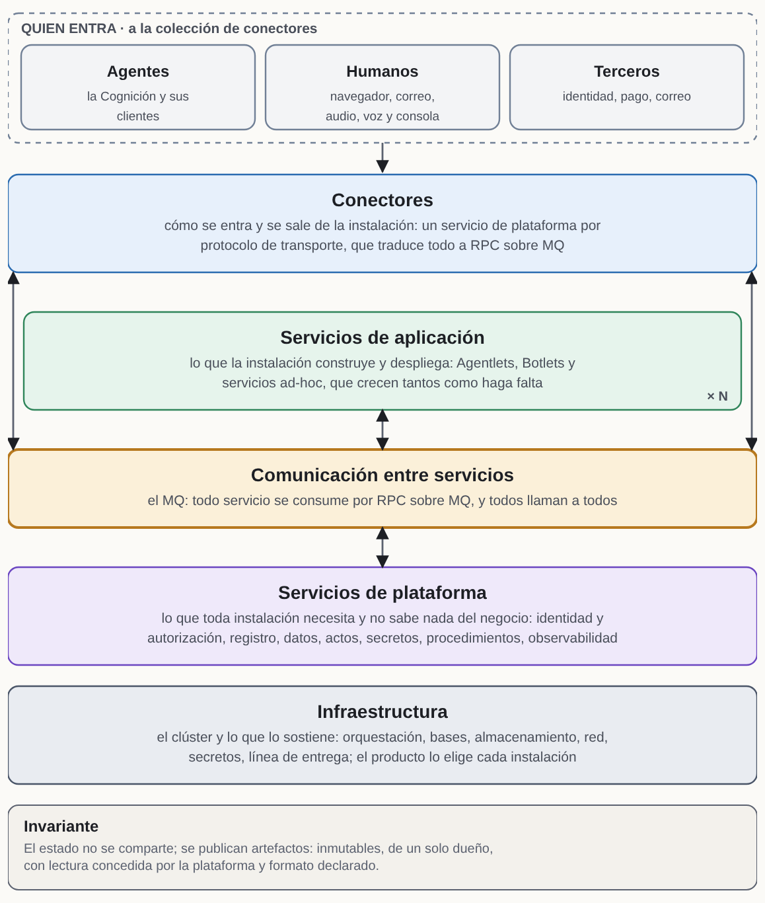
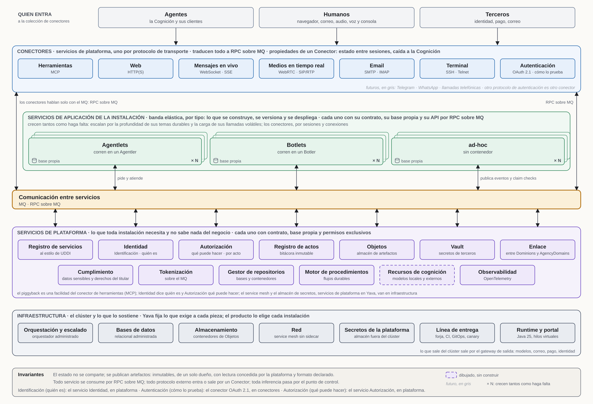
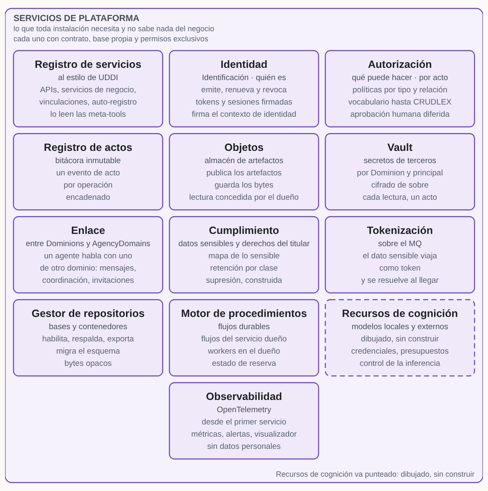
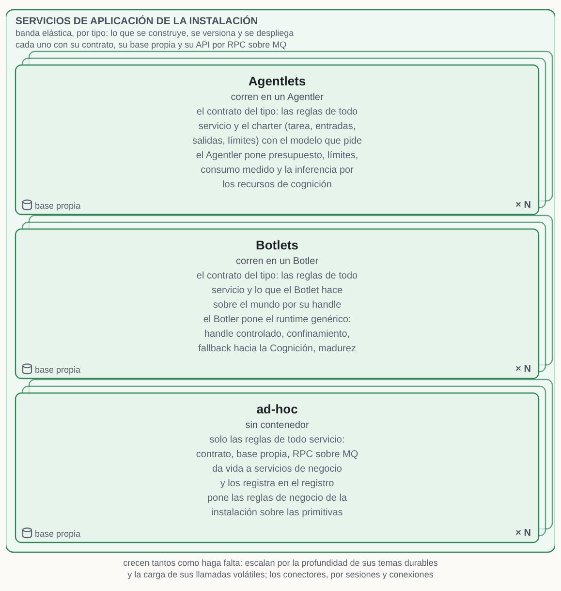
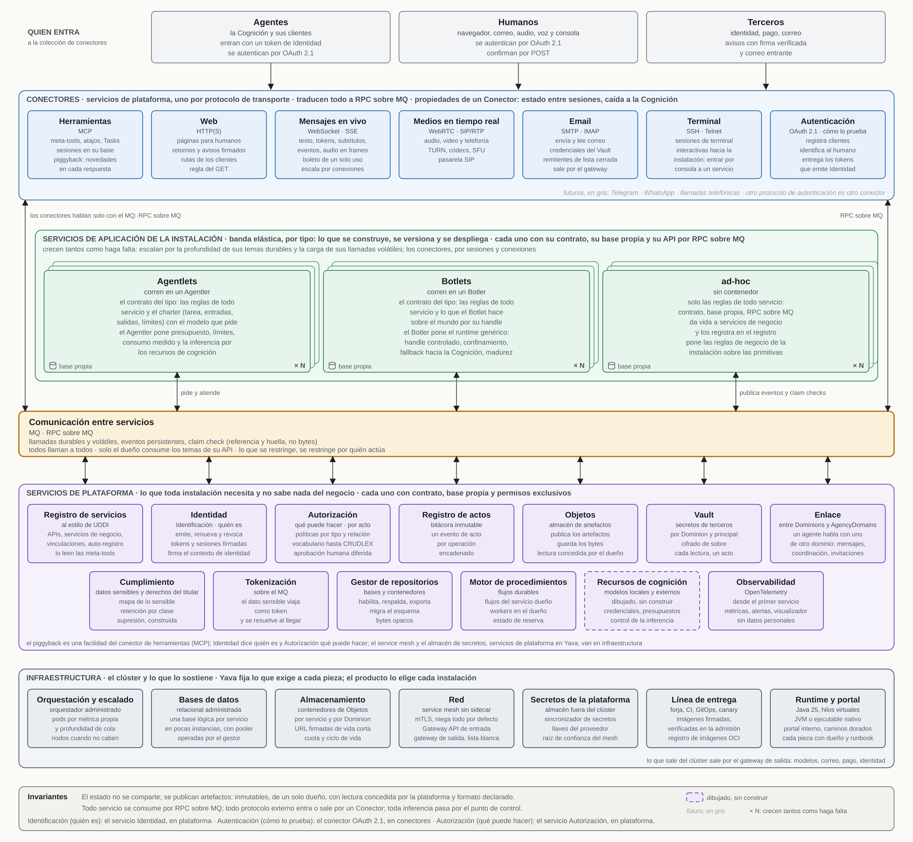
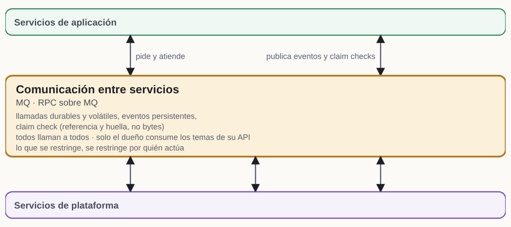
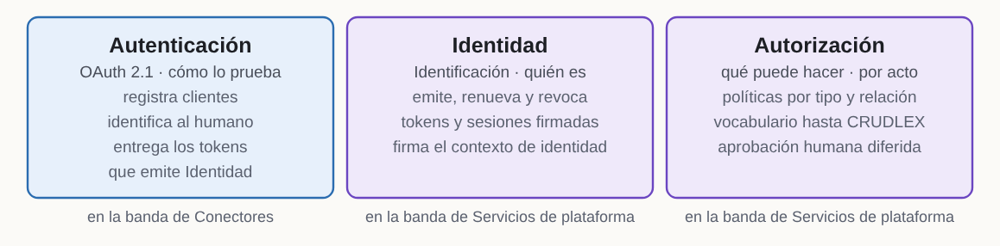
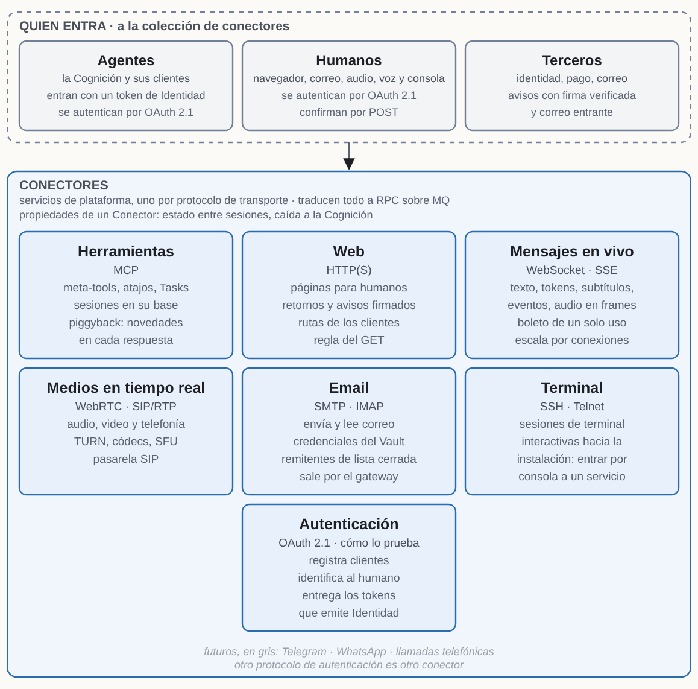
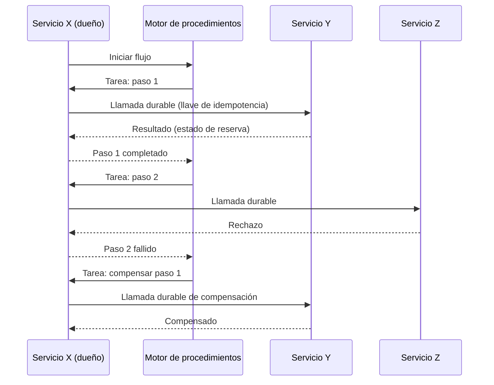
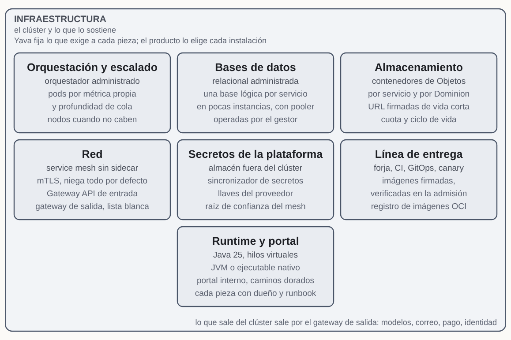

# Yava · Arquitectura de lo determinista del AgencyDomain

| | |
|---|---|
| **Versión** | 1.4.5 |
| **Autores** | César Obach-Renner y Simón Alero |
| **Licencia** | Documentación bajo GNU FDL v1.3 y código bajo AGPL-3.0, como exige el canon a la implementación de referencia |
| **Marco** | *AgencyDomains: Arquitectura del Mundo Agentivo*, de César Obach-Renner (el canon) |
| **Alcance** | La arquitectura que da vida a todo lo determinista de un AgencyDomain. Quedan fuera la Cognición, los asuntos de proyecto, los lineamientos de construcción y los servicios concretos que se monten sobre ella |

## ¿Qué es Yava y de qué parte?

### ¿Qué es Yava?

**Yava es la arquitectura que da vida a todo lo determinista de un AgencyDomain.** El canon define cuatro capas (Interacción, Cognición, Autonomía y Acceso) y una Trust Infrastructure transversal. Yava no se delimita por capa, sino por **naturaleza**: abarca todo lo que se ejecuta como código determinista, esté en la capa que esté, y deja fuera lo que no lo es.



*Figura 1 · Yava en una mirada: quien entra cae en los Conectores, que traducen todo a RPC sobre MQ; los servicios de aplicación de la instalación crecen tantos como haga falta; debajo del MQ, los servicios de plataforma, y al fondo la infraestructura.*



*Figura 2 · La plataforma de un vistazo: arriba quien entra y los Conectores, al medio los servicios de aplicación de la instalación (los que crecen), el MQ como línea, y debajo los servicios de plataforma y la infraestructura. Cada caja lleva su función y, debajo, su tecnología.*

| Pieza del canon | Capa | ¿Dentro de Yava? |
|---|---|---|
| **Botlets**, incluidos los de presentación y los de fachada operativa | 3 (invocados desde 1, 2 o por eventos) | Sí: régimen persistente. Cada Botlet es un servicio de aplicación de tipo Botlet, que corre en su contenedor, el Botler |
| **Facetas** | 1 | Sí: régimen efímero |
| **Conectores** | 4 | Sí: servicios de plataforma, uno por protocolo de transporte y uno por protocolo de autenticación. Un Conector puede declarar las propiedades del régimen persistente (ver «¿Qué es un Conector?») |
| **Trust Infrastructure determinista** (políticas, CRUDLEX, log *append-only*) | Transversal | Sí. Sus formas están en este documento: el evento de acto, el vocabulario de permisos y el aprobador autenticado. Su construcción completa, después de que la primera instalación esté en marcha |
| **Botler** (el contenedor de los Botlets) | 3 | Sí: es el corazón de Yava, el runtime genérico que aloja a los Botlets |
| **Agentlets** | 3 | Su alojamiento, sí: cada Agentlet es un servicio de aplicación de tipo Agentlet, que corre en su contenedor, el Agentler, con presupuesto, límites y consumo. Su cuerpo, que es inferencia, no |
| **Interfaz de la Cognición hacia la Capa 3**, por MCP | 2 → 3 | Sí: el conector Herramientas (MCP) |
| **Cognición, Capabilities, Pattern Recognition, generación de Botlets** | 2 | No |
| **Validación con modelos** (detección de alucinaciones y similares) | Transversal | No |

**Dos regímenes de vida.** El canon distingue piezas con naturalezas distintas, y Yava sostiene ambas:

1. **Régimen persistente**, para Botlets (en G1, configuraciones de proto-Botlets) y Conectores: estado entre sesiones, garantía de fallback hacia la Cognición, ciclo de regeneración 95/4/1 y fases de madurez. En un Conector, cada una de estas es una propiedad que declara en su contrato.
2. **Régimen efímero**, para Facetas: instrumentos que la Cognición invoca mientras conversa y suelta al terminar; catálogo plano, sin fallback ni persistencia. Si una Faceta falla, el agente vuelve al texto.

**Relación con Vergis.** Vergis es la implementación de referencia de AgencyDomains, y hoy implementa un subconjunto de lo que debe ser. Yava se diseña para convertirse en **la base determinista de Vergis**: se escribe de forma genérica, sin acoplarse a ninguna instalación, aunque su primera instalación sea Soveria, que consolida los productos del Grupo Ultra.

**Cómo se corresponden los términos de este documento con el canon:**

| Término de Yava | Correspondencia con el canon |
|---|---|
| Servicios de plataforma | El sustrato del Botler: las piezas genéricas que gestionan ciclo de vida, aislamiento, identidad, datos y ejecución sin conocer el dominio |
| Conector | El Conector de la Capa 4 del canon: el servicio de plataforma por el que un protocolo externo entra a la arquitectura o sale de ella, uno por protocolo de transporte y uno por protocolo de autenticación. Un conector con un tercero es un Conector de su protocolo |
| Conector Herramientas (MCP) | El servidor MCP del Botler: la interfaz por la que la Cognición comanda la Capa 3 |
| Meta-tools | La API de operación del Botler hacia la Cognición |
| Servicio de aplicación | Unidad desplegable con su base y su API, de tipo Agentlet (corre en un Agentler), Botlet (corre en un Botler) o ad-hoc |
| Servicio de negocio | Operación invocable por la Cognición, implementada por un Botlet de fachada operativa o por otro servicio de aplicación |
| Dominion | El territorio de cada agente dentro del AgencyDomain, con el nombre que le da el glosario del canon |
| Operador | El humano responsable de lo que hace un agente |
| Estado y artefacto | El dato vivo y privado de un servicio, que solo toca su dueño; y el dato terminado y publicado, que es lo único que se comparte entre servicios |
| Registro de servicios | Registro en ejecución de lo que existe y por dónde se llega; distinto del **catálogo** del canon, que es el repertorio de proto-Botlets y Capabilities |
| Motor de procedimientos | Sustrato de ejecución durable sobre el que corren flujos deterministas; no es la Capa 3 misma, que el canon distingue de los orquestadores de flujos estáticos |

### ¿De qué parte Yava?

Yava parte de su conformidad con el canon y de cuatro premisas propias. Si alguna cambia, la arquitectura se revisa desde ese punto. Las condiciones propias de cada instalación están en su perfil de despliegue.

#### ¿Qué conformidad declara con el canon?

**Yava es una implementación conforme de *AgencyDomains: Arquitectura del Mundo Agentivo* (v1.2.1) en su ámbito determinista.** Cumple todos los requisitos obligatorios (MUST) de la especificación que aplican a lo determinista, y el canon es la norma: este documento no lo repite, y describe en cada sección cómo Yava cumple lo que le aplica.

Como base determinista de Vergis, Yava cumple además los requisitos de conformidad que el canon exige a la **implementación de referencia** *(capítulo 9, «Conformidad»)*:

- disponible públicamente, descargable y ejecutable;
- código bajo licencia libre con copyleft de red (AGPL);
- documentación bajo licencia libre (GFDL);
- un Botler genérico, sin especialización por dominio;
- al menos un proto-Botlet de plataforma operando en la generación G1;
- una cadena de derivación trazable en sus ejemplos (caso de uso, Botlets, proto-Botlets).

**Generación operativa.** Yava opera en **G1**, como Vergis: la Cognición **configura** proto-Botlets ya forjados del catálogo y no escribe el cuerpo de sus motores *(capítulo 9, «Frontera de evolución», y capítulo 5, §2)*. Un Botlet nuevo en G1 es una configuración de un proto-Botlet que ya llegó a producción por la línea de entrega. Las generaciones G2 y G3, en que la Cognición genera código, son frontera de evolución.

**Cómo lee Yava los ámbitos del canon.** Una instalación de Yava es un **AgencyDomain** con muchos agentes. El **Dominion** es el territorio de cada agente dentro de él (ver «¿Qué es un Dominion?»), y la **Cuenta** es la dueña de uno o varios agentes. Yava sigue la definición del AgencyDomain como un ámbito con muchos agentes, y no la línea 122 de `domains-spec.md`, que dice que un agente es un AgencyDomain: es una inconsistencia del canon, que su autor declaró y va a corregir.

Además de lo anterior, Yava cumple estos requisitos del canon en su ámbito:

- **la portabilidad:** cada servicio exporta lo de un Dominion o de un titular como artefacto, en un formato documentado (ver «¿Cómo se respalda, se restaura y se porta lo de un servicio?»);
- **los tres tiempos del agente** (Preparación, Atención e Ingeniería): cada operación declara el suyo en su contrato, y la telemetría lo lleva;
- **la frontera con el exterior:** todo protocolo externo entra o sale por un Conector, y el recorrido de los datos hacia terceros queda trazado (ver «¿Cómo se tratan los datos sensibles?»).

**Salvedad:** la conformidad no es completa todavía. Las brechas con el canon que siguen abiertas son **no conformidades pendientes**, y mientras existan, la conformidad se declara con esa salvedad. La conformidad del ciclo de vida del agente se trata en el reprise.

#### ¿Qué premisas propias tiene?

- **P1.** Yava debe ser **muy escalable, robusta y segura** desde el inicio.
- **P2.** **La plataforma escala automáticamente con la demanda**, dentro de máximos declarados de escala y de costo.
- **P3.** **El service mesh es robusto desde el primer día.**
- **P4.** **Todo el software es FOSS**, con su licencia validada pieza por pieza. P4 alcanza al software, no a la operación: un servicio administrado se acepta si expone una API estándar y tiene un equivalente FOSS autoalojable. El mismo criterio rige para la forja y el CI.

Las decisiones de arquitectura (servicios de grano medio, una base por servicio, RPC sobre MQ, el lenguaje, el almacén de secretos externo) no son premisas: cada una vive en su sección, con su justificación y lo que se descartó.

### ¿Qué dice el estado del arte?

En 2026 el estado del arte no consiste en partir más el sistema, sino en gestionar menos servicios, mejor delimitados, sobre infraestructura más liviana y con una plataforma interna que absorba la complejidad.

- **Consolidación.** La industria corrigió el exceso de microservicios finos. Lo que importa es el despliegue independiente y los datos con dueño, no la cantidad de procesos. *(Verificado como tendencia; las cifras de adopción que circulan se contradicen entre fuentes secundarias y no deben citarse sin ir al dataset primario de la encuesta de la CNCF.)*
- **Orquestación de contenedores como base.** La gran mayoría de quienes usan contenedores los orquesta en producción con un orquestador estándar. *(Reportado por medios que citan la encuesta CNCF 2025.)*
- **Service mesh sin sidecar.** Separar el tráfico L4 (un proxy compartido por nodo) del L7 (proxies opcionales donde hacen falta) para pagar L7 solo donde se usa, partiendo con mTLS y telemetría y agregando manejo avanzado de tráfico solo donde se justifique. *(Verificado.)*
- **Ingeniería de plataforma** con portales internos y caminos dorados, y **OpenTelemetry** como estándar de telemetría. *(Verificado como tendencia; conocimiento consolidado.)*
- **Ejecución durable** para los procesos que cruzan servicios, con motores de flujos que guardan el estado y los plazos de cada ejecución. *(Verificado como categoría.)*

---

## ¿Cómo se arma la plataforma?

### ¿Qué tipos de servicio hay?

La arquitectura distingue tres tipos de servicio, que coinciden con las tres capas del estándar de modelado ArchiMate, de The Open Group: negocio, aplicación y tecnología *(conocimiento previo)*.

| Tipo | Qué es | Cómo se accede | Ejemplos |
|---|---|---|---|
| **Servicio de plataforma** | Una capacidad compartida de infraestructura, sin lógica de negocio, de la que dependen los servicios de aplicación. Puede ser un producto o una pieza construida como parte de Yava | La usan los servicios de aplicación, los conectores y la operación | MQ, motor de procedimientos, registro de servicios, conectores (Herramientas, Web, Mensajes en vivo, Medios en tiempo real, Email, Terminal y Autenticación), Identidad, Autorización, Objetos, Vault, Enlace, Cumplimiento, tokenización, gestor de repositorios, registro de actos, almacén de secretos, observabilidad, service mesh |
| **Servicio de aplicación** | Una pieza desplegable con su propia base y su API, que da vida a servicios de negocio | Por RPC sobre MQ, desde otros servicios | Cada servicio que se monte sobre la arquitectura |
| **Servicio de negocio** | Una capacidad funcional que se ofrece a los agentes | Por las meta-tools del conector Herramientas (MCP), o como atajo (ver «¿Cómo funciona el conector Herramientas (MCP)?») | Enviar un correo, leer una bandeja de entrada |

**Criterio de clasificación:** un servicio es **de plataforma** si toda instalación de Yava lo necesita y no da vida a servicios de negocio; es **de aplicación** si da vida a servicios de negocio, o si solo algunas instalaciones lo necesitan. Por ese criterio, el registro de servicios es de plataforma. El conector Herramientas también es de plataforma: es el servidor MCP del Botler, la interfaz por la que la Cognición comanda la Capa 3, y toda instalación lo necesita. Por el mismo criterio son de plataforma Identidad, el Conector de autenticación, Autorización, Objetos, el Vault, el Enlace, Cumplimiento, la tokenización, el gestor de repositorios y el registro de actos: cualquier solución que corra sobre Yava los necesita, y ninguno sabe qué es la memoria de un agente ni una regla de negocio de la instalación.



*Figura 3 · Los trece de la banda de plataforma (los Conectores también son servicios de plataforma, en su propia banda): cada uno con contrato, base propia y permisos exclusivos, todos colgados del MQ; Recursos de cognición va punteado porque está dibujado y sin construir.*

**Cómo se reparte un tema entre la plataforma y la aplicación.** Tres preguntas, en orden:

| Pregunta | Si la respuesta es sí |
|---|---|
| ¿Lo necesitaría cualquier solución que corra sobre Yava? | Va a Yava, como servicio de plataforma, facilidad o regla |
| ¿Hace falta conocer un concepto de la instalación (su memoria, sus territorios, sus reglas de negocio) para hacerlo? | Va a la instalación, como servicio de aplicación |
| ¿Tiene las dos caras? | Se parte: Yava pone la primitiva y su contrato, y la instalación pone la regla encima |

Dónde corre cada pieza es una decisión de operación de la instalación, no de la arquitectura.

**Un servicio de plataforma construido como parte de Yava** expone su API por RPC sobre MQ y sigue las mismas reglas que cualquier servicio: base propia, contrato y permisos exclusivos.

Un servicio de aplicación puede dar vida a varios servicios de negocio, y los **registra** en el registro de servicios al aparecer (ver «¿Cómo funciona el registro de servicios?»). ArchiMate llama «componente de aplicación» a la pieza desplegable y «servicio de aplicación» al comportamiento que expone; este documento usa «servicio de aplicación» para las dos cosas. **Cuando el documento dice «servicio» a secas, se refiere a cualquier servicio con API por RPC sobre MQ, de aplicación o de plataforma construido como parte de Yava.**

#### ¿Qué tipos de servicio de aplicación hay?

Cada servicio de aplicación declara su **tipo**: lo que el equipo construye, versiona y despliega por la línea de entrega, y lo que se registra en el registro de servicios y escala. Los dos primeros tipos son piezas del canon que corren dentro de un **contenedor**, el runtime que las aloja; el contenedor no es un tipo, sino el lugar donde vive cada pieza del tipo.



*Figura 4 · Los tres tipos: lo que se construye y se despliega es el Agentlet, el Botlet o el servicio ad-hoc; el Agentler y el Botler son el contenedor en que corren los dos primeros. Las tarjetas repetidas y el «× N» dicen que crecen tantos como haga falta; cada uno con su base propia.*

| Tipo | Corre en | Qué cubre el contrato del tipo | Qué pone el contenedor |
|---|---|---|---|
| **Agentlet** | Un **Agentler** | Las reglas de todo servicio, y el charter del Agentlet (tarea, entradas, salidas y límites) con el modelo que pide | El presupuesto por ejecución, los límites de recursos, el consumo medido y la inferencia por la gestión de recursos de cognición (ver «¿Cómo corren los Botlets y los Agentlets?») |
| **Botlet** | Un **Botler** | Las reglas de todo servicio, y lo que el Botlet hace sobre el mundo a través de su handle | El runtime genérico del Botler del canon: el handle controlado, el confinamiento, el fallback hacia la Cognición y las fases de madurez |
| **ad-hoc** | Ningún contenedor | Solo las reglas de todo servicio: contrato, base propia y RPC sobre MQ | — |

**En G1, lo que llega por la línea de entrega como Botlet es el proto-Botlet forjado.** Cada configuración suya que hace la Cognición es también un Botlet, y se registra en el Botler sin pasar por la línea. Esta lectura concilia la regla de los tipos con la generación G1 y es **provisional**: se decide en el reprise, al diseñar el Botler y el proto-Botlet. No afecta la primera versión de una instalación que no tenga Botlets.

Los contratos de cada tipo y de cada contenedor, y cómo llega el contenedor a producción, son un diseño pendiente.

### ¿Qué arquitectura se propone por capa?



*Figura 5 · La arquitectura entera, con los alcances de cada pieza: léase de arriba abajo siguiendo las flechas, y de la banda de conectores al MQ por los dos ramales laterales.*

| Capa | Arquitectura |
|---|---|
| Empaquetado | Imágenes de contenedor firmadas, con SBOM |
| Registro de imágenes | Registro administrado del proveedor de nube, aceptado por P4 (habla la especificación de distribución OCI y tiene salida FOSS) |
| Orquestación | Orquestador de contenedores administrado |
| Escalado automático | Escalado de pods por métrica propia de cada servicio, escalado por profundidad de cola y escalado de nodos (ver P2) |
| Lenguaje y framework | Java 25 con un framework de servicios explícito basado en hilos virtuales; sobre la JVM o como ejecutable nativo (ver «¿Qué lenguajes usa Yava?») |
| Forja | Forja que cumpla los mínimos de la línea de entrega, administrada o autoalojada |
| CI | Pipelines en formato FOSS que corren en el clúster; la forja solo las dispara |
| Línea de entrega | Por servicio: integración en `develop` con juicio de integración obligatorio, canary desde `develop` y promoción del commit probado a `main` (ver su sección) |
| Despliegue | GitOps sobre un repositorio de entorno |
| Entrega progresiva | Canary con análisis de métricas y reversa automática |
| Salud | Readiness contra la salud propia de cada servicio; la salud semántica, en el análisis del canary |
| Configuración y secretos | Configuración declarativa y sincronizador de secretos contra el almacén de secretos externo |
| Red | Service mesh sin sidecar (ver su sección) |
| Registro de servicios | Servicio de plataforma al estilo de UDDI: APIs de los servicios, servicios de negocio y vinculaciones, con auto-registro (ver su sección) |
| Conectores | Uno por protocolo de transporte: Herramientas (MCP), Web (HTTP), Mensajes en vivo (WebSocket · SSE), Medios en tiempo real (WebRTC · SIP/RTP), Email (SMTP/IMAP) y Terminal (SSH · Telnet); y uno por protocolo de autenticación, el primero Autenticación (OAuth 2.1) (ver «¿Qué es un Conector?») |
| Conector Herramientas (MCP) | Servidor de protocolo hacia los agentes, con meta-tools, atajos, sesiones propias y piggyback; lee el registro (ver su sección) |
| Identidad y autorización | Identificación en Identidad, servicio de plataforma que guarda las identidades, emite, renueva y revoca los tokens y las sesiones, y firma el contexto de identidad; autenticación en un Conector de autenticación por protocolo, en el borde, el primero OAuth 2.1; autorización en Autorización, servicio de plataforma que decide qué puede hacer cada quien (ver «¿Cómo se autentican y se autorizan los que llaman?») |
| Comunicación entre servicios | RPC sobre MQ, con llamadas durables o volátiles, eventos persistentes y vinculaciones por operación resueltas en tiempo de ejecución (ver su sección) |
| Comunicación entre dominios | El Enlace, servicio de plataforma para la comunicación entre agentes de distintos Dominions y de distintos AgencyDomains (ver su sección) |
| Contratos | API de cada servicio descrita en AsyncAPI, con mensajes en Protobuf, y compatibilidad verificada en el CI (ver «¿Cómo se escribe un contrato?») |
| Datos | El estado no se comparte; se publican artefactos. Una base relacional por servicio, agrupadas en pocas instancias administradas y operadas por el gestor de repositorios; outbox, inbox e idempotencia en cada servicio; *pooler* de conexiones |
| Objetos | Servicio de plataforma que guarda los artefactos y los bytes de los servicios, con lectura concedida por su dueño (ver «¿Cómo funciona Objetos?») |
| Datos sensibles | Una marca declarada en el contrato; Cumplimiento, tokenización sobre el MQ, trazabilidad del recorrido y supresión (ver «¿Cómo se tratan los datos sensibles?») |
| Registro de actos | Servicio de plataforma que guarda el evento de acto de cada operación (ver «¿Qué forma tiene el registro de un acto?») |
| Secretos de terceros | El Vault, servicio de plataforma que custodia las credenciales de los usuarios por Dominion y por principal (ver su sección) |
| Recursos de cognición | Servicio de plataforma por el que pasa toda inferencia, con sus presupuestos y límites; dibujado, sin construir (ver «¿Cómo corren los servicios?») |
| Procedimientos | Motor de procedimientos de plataforma; flujos en el servicio dueño; pasos que llaman a los contratos de los demás |
| Observabilidad | OpenTelemetry desde el primer servicio, con un sistema de métricas y alertas y un visualizador |
| Admisión | Verificación de firma de imagen al admitir pods |
| Plataforma | Portal interno y caminos dorados; cada pieza con dueño, runbook y cadencia de actualización |

Lo que se exige a cada pieza está en «¿Qué exige Yava a cada pieza?», y los productos los elige cada instalación, en su perfil de despliegue.

#### ¿Qué se mantiene como invariante?

- **El estado no se comparte; se publican artefactos.** Ningún servicio accede al estado de otro, sin excepciones. Lo único que se comparte entre servicios son **artefactos**, y solo si cumplen cuatro premisas (ver «¿Cómo se organizan los datos?»):
  1. **inmutables:** no se editan; un cambio es una versión nueva, con otra referencia;
  2. **un solo dueño,** que decide su ciclo de vida, quién lo lee y su borrado;
  3. **lectura concedida por la plataforma:** el dueño declara quién lee qué, la plataforma lo hace cumplir y lo registra, y nadie lista ni recorre lo de otro;
  4. **formato declarado como contrato,** versionado como una API cuando no es un estándar.
- **Todo servicio se consume por RPC sobre MQ** (ver «¿Cómo se comunican los servicios?»).
- **Ninguna llamada durable aceptada se pierde** aunque se caiga quien la hizo, el servicio o la conexión a mitad de camino: queda persistida en el MQ, con su confirmación de publicación, antes de responder.
- **Ningún estado intermedio de un procedimiento es visible** para un lector: existe solo como estado de reserva hasta confirmarse.
- **`main` nunca va delante de producción:** `main` es siempre el último commit que pasó el canary.
- **Ninguna acción con efecto se ejecuta por GET,** y toda confirmación exige un POST de un humano autenticado (ver «¿Cómo se autentican y se autorizan los que llaman?»).
- **Todo servicio que guarda un dato personal sabe suprimirlo,** por su contrato (ver «¿Cómo se tratan los datos sensibles?»).

### ¿Cómo llega un cambio a producción?

Cada servicio tiene su propia rama de integración, **`develop`**, y su propia rama de producción, **`main`**. Los cambios se integran a `develop`, el canary corre desde `develop`, y `main` avanza solo hasta el commit que pasó el canary. Así, la integración es la estándar de la forja y `main` siempre es exactamente lo que está en producción.

#### ¿Qué juicios pasa un cambio?

Tres, cada uno sobre un objeto distinto  *(los modelos los elige cada instalación, en su perfil)*:

1. **Diseño:** lo juzga el modelo de mayor capacidad.
2. **Construcción:** la juzga el modelo de alta gama opuesto al que construyó, para que la revisión tenga otros puntos ciegos que el autor.
3. **Integración:** la juzga el **modelo de alta gama de menor costo**, como *check* obligatorio antes de integrar a `develop`. Revisa lo que solo aparece al integrar: el resultado de combinar el cambio con lo que ya está en `develop`, como conflictos mal resueltos, interacciones con otros cambios recientes, APIs que dejaron de calzar con lo que esperan otros servicios o límites cruzados sin declarar. Queda **atado al resultado de la integración**: si `develop` avanzó y el cambio se tiene que volver a combinar, se juzga de nuevo. Las forjas pueden descartar automáticamente las aprobaciones cuando un PR recibe commits nuevos *(conocimiento previo)*.

#### ¿Cuáles son los pasos?

1. **Unidad de cambio:** el PR, por servicio.
2. **Checks obligatorios** del PR: construcción, pruebas, verificación de compatibilidad de contratos y juicio de integración. Con todos en verde, el PR se integra a `develop` con la integración estándar de la forja.
3. **Servicios dueños de procedimientos:** el CI reproduce historiales reales del motor de procedimientos contra el código nuevo de los flujos (ver «¿Qué reglas siguen los flujos?»). Si la reproducción falla, el cambio no sigue.
4. El CI construye la imagen del commit de `develop`, la **firma** y la publica en el registro.
5. El repositorio de entorno pasa a apuntar a esa imagen; el despliegue GitOps converge y la entrega progresiva corre el **canary** con su análisis (métricas y salud semántica).
6. Si el canary **promueve**, el **promotor** avanza `main` por *fast-forward* exactamente al commit probado y activa en el registro de servicios las descripciones de servicios de negocio que la versión nueva haya registrado como pendientes. Si **aborta**, el canary se revierte en producción y el problema se corrige o se revierte en `develop`; `main` nunca se tocó.

#### ¿Qué hay que cuidar?

- **El promotor promueve el commit probado, no la punta de `develop`.** Mientras corre un canary pueden integrarse más PR a `develop`; lo que llegó después espera su propio canary. El promotor es un automatismo chico y la **única identidad con permiso para escribir en `main`**.
- **Un `develop` por servicio**, lo más simple con un repositorio por servicio. Un `develop` común a varios servicios haría que un canary probara varios servicios juntos y rompería el despliegue independiente.
- **Un `develop` roto bloquea lo que viene detrás:** tras un canary abortado, los cambios integrados después no se pueden promover hasta corregir `develop`. Se mitiga con canarios frecuentes, cambios chicos y revirtiendo rápido en `develop`.
- **Todo pasa por `develop`, también las urgencias:** nada se integra directo a `main`. Una urgencia pasa por su canary, quizás con un análisis más corto.

**Se descartó:** una **cola de integración propia** que promueva antes de integrar, porque exigía construir y mantener una pieza crítica propia, y `develop` con promotor da la misma garantía con integración estándar; **integrar directo a `main` y promover después**, porque `main` iría por delante de producción durante un canary que aborta, y su historia acumularía reversiones; y un **juicio de integración por un modelo distinto al autor**, porque el riesgo de puntos ciegos compartidos ya lo cubre el juicio cruzado de la construcción.

#### ¿Cómo cambia el esquema de una base?

Durante un canary conviven dos versiones de un servicio sobre la misma base, así que todo cambio de esquema sigue el patrón **expandir, migrar y contraer**:

1. **Cada versión de un servicio es compatible con el esquema de la anterior y de la siguiente.**
2. **La migración que agrega corre antes del canary,** como un paso de la línea de entrega que ejecuta el gestor de repositorios (ver «¿Qué hace el gestor de repositorios?»), con la compatibilidad del esquema verificada en el CI contra la versión anterior.
3. **La migración que quita se aplica en una versión posterior,** cuando ninguna réplica usa lo quitado.
4. **Ninguna réplica se niega a operar por la versión del esquema** dentro de la misma versión mayor.

**Se descartó:** migrar al arrancar cada réplica, porque varias réplicas compiten por la misma migración y un canary que aborta deja el esquema a medio camino.

---

## ¿Cómo se guardan y se protegen los datos?

### ¿Cómo se organizan los datos?

**El estado no se comparte; se publican artefactos.**

| Término | Qué es | Quién lo toca |
|---|---|---|
| **Estado** | El dato vivo y privado de un servicio, en su base | Solo su dueño. **Ningún servicio accede al estado de otro, sin excepciones** |
| **Artefacto** | El dato terminado y publicado que cumple las cuatro premisas | Quien tenga la lectura concedida. **Es lo único que se comparte entre servicios,** se guarde donde se guarde; normalmente, en Objetos |

**Cada servicio tiene su propia base, y ningún servicio lee ni escribe la base de otro**. Lo que un servicio necesita de otro lo obtiene a través de la API de ese otro, por RPC sobre MQ, de los eventos que ese otro publica, o de los artefactos que ese otro publica y le concede leer.

#### ¿Qué es un artefacto?

Un dato que un servicio comparte cumple **cuatro premisas**:

1. **Inmutable.** No se edita; un cambio es una versión nueva, con otra referencia. Lo que se escribe en vivo es estado del dueño, y pasa a artefacto al cerrarse.
2. **Un solo dueño,** que decide su ciclo de vida, quién lo lee y su borrado. La supresión de un artefacto la ejecuta su dueño, y los lectores toleran el «ya no existe».
3. **Lectura concedida por la plataforma.** El dueño declara a Objetos qué servicios o roles leen qué; la plataforma lo hace cumplir y lo registra, y nadie lista ni recorre lo de otro.
4. **Formato declarado como contrato,** versionado como una API cuando no es un estándar (una imagen o un PDF sí lo son).

**El aviso viaja por *claim check*:** por el MQ viajan la referencia y la huella del artefacto, no sus bytes. Por ejemplo, la transcripción cruda de una sesión: su dueño la cierra y la publica en Objetos, avisa por el MQ con la referencia, y cada lector con permiso la baja con un permiso de lectura de corta duración.

**El gestor de repositorios no es una excepción:** opera los contenedores de cada servicio como bytes opacos (crear, respaldar, restaurar, exportar, importar), sin leer ni interpretar los datos (ver «¿Qué hace el gestor de repositorios?»).

#### ¿Qué reemplaza al estado compartido?

Seis patrones, uno para cada forma en que un componente podría querer el estado de otro:

| Patrón | Qué es |
|---|---|
| **Llamada viva** | El que necesita el dato se lo pide al dueño por su contrato, con una llamada durable o volátil |
| **Evento** | El dueño publica un hecho; quien lo necesita lo consume y lo guarda en su propio estado |
| **Procedimiento** | Lo que cruzaría varias bases en una transacción es un procedimiento del servicio dueño, con compensaciones |
| **Dato firmado** | Lo que se verificaría leyendo la base de otro se verifica localmente con un dato firmado por su emisor (un token, el contexto de identidad) |
| **Artefacto** | Lo que se compartiría como bytes es un artefacto en Objetos, con lectura concedida y aviso por *claim check* |
| **Interno** | La relación deja de cruzar componentes: el dato es estado del mismo dueño |

Las copias que un servicio mantiene a partir de eventos ajenos son su propio estado, y siguen la regla «nadie decide con datos derivados» (ver «¿Qué reglas protegen los límites entre servicios?»). El modelo de lectura de un servicio es interno a él: no es una copia en otro servicio.

**Se descartó:** una excepción de plataforma para el respaldo, la restauración, la exportación y la importación, porque el gestor de repositorios las hace sobre bytes opacos, sin acceder al estado; y las excepciones de servicio a servicio para los datos voluminosos, que van por *claim check*.

#### ¿Dónde viven las bases?

Una **base lógica por servicio**, con credenciales propias, **agrupadas en pocas instancias** de la base relacional administrada, según su criticidad. El aislamiento de acceso es total desde el primer día; llevar una base a su propia instancia más adelante es una operación, no un rediseño. Varias bases en una instancia comparten su CPU, su memoria y su falla, así que la instancia es una pieza compartida en la sección de fallas en cadena. El motor de procedimientos tiene su propia base, en una instancia de plataforma. Las bases las habilita y las opera el gestor de repositorios.

**Se descartó:** una **instancia de base por servicio desde el inicio**, porque exige una instancia con alta disponibilidad por servicio; se reserva para la base que lo necesite.

#### ¿Cómo aísla un servicio a sus Dominions dentro de su base?

El aislamiento entre Dominions es tan obligatorio como entre servicios. Es **lógico por omisión**: la identidad del Dominion va en cada fila y en cada llamada, verificada. Hay dos formas de aplicarlo:

1. **El filtro por Dominion en la aplicación,** que la biblioteca del servicio pone en cada consulta a partir del contexto de identidad.
2. **La seguridad por fila de la base,** con un rol de trabajo que no es dueño de las tablas, de modo que una consulta sin filtro no ve lo de otro Dominion.

La segunda protege también contra un error del código, y exige que la base y el *pooler* en modo transacción la soporten; la primera no depende de la base. Un aislamiento físico (una base o un espacio por Dominion) se usa solo por excepción declarada.

#### ¿Qué patrones son obligatorios en cada servicio?

1. **Outbox, donde hay cambio de estado y publicación.** Cuando un servicio cambia su base **y** publica algo que depende de ese cambio (un resultado, un evento), escribe el mensaje en una tabla de su base en la misma transacción, y un publicador lo envía al MQ.
2. **Publicación directa, donde no hay estado propio.** Quien solo encola, sin cambiar una base propia, publica directo en el MQ y espera la confirmación de publicación, que asegura que el mensaje quedó persistido. *(Verificado.)*
3. **Resultados por llave.** Toda llamada durable trae una llave de idempotencia, y el servicio guarda el resultado de cada una por su llave. Es lo que hace que una llamada repetida no se ejecute dos veces y lo que permite consultar después su resultado. **La misma llave con otra huella de contenido es un rechazo, no una repetición.**
4. **Inbox para los eventos consumidos.** Cada evento que un servicio consume se registra por su identificador antes de procesarse, y uno repetido se descarta: el MQ entrega al menos una vez.
5. **Estados de reserva invisibles.** Lo que todavía no se confirma en una operación de varios pasos existe en un estado que ningún lector expone como válido, y todo lector respeta esos estados.
6. **Sin material de credencial.** Un servicio rechaza guardar en su base material de credencial (contraseñas, tokens, llaves): las credenciales de terceros van al Vault, y las de la plataforma, al almacén de secretos.

**Se descartó:** alimentar el outbox con **captura de cambios (CDC)** desde la base, porque el publicador propio no necesita decodificación lógica en la base.

#### ¿Cómo se ordena lo de un mismo Dominion?

Cuando las operaciones sobre un mismo Dominion tienen que ejecutarse de a una, hay dos formas:

1. **Un candado por Dominion en la base propia del servicio,** tomado dentro de la transacción de la operación. Sirve cuando el orden importa solo dentro de un servicio y las operaciones son cortas.
2. **El orden por clave en el MQ,** con el Dominion como clave de partición del consumo. Sirve cuando el orden importa en el flujo de mensajes y no solo en la escritura.

Cada servicio declara cuál usa. Ninguna de las dos exige que un servicio espere a otro.

#### ¿Cómo se respalda, se restaura y se porta lo de un servicio?

1. **El respaldo y la restauración son del gestor de repositorios,** sobre bytes opacos, y la unidad de restauración es el servicio. La restauración se ensaya.
2. **Cada servicio exporta lo de un Dominion o de un titular** por una operación de su API, en un formato neutro y documentado, y **lo publica como artefacto**. Es la portabilidad que exige el canon.
3. **Un procedimiento compone la exportación completa** de un Dominion o de un titular a partir de los artefactos de cada servicio.
4. **La supresión alcanza a los respaldos** a medida que vencen (ver «¿Cómo se tratan los datos sensibles?»).

**Se descartó:** un servicio de exportación que lee a todos, porque leería el estado de otros servicios.

### ¿Cómo funciona Objetos?

**Objetos** es el servicio de plataforma donde se publican los artefactos y donde los servicios guardan sus bytes. Expone **contenedores por servicio y por Dominion**, con cuota, URL firmadas de vida corta y ciclo de vida (vencimiento y barrido de lo que quedó sin referencia).

#### ¿Qué reglas sigue?

1. **Los bytes no viajan por el MQ.** Por el MQ viajan la referencia y la huella (*claim check*).
2. **El dueño publica un artefacto inmutable** con su formato declarado; un cambio es una versión nueva, con otra referencia.
3. **El dueño declara qué servicios o roles leen qué.** Objetos lo hace cumplir, registra cada lectura como acto (ver «¿Qué forma tiene el registro de un acto?») y no deja que nadie liste ni recorra lo de otro.
4. **La lectura es con un permiso de corta duración,** emitido para quien tiene la lectura concedida.
5. **El dueño decide el borrado,** y la supresión de un artefacto la ejecuta él; los lectores toleran el «ya no existe».
6. **Cada servicio tiene su identidad ante Objetos,** y un cliente externo sube y baja con URL firmadas de vida corta, sin pasar los bytes por el servicio.

**La operación** la hace el gestor de repositorios, que trata cada contenedor de Objetos como un tipo más de repositorio: lo habilita, lo respalda, lo exporta y lo suprime sobre bytes opacos.

**Se descartó:** que cada servicio use por su cuenta el almacenamiento de la nube con un mínimo común, porque la identidad de cada servicio ante el almacenamiento, las URL firmadas y la lectura concedida son de plataforma, y se repetirían en cada servicio que guarda bytes.

Su contrato (cómo se declara la lectura, cómo se versiona un artefacto y qué viaja en el aviso) es un diseño pendiente.

### ¿Qué hace el gestor de repositorios?

El **gestor de repositorios** es el servicio de plataforma que da a cada servicio sus repositorios de datos (sus bases y sus contenedores de Objetos) y opera su vida:

1. **habilitarlos,** con su configuración y sus credenciales;
2. **respaldarlos y recuperarlos,** por servicio;
3. **exportarlos e importarlos;**
4. **migrar su esquema** como paso de la línea de entrega (ver «¿Cómo cambia el esquema de una base?»).

**Los bytes son opacos:** el gestor crea, respalda, restaura, exporta e importa sin leer ni interpretar los datos. Por eso no es una excepción a la regla del estado. Lo que un servicio exporta por Dominion o por titular no lo extrae el gestor: lo publica el dueño como artefacto.

Qué opera el gestor como infraestructura y qué pide al dueño por su contrato es un diseño pendiente.

### ¿Cómo se tratan los datos sensibles?

Yava no adivina qué dato es sensible ni sabe qué es lo que la instalación guarda: **lo respeta donde el servicio lo marcó**.

#### ¿Cómo se marca un dato sensible?

Con **una sola marca**, declarada en el contrato de cada servicio: un campo de un mensaje, o un valor, es secreto, personal o sensible. La misma marca sirve a cinco usos:

1. la telemetría sin secretos ni datos personales;
2. la tokenización sobre el MQ;
3. el mapa de dónde están los datos sensibles, que lleva Cumplimiento;
4. la supresión;
5. la trazabilidad del recorrido de los datos.

**Lo que no sale en la telemetría:** los registros, las trazas, la salud y los errores no llevan cargas, secretos ni datos personales. Las cargas van por su huella, los errores por un código de una lista cerrada, y lo que viaja en los encabezados se limita a identificadores.

#### ¿Qué hace Cumplimiento?

**Cumplimiento** (en la cara pública en inglés, *Compliance*) es el servicio de plataforma que lleva el **mapa de qué datos sensibles de qué titular están en qué servicio**, y que coordina los derechos del titular:

1. **Cada servicio publica un evento** cuando guarda o borra un dato marcado, con referencias y no con el dato.
2. **Cada servicio que guarda datos marcados implementa las operaciones que exige la ley:** identificar lo de un titular, exportarlo y suprimirlo, con su confirmación.
3. **Cumplimiento las invoca** y lleva el acta de cada pedido.
4. **La retención se declara por clase de dato,** y el borrado al vencer lo ejecuta el dueño. El cierre de un Dominion es un evento que cada servicio consume y confirma, y borra lo del Dominion de punta a punta.

La protección de datos personales es para la instalación una obligación con fecha cierta, que declara su perfil. El contrato de Cumplimiento es un diseño pendiente.

#### ¿Qué hace la tokenización?

La **tokenización** es el servicio de plataforma que reemplaza un dato marcado por un token mientras viaja por el MQ, y lo devuelve a quien tiene permiso de verlo:

1. lo que se tokeniza lo dice la marca;
2. la biblioteca de llamada tokeniza al publicar y destokeniza al recibir, si la autorización lo permite;
3. el mapa entre token y dato vive en este servicio, y suprimirlo es parte de la supresión.

Sirve también para tokenizar un dato personal antes de enviarlo a una cognición externa. Su costo por mensaje y su comportamiento si cae son parte de su diseño.

**Se descartó:** dejar la tokenización a cada instalación, porque la marca y el MQ ya son de plataforma, y la tokenización en vuelo solo se puede poner donde viajan los mensajes.

#### ¿Cómo se sabe por dónde pasó un dato?

Para un dato marcado se puede consultar **por qué servicios pasó, a qué terceros salió y dónde quedó**:

1. la traza de cada mensaje (OpenTelemetry) lleva la clase del dato, no el dato;
2. los conectores de salida registran qué clase de dato salió hacia qué tercero;
3. Cumplimiento guarda dónde quedó.

#### ¿Cómo se suprime un dato personal?

La **supresión a pedido del titular** la implementa cada servicio por su contrato y la orquesta Cumplimiento: un pedido de supresión que cada servicio atiende y confirma, con su plazo. El servicio borra el contenido, alcanza los respaldos a medida que vencen y, en un artefacto, ejecuta él la supresión, mientras los lectores toleran el «ya no existe».

**El mecanismo se construye y se prueba, y queda deshabilitado** con un interruptor. Se habilita cuando estén implementados los mecanismos que garantizan que lo use de manera legítima el dueño del dato que se va a suprimir.

**El registro de actos no se contradice con la supresión** si guarda referencias y huellas con llave (una llave secreta por instalación, que no sale del servicio), y no huellas simples del dato: la huella simple de un dato personal pequeño, como un correo o un nombre, se revierte por fuerza bruta. Qué conserva un servicio después de suprimir (una lápida sin huella del dato, o una huella con llave donde una auditoría necesite probar qué se suprimió) es un diseño pendiente.

---

## ¿Cómo se hablan los servicios y quién habla?

### ¿Cómo se comunican los servicios?

**Todo servicio se consume por RPC sobre MQ**: quien llama envía una petición y espera su respuesta, como en una llamada común, pero el transporte es el MQ y no una conexión directa. La **API de cada servicio** es el conjunto de operaciones que expone de esa forma, descrito en AsyncAPI con mensajes en Protobuf. Un servicio habla con el MQ, con su propia base, con el motor de procedimientos si tiene procedimientos, con Objetos para los bytes, y con la plataforma (secretos y telemetría).



*Figura 6 · Todo pasa por el MQ: los servicios de aplicación piden y atienden, y publican eventos y claim checks; los servicios de plataforma cuelgan de él con flechas de dos puntas, porque todos llaman a todos.*

#### ¿Qué tipos de operación hay?

Todas las operaciones de una API son **llamadas RPC**. Cada una declara si es **durable** o **volátil**, y además un servicio puede publicar **eventos**:

| | Llamada durable | Llamada volátil | Evento |
|---|---|---|---|
| Qué es | Una llamada cuya petición se persiste antes de atenderse | Una llamada que no se persiste | Un hecho que el servicio publica sin esperar respuesta |
| Cuándo se usa | Cambia estado, o puede tardar más que el plazo de una llamada volátil | Pide un dato que se necesita al instante | Avisar algo a quien quiera escucharlo |
| Si el servicio no está | La petición espera en el MQ y se atiende cuando vuelve | La llamada vence su plazo y falla; se puede repetir sin riesgo | El evento queda persistido; cada suscriptor lo recibe cuando vuelve |
| Duplicados | Llave de idempotencia como identificador del mensaje, más los resultados por llave | No hace falta: no tiene efectos | Inbox de cada suscriptor |
| Tema | Por operación; puede redirigirse (vinculaciones) | Por operación; puede redirigirse (vinculaciones) | **Permanente**: nunca se redirige |

Una llamada volátil no se persiste porque una respuesta tardía no le sirve a nadie: quien preguntó necesitaba decidir en ese momento, el dato podría estar viejo al llegar, y perderla no tiene riesgo porque se repite sin efectos.

**Eventos:** se persisten en el MQ, y **cada suscriptor tiene un consumidor durable propio**, que le guarda los eventos mientras está caído y le entrega los pendientes al volver. Un servicio no sabe quién escucha sus eventos.

**Por qué un MQ con estas tres modalidades:** permite en un mismo sistema la persistencia de las llamadas durables y de los eventos, la petición y respuesta sin persistir de las llamadas volátiles, temas con comodines, permisos por tema y un escalador por profundidad de cola. Los mínimos que se exigen al MQ están en «¿Qué exige Yava a cada pieza?».

**Se descartó:** la **comunicación por HTTP entre servicios**, porque la durabilidad de las llamadas habría que construirla en cada servicio que llama, con un outbox y un repartidor propios, y el servicio destino no vería su trabajo pendiente para escalar por él.

#### ¿Cómo se ve una llamada?

Para quien escribe un servicio, llamar a otro es **una llamada tipada**: se llama, se espera la respuesta con un plazo y se sigue. Ese modelo lo da una **biblioteca de llamada común**, de infraestructura pura, que encapsula la correlación, la dirección de retorno, el plazo, la llave de idempotencia, la vinculación vigente, la recuperación del resultado y el interruptor frente a dependencias enfermas. Esperar bloquea un hilo virtual, no uno real, así que miles de llamadas pueden esperar a la vez a costo casi nulo.

Una llamada durable tiene **dos salidas**:

- **resultado**, si la respuesta llega dentro del plazo;
- **pendiente**, con su **ticket**, si vence el plazo o si el servicio no está atendiendo: la petición sigue persistida y se atenderá igual.

Una llamada volátil devuelve su respuesta o falla al vencer su plazo.

#### ¿Cómo se recibe la respuesta de una llamada durable?

De tres formas, uniformes para todas:

1. **Síncrona:** si el resultado llega dentro del plazo, en la misma llamada.
2. **Ticket y consulta posterior:** quien llama consulta después el estado o el resultado por su ticket.
3. **Ticket y notificación:** quien llama se suscribe y recibe un aviso cuando el resultado está listo.

Reglas:

- **El ticket es la llave de idempotencia.** No tiene información técnica: identifica la petición, y el servicio que implementa la operación guarda su resultado por llave, sin importar por qué tema llegó.
- **La notificación nunca es el único camino.** Puede perderse; la consulta por ticket siempre está disponible.
- **Toda API ofrece dos operaciones estándar:** la consulta de estado y resultado por llave, y un tema de resultados donde se publica cada resultado.
- **Retención:** cada resultado se conserva por un plazo declarado por servicio; pasado ese plazo, el ticket responde «vencido».

#### ¿Cuánto se puede esperar en cadena?

**Las esperas tienen profundidad uno: un servicio que atiende una llamada no espera, a su vez, la respuesta de otra llamada durable.** Si A espera a B, que espera a C, el tiempo de A es la suma de todos, y si C se pone lento, A y B quedan esperando con él. El MQ garantiza que la petición no se pierda, pero no elimina el acoplamiento de quien espera.

Si un servicio necesita algo de otro para terminar, tiene dos caminos: **hacer la llamada sin esperar su resultado**, si no condiciona su propia respuesta, o **convertir la operación en un procedimiento** (ver su sección), si sí la condiciona. Una llamada volátil para obtener un dato que se necesita al instante es la única espera permitida dentro de la atención de una llamada, siempre que el servicio consultado no espere, a su vez, a un tercero. Los pasos de un procedimiento quedan fuera de esta regla, porque su espera la gestiona el motor.

#### ¿Cómo se nombran los temas?

Cada operación tiene un **tema por omisión** derivado de su descripción: `<instalación>.<servicio>.<cmd|qry|evt>.<operación>.v<versión>`, para llamadas durables, llamadas volátiles y eventos respectivamente; el primer segmento es el nombre de la instalación.

Un servicio **escucha todas las operaciones de su API con comodines**, por ejemplo `<instalación>.<servicio>.cmd.*.v1`. El MQ elegido admite comodines en los temas (`*` para un segmento, `>` para uno o más al final), en los consumidores de los streams persistentes y en los permisos *(conocimiento previo; se verifica antes de construir)*.

#### ¿Cómo se redirige una operación?

El tema por el que una operación llega a su servicio **se resuelve en tiempo de ejecución** y puede cambiarse en caliente, al estilo de un *endpoint* por operación de WSDL, o de UDDI.

1. **Una tabla de vinculaciones** guarda solo las excepciones: `operación → tema`. La clave es la identidad de la operación, es decir, la interfaz Java generada de su contrato, con su versión, más el nombre de la operación. Sin entrada, la operación usa su tema por omisión.
2. La tabla vive en el **registro de servicios**, que es el lugar único donde se responde qué existe, cómo se usa y por dónde se llega. Cada servicio mantiene una copia en memoria, que el registro actualiza publicando un evento cada vez que una vinculación cambia.
3. **En cada llamada**, la biblioteca busca la operación en la copia en memoria y publica en el tema vinculado en ese instante. Es una búsqueda local, sin latencia agregada.
4. **Si el registro no está disponible**, cada servicio sigue con la última vinculación conocida.
5. **Los eventos nunca se redirigen:** su tema es permanente.

**La vinculación es solo ruteo:** cambia el tema, nunca el servicio que implementa la operación, así que sus resultados, su idempotencia y sus tickets no se ven afectados. Cambiar el servicio que implementa una operación es una **migración del contrato**, un acto aparte que se diseña cuando haga falta.

**Condiciones que no dependen del caso:**

- **Si un servicio va a atender el tema nuevo**, su permiso de consumirlo tiene que existir antes; para un respiro, en el que nadie escucha, no hace falta.
- **Para una llamada durable, el tema nuevo tiene que estar capturado por un stream persistente.** Si lo está, las llamadas se acumulan ahí aunque nadie escuche; si no, el MQ no tiene dónde guardarlas y rechaza la publicación.

**Observaciones para operarlo**, que dependen de cada caso:

- **Redirigir a un tema que nadie escucha es legítimo:** sirve para darle un respiro a un servicio saturado. Las llamadas se acumulan en el stream, y después el servicio puede escuchar el tema nuevo o la vinculación puede volver al tema original.
- **Lo que esperaba en el tema anterior no se mueve:** quien atiende ese tema decide si lo vacía antes de dejarlo.
- **Hay un instante de mezcla:** el aviso no llega a todas las réplicas en el mismo milisegundo, así que por un momento unas publican en el tema anterior y otras en el nuevo.
- **Las vinculaciones son un punto sensible de seguridad:** quien pueda cambiarlas puede desviar llamadas. La escritura queda restringida y auditada, y cada cambio sigue la exigencia 8 de fallas en cadena, con su reversa declarada.
- **Reparto por pesos, si alguna vez se necesita:** una vinculación podría apuntar a dos temas con un peso cada uno, resuelto por la biblioteca de llamada.

**Se descartó:** el **mapeo de temas en el servidor del MQ** como mecanismo de redirección, porque las vinculaciones explícitas por operación dan una indirección visible y ligada al contrato; el reparto por pesos queda como opción de la biblioteca de llamada.

#### ¿Quién puede hablar con quién?

**Todos los servicios pueden llamar a todos y escuchar los eventos de todos; cada uno atiende solo lo suyo y registra solo lo suyo.** Una vez en la red, un servicio puede usar lo que otros ofrecen y actuar de forma dinámica, sin pedir permiso para cada dependencia nueva.

**Cada servicio tiene su propia identidad en el MQ:**

- **Puede publicar** en los temas de las operaciones de cualquier servicio y en los temas de sus propios eventos.
- **Puede suscribirse** a los eventos de cualquier servicio y a los resultados de lo que pidió.
- **Solo él consume los temas de su propia API.** Que cualquiera pueda pedir no significa que cualquiera pueda atender: si otro servicio pudiera consumir una cola ajena, podría quedarse con las peticiones dirigidas a otro y responder en su nombre.
- **Solo él registra su API y los servicios de negocio de su contrato** en el registro de servicios (ver «¿Cómo funciona el registro de servicios?»).

**Los permisos exclusivos se generan desde los contratos y las vinculaciones:** el de consumir los temas de cada API, incluidos los temas a los que se redirigió una operación, y el de registrar cada API y cada servicio de negocio en el registro. El service mesh cifra con mTLS las conexiones hacia el MQ, pero no ve a qué tema va cada mensaje: por eso los permisos del MQ son indispensables para esas dos exclusividades.

**Lo que se restringe, se restringe por quién actúa,** no por qué servicio llama: cada llamada lleva el contexto de identidad firmado (ver «¿Cómo viaja la identidad?»), y lo que un sujeto puede hacer lo decide Autorización (ver «¿Cómo se autentican y se autorizan los que llaman?»).

**Lo que se acepta:** el alcance de un servicio comprometido crece, porque podría llamar a cualquier operación de cualquier servicio, aunque no a nombre de un Dominion que nadie le delegó. La confianza descansa en la línea de entrega: los tres juicios, la imagen firmada y su verificación en la admisión. **El mapa de dependencias se descubre en vez de declararse:** la telemetría muestra quién llama a quién, y el juicio de integración revisa cada dependencia nueva.

**El autodescubrimiento** lo da el registro de servicios: cualquier servicio puede consultar qué APIs ofrecen los demás.

**Se descartó:** que el contrato de una operación declare una lista de llamadores y que el MQ la haga cumplir, porque restringir a los llamadores dentro de la arquitectura atenta contra la capacidad de los servicios de actuar de forma dinámica.

### ¿Cómo viaja la identidad?

El conector de entrada verifica el token del cliente, que emitió Identidad, y produce el **contexto de identidad firmado** con la firma de Identidad (cómo, sin agregar un salto por llamada, es un diseño pendiente). El contexto lleva:

- el Dominion;
- el principal humano;
- el cliente;
- la sesión;
- los permisos efectivos.

**El contexto viaja en los encabezados de cada mensaje.** La biblioteca de llamada lo verifica al recibir y lo propaga sin cambio al llamar; un servicio no lo fabrica ni lo reescribe. Es un dato firmado: se verifica localmente, sin consultar a nadie en cada llamada. Que el MQ y la biblioteca lo lleven y lo verifiquen sin costo apreciable se verifica antes de construir.

**Lo que un servicio inicia por sí mismo** (un trabajo de fondo, un procedimiento que él dispara) lleva su identidad de servicio, y solo actúa a nombre de un Dominion con una delegación declarada.

**Toda escritura guarda la sesión** del contexto con que se hizo. Es lo que permite poner en cuarentena lo escrito en una sesión que el humano no autorizó (ver «¿Cómo se autentican y se autorizan los que llaman?»).

**Se descartó:** reenviar el token del cliente a cada servicio, porque lo expone a todos; y una credencial de corta vida por llamada emitida por Identidad, porque agrega un salto por llamada y lo pone en el camino de todo.

### ¿Qué es un Dominion?

El **Dominion** es el territorio de cada agente dentro del AgencyDomain. El canon lo nombra en su glosario como el Domain que un agente consigue; Yava usa el término para las dos maneras de llegar a él, conseguido o asignado. Un Dominion tiene:

- **su identificador,** estable y que no revela datos personales;
- **los principales humanos que le abren,** con los roles que define la instalación;
- **lo que lo atraviesa:** la identidad de cada llamada, los datos que cada servicio guarda de él, los límites de uso y el registro de sus actos.

**Las URI canónicas.** El AgencyDomain, cada agente (`{domain}/agents/{agent}`) y cada herramienta tienen una URI canónica, que se resuelve a su Dominion. El esquema es el del canon; los nombres propios (los *handles*, los números) los pone la instalación. El registro de servicios guarda la URI de cada herramienta.

**Los límites,** en el conector Herramientas (MCP) y en la escritura, se aplican por Dominion y por principal.

### ¿Cómo se autentican y se autorizan los que llaman?

Tres papeles, cada uno en su pieza, con preguntas distintas:

| Papel | Qué responde | Dónde vive |
|---|---|---|
| **Identificación** | **Quién es** el que llama | **Identidad**, servicio de plataforma |
| **Autenticación** | **Cómo prueba** que es quien dice ser | **Un Conector de autenticación por protocolo**, en el borde; el primero, **OAuth 2.1** |
| **Autorización** | **Qué puede hacer** ese quién | **Autorización**, servicio de plataforma |

El Conector de autenticación prueba quién llega y le pide a Identidad sus tokens y su sesión; los conectores y los servicios le piden la decisión a Autorización y la aplican; Autorización la toma. Autenticar con otro protocolo es otro Conector de autenticación, y Identidad y Autorización no cambian.



*Figura 7 · Dónde vive cada papel: la Autenticación es un Conector (OAuth 2.1, el primero), en la banda de conectores; la Identificación y la Autorización son dos servicios de plataforma, Identidad y Autorización.*

#### ¿Qué hace Identidad?

Es un servicio de plataforma, con su base y su API por RPC sobre MQ:

1. **Qué hace:** guarda las identidades; emite, renueva y revoca los tokens y las sesiones con que los clientes llegan a los conectores; y firma el contexto de identidad (ver «¿Cómo viaja la identidad?»).
2. **Qué no hace:** no habla ningún protocolo de autenticación, que es del Conector de autenticación; y no decide qué Dominions le abren a un humano, que se lo pregunta a Autorización.
3. **Cómo se valida un token:** los tokens son firmados, y el conector los verifica localmente con las claves que Identidad publica, sin consultarla en cada petición. Las revocaciones llegan por eventos, y el conector las mantiene en memoria.
4. **Qué eventos publica:** la revocación de una familia de tokens.
5. **Cómo se comporta si cae:** los tokens vigentes siguen funcionando; fallan los inicios de sesión nuevos y las renovaciones.

**Se descartó:** validar el token con una llamada volátil a Identidad en cada petición, porque la pone en el camino de todo y agrega un salto por llamada. Lo que cuesta: una revocación surte efecto cuando llega su evento, no exactamente en la petición siguiente.

Su contrato es un diseño pendiente. Si Identidad y el Conector de autenticación se construyen o se adopta un producto FOSS que cumpla sus mínimos es una decisión pendiente.

#### ¿Qué hace el Conector de autenticación?

Es el Conector por el que un cliente o un humano prueba quién es, en el borde. Hay **uno por protocolo de autenticación**; el primero es **OAuth 2.1**, que habla sobre HTTP:

1. **Qué hace:** registra los clientes, conduce el inicio de sesión del humano y del cliente, y entrega los tokens que emite Identidad; autentica al aprobador de una autorización diferida.
2. **Qué no hace:** no guarda las identidades, los tokens ni las sesiones, que son de Identidad; y no decide qué puede hacer nadie, que es de Autorización.
3. **Cómo se comporta si cae:** los tokens vigentes siguen funcionando; fallan los inicios de sesión nuevos y las renovaciones.

#### ¿Qué hace Autorización?

**Autorización** es el servicio de plataforma que decide si un sujeto puede usar una operación:

1. **Cada servicio declara en su contrato los permisos que exige cada operación,** con una clase (crear, leer, actualizar, borrar, listar o ejecutar) de un vocabulario que puede crecer a CRUDLEX. El registro de servicios la guarda.
2. **La consulta es volátil:** «¿puede este sujeto hacer esta operación sobre este Dominion?», con el contexto de identidad como sujeto.
3. **Las políticas son por tipo de usuario** (agente, humano, servicio) y por relación (quién abre qué Dominion, quién es el operador de qué agente). Las reglas de negocio de la instalación se publican en Autorización como relaciones y políticas.
4. **La autorización vale igual** para una invocación por las meta-tools que para un atajo.

Es el patrón que separa el punto que decide del que aplica *(conocimiento previo, no verificado)*. Su contrato, cómo falla si cae y los productos FOSS que conviene evaluar antes de construirla son un diseño pendiente; también la frontera con el servicio de la instalación que guarda sus reglas de acceso y si la habilitación de un servicio de negocio por Dominion es un campo del registro o una política de Autorización.

#### ¿Cómo aprueba un humano?

**La aprobación humana es una autorización diferida:** un acto espera hasta que un humano autenticado la concede. Sigue las reglas del canon:

1. **el aprobador, autenticado** por el Conector de autenticación;
2. **un plazo,** que aborta el acto al vencer;
3. **la decisión registrada** como evento de acto;
4. **la aprobación en lote,** registrada.

La decisión y su registro son de Autorización; la espera de un acto largo puede correr sobre el motor de procedimientos; el aviso al humano lo compone la aplicación y lo transporta un conector. La confirmación es un POST del aprobador autenticado.

#### ¿Qué pasa si el humano no autorizó algo?

El humano que ve algo que no hizo declara que **no lo autorizó**. Eso:

1. **revoca la sesión** en Autorización, que publica la revocación como evento para los conectores y los servicios dueños;
2. **deja en cuarentena lo que se escribió en esa sesión:** cada servicio dueño deja de mostrarlo sin borrarlo, porque cada escritura guarda su sesión (ver «¿Cómo viaja la identidad?»). Quién levanta la cuarentena es un diseño pendiente.

Es una declaración **después del hecho**. **Se descartó:** exigir aprobación previa de cada sesión nueva.

#### ¿Qué es un operador?

El **operador** es el humano responsable de lo que hace un agente. La arquitectura considera su existencia y su ciclo de vida genérico, y la instalación monta encima sus propias reglas:

1. un agente tiene **cero, uno o varios operadores;**
2. el vínculo tiene un ciclo de vida genérico: un agente que **nace sin operador,** que gana uno, que lo cambia, que lo pierde;
3. cada transición es un acto registrado;
4. Autorización sabe quién es el operador de cada agente y lo usa en sus políticas.

Su contrato es un diseño pendiente.

#### ¿Qué controla el acceso privilegiado?

El **acceso privilegiado** es el del soporte que ve o toca datos de un Dominion. Toda operación de acceso privilegiado:

1. es una operación declarada del contrato del servicio, nunca un acceso directo a su base;
2. exige al humano autenticado por el Conector de autenticación;
3. se registra como evento de acto, con su porqué;
4. si levanta una protección (desellar, dar acceso, leer datos de un Dominion), exige **cuatro ojos**.

Quién es la segunda persona mientras la plataforma tenga un solo dueño es una decisión pendiente.

#### ¿Qué no se hace por GET?

1. **Ninguna acción con efecto se ejecuta por GET.**
2. **Toda confirmación exige un POST** de un humano autenticado por el Conector de autenticación.
3. **Un enlace enviado a un humano solo lleva a una página;** la acción la hace el POST desde esa página.

La regla no tiene excepciones. El conector Web (HTTP) la aplica a toda ruta (ver «¿Cómo funciona el conector Web (HTTP)?»).

### ¿Qué forma tiene el registro de un acto?

El **registro de actos** es el servicio de plataforma que guarda, encadena y sirve el registro de cada acto. El canon lo exige: inmutable, encadenado y con la huella de los parámetros y del resultado en vez de su contenido. Su contrato y sus mínimos (cómo sirve, cómo falla y qué retiene) son un diseño pendiente, y cuándo se construye se trata en el reprise.

**El evento de acto** tiene una forma común, que cada servicio publica en un tema permanente:

- quién actuó (agente o servicio);
- a nombre de qué principal y de qué Dominion;
- la sesión;
- la operación;
- la autorización (los permisos y la aprobación, si la hubo);
- el resultado;
- las referencias a lo afectado.

**Por omisión lleva referencias y huellas, no datos personales,** y por eso no choca con la supresión. El generador produce el evento de acto de cada operación que cambia estado. La vista para el humano de lo que hizo su agente la arma la instalación encima.

Esta forma, y el registro de actos que la guarda, son la parte de la Trust Infrastructure del canon que está en este documento; el resto se construye después de que la primera instalación esté en marcha.

### ¿Cómo se escribe un contrato?

La API de cada servicio tiene dos capas, cada una con su estándar:

1. **La descripción de la API, en AsyncAPI:** los temas, las operaciones, si cada una es durable o volátil (como extensión `x-` del estándar), sus respuestas y **los eventos** que el servicio publica. AsyncAPI es a la mensajería lo que OpenAPI es a HTTP, y su versión 3 incorpora la petición y respuesta *(conocimiento previo)*. *(Licencia Apache-2.0 medida.)*
2. **El formato de los mensajes, en Protobuf:** tipos estrictos para Java, reglas de evolución bien definidas (cada campo tiene un número fijo y agregar campos no rompe a los consumidores) y eficiencia binaria. *(Licencia BSD medida.)*

**Por qué dos formatos.** Cada uno es completo en una mitad del contrato. Protobuf es completo en los datos y en la forma de una llamada, pero su modelo de servicio es de petición y respuesta: no expresa eventos ni la semántica de entrega. AsyncAPI es completo en la mensajería, incluidos los eventos, pero no tiene un sistema de tipos propio. Expresar todo en Protobuf obligaría a inventar un formato propio.

**Se descartó:** **JSON Schema como formato interno de los mensajes**, porque su generación de código Java y su verificación de compatibilidad entre versiones son más débiles; y el **RPC atado a HTTP/2**, porque Yava usa RPC sobre MQ, y de ese RPC solo se adopta su IDL de mensajes.

**El generador.** Desde el contrato de cada servicio, un generador propio produce:

- **el cliente Java tipado** con que otros servicios lo llaman: cada llamada durable devuelve un tipo sellado con sus dos salidas (resultado o pendiente con su ticket), de modo que el compilador obliga a manejar ambas; cada llamada volátil devuelve su respuesta o lanza una excepción si vence su plazo; cada evento se escucha con una suscripción tipada;
- **la interfaz Java del servidor**, que el servicio implementa sin escribir infraestructura: la biblioteca toma el mensaje, deduplica por llave, abre la transacción, guarda el resultado y lo publica junto con los eventos, por el outbox;
- **los permisos exclusivos del MQ** (consumo y registro), **los esquemas de las herramientas MCP** (JSON Schema, generado desde Protobuf) y **la documentación**.

Para quien escribe un servicio, llamar a otro es una llamada tipada y atender una llamada es implementar un método: el MQ, el outbox, la deduplicación y los encabezados no aparecen en su código.

**Qué declara además el contrato** de cada servicio, para que el generador y la plataforma lo usen:

- **su tipo** de servicio de aplicación (Agentlet, Botlet o ad-hoc);
- **los permisos que exige cada operación,** con su clase (crear, leer, actualizar, borrar, listar o ejecutar);
- **la marca de lo sensible** en cada campo que la lleve (ver «¿Cómo se tratan los datos sensibles?»);
- **el tiempo del agente** en que corre cada operación: Preparación, Atención o Ingeniería;
- **el formato de cada artefacto** que publica, versionado como una API cuando no es un estándar;
- **los servicios de negocio que sugiere como atajo,** con su porqué (ver «¿Cómo funciona el conector Herramientas (MCP)?»).

El generador produce además **el evento de acto** de cada operación que cambia estado (ver «¿Qué forma tiene el registro de un acto?»).

**Qué viaja en cada mensaje:** el cuerpo en Protobuf binario y encabezados con la llave de idempotencia (como identificador del mensaje, para la deduplicación del MQ), la dirección de retorno y la correlación, la huella del contenido, el plazo, el contexto de identidad firmado y el contexto de traza de OpenTelemetry, que lleva la clase de los datos marcados y el tiempo de la operación. Los bytes de un artefacto no viajan: viajan su referencia y su huella.

**Cómo se verifica que un cambio no rompe**, en el CI:

- la compatibilidad de los mensajes Protobuf con su versión anterior *(herramienta con licencia Apache-2.0 medida)*;
- la compatibilidad de las operaciones y eventos de AsyncAPI, por ejemplo que una llamada durable no pase a volátil ni desaparezca un evento *(conocimiento previo; se verifica antes de construir)*;
- contratos dirigidos por el consumidor, que verifican que lo que el consumidor espera coincide con lo que el proveedor entrega *(licencias MIT medidas)*.

**Por qué importa la serialización binaria** *(magnitudes de conocimiento previo, no medidas en Yava)*: menos CPU por mensaje (bajo carga domina la CPU por petición), mensajes varias veces más chicos en la red, menos disco y menos tráfico de replicación en los streams persistentes (replicados en tres nodos), y más capacidad del MQ antes de crecer. Matices: en mensajes muy pequeños los encabezados pesan tanto como el contenido, y hacia los agentes no aplica, porque MCP habla JSON y el conector convierte una vez por petición. **Lo que cuesta:** el binario no se lee a simple vista, y se compensa con herramientas que lo decodifican en registros, trazas e inspección de colas.

**Reglas de toda operación que pueda participar en un procedimiento:** es idempotente con llave; su compensación es otra operación de la misma API; y si es durable, su estado y resultado se pueden consultar por llave.

### ¿Cómo funciona el registro de servicios?

El **registro de servicios** es un **servicio de plataforma**, construido como parte de Yava, al estilo de UDDI: el lugar único donde se responde **qué existe, cómo se usa y por dónde se llega**. Tiene su propia base y su API por RPC sobre MQ, y guarda tres cosas:

1. **Las APIs de los servicios:** qué operaciones y eventos ofrece cada uno, con sus esquemas. Es lo que usan los servicios para descubrirse entre sí.
2. **Los servicios de negocio:** qué servicio de negocio implementa qué operación, con su título, su descripción y su descripción vigente o pendiente. Es lo que usan los conectores para ofrecerlos.
3. **Las vinculaciones:** por qué tema llega cada operación a su servicio, cuando no usa su tema por omisión (ver «¿Cómo se redirige una operación?»).

**Nadie consulta el registro en cada llamada.** Los servicios y los conectores mantienen una copia en memoria de lo que necesitan, que el registro actualiza publicando un evento cada vez que algo cambia. Así, enrutar una llamada no agrega una consulta remota, y se respeta la profundidad uno de las esperas.

**Si el registro cae, todo sigue funcionando** con la última copia conocida. Los registros nuevos son llamadas durables, así que esperan en el MQ y se aplican cuando el registro vuelve. Es una pieza compartida crítica, con alta disponibilidad (ver «¿Cómo se contienen las fallas en cadena?»).

#### ¿Cómo se registran las APIs y los servicios de negocio?

**Las APIs y los servicios de negocio se auto-registran**, sin que nadie administre el registro:

1. **Cada contrato describe la API del servicio y declara los servicios de negocio que ofrece**, con su nombre, título, descripción, esquemas y la operación de su API que implementa cada uno.
2. **Al aparecer en el ambiente**, cada servicio llama a la API del registro, por RPC sobre MQ, y registra su API y los servicios de negocio de su contrato. **El descriptor que envía se genera desde su contrato**, con el mismo generador, para que siempre coincida con lo que su API implementa.
3. **Registrarse es idempotente y se repite en cada arranque.** Varias réplicas pueden registrar lo mismo sin duplicar nada, y un registro perdido se restituye en el siguiente arranque.
4. **Quien necesita el registro lo lee:** los servicios, para descubrir las APIs de los demás; y los conectores, para ofrecer los servicios de negocio y enrutar cada invocación.

**Nombres simples, únicos en el registro.** A través de `meta.catalog`, el agente ve nombres como los de cualquier servidor MCP, por ejemplo:

```json
{
  "servicios": [
    { "id": "send_mail", "titulo": "Enviar un correo", "modo": "durable" },
    { "id": "read_inbox", "titulo": "Leer la bandeja de entrada", "modo": "volatil" }
  ]
}
```

Igual que los nombres de las herramientas son únicos dentro de un servidor MCP, los nombres de los servicios de negocio son únicos en el registro, y por lo tanto en el conector Herramientas (MCP).

**Nadie puede registrar un servicio de negocio ajeno**, y eso no exige administrar nada. Funciona como la tarjeta de acceso de una oficina, que se genera sola a partir del contrato de cada empleado:

- **Del contrato de cada servicio se genera su permiso de registro:** el tema de registro es por servicio de negocio (por ejemplo, `<instalación>.catalogo.cmd.registrar.send_mail`), y solo el servicio de aplicación cuyo contrato declara `send_mail` puede publicar en él. Un servicio que intente registrar un nombre que su contrato no declara es rechazado por el MQ, sin llegar al registro. Lo mismo vale para la API: solo el servicio que implementa un contrato puede registrarlo. *(Que los permisos del MQ admiten este esquema es conocimiento previo; se verifica antes de construir.)*
- **Si dos contratos declaran el mismo nombre**, la verificación automática del repositorio de entorno, donde se reúnen los permisos de toda la plataforma, rechaza el segundo antes de desplegarlo.
- **La confianza viene de la línea de entrega:** para tener una identidad en el MQ, un servicio tiene que haberse desplegado con sus juicios, su imagen firmada y la verificación de firma en la admisión.

**Versiones que conviven.** Un servicio de negocio **solo evoluciona de forma compatible**: agregar campos opcionales está permitido; quitar campos o cambiar su sentido, no, y lo verifica el CI. Un cambio incompatible es un servicio de negocio nuevo, con otro nombre, y el anterior se retira de forma explícita. Durante un canary, las réplicas de la versión nueva registran su descripción como **pendiente de promoción**; el registro sigue ofreciendo la descripción vigente, y **el promotor activa la nueva** cuando el canary promueve. Si aborta, la descripción pendiente nunca se ofreció. Así, un agente nunca envía un campo que la réplica que lo atiende no conoce.

**El registro no depende de que el servicio esté vivo.** Si el servicio de aplicación cae, sus servicios de negocio siguen listados, porque las invocaciones durables esperan en el MQ hasta que vuelva. Retirar un servicio de negocio es un acto explícito.

#### ¿Qué más guarda de cada servicio de negocio?

Además de su nombre, su título, su descripción y la operación que lo implementa, el registro guarda, generado desde el contrato:

1. **los permisos** que exige, con su clase, que usa Autorización;
2. **su fase:** abierto, alfa, interno, o descrito sin habilitar;
3. **los Dominions habilitados,** cuando está en piloto (si esto es un campo del registro o una política de Autorización es un diseño pendiente);
4. **el texto de su modo degradado,** lo que el agente recibe cuando el servicio no puede atender;
5. **si se sugiere como atajo,** y su porqué;
6. **la URI canónica** de la herramienta (ver «¿Qué es un Dominion?»).

`meta.catalog` lista solo lo que está habilitado para el Dominion que llama. Los servicios de aplicación registran también **las skills** que ofrecen, que la Cognición pide por su meta-tool.

---

## ¿Cómo entra y sale lo de afuera?

### ¿Qué es un Conector?

**Todo protocolo externo entra o sale por un Conector, y ningún servicio habla otro protocolo que RPC sobre MQ.** «Conector» es el término único, el mismo del canon: la pieza por la que algo externo entra a la arquitectura o sale de ella, y lo traduce a llamadas RPC sobre MQ. «Adaptador» queda solo como el nombre del patrón de puertos y adaptadores. **Conector es un solo concepto:** un conector con un tercero es un Conector de su protocolo.



*Figura 8 · Agentes, humanos y terceros caen en la colección de Conectores, no en uno en particular; hay un Conector por protocolo de transporte, Herramientas (MCP), Web (HTTP(S)), Mensajes en vivo (WebSocket · SSE), Medios en tiempo real (WebRTC · SIP/RTP), Email (SMTP · IMAP) y Terminal (SSH · Telnet), y uno por protocolo de autenticación, Autenticación (OAuth 2.1); los futuros, en gris.*

**Hay un Conector por protocolo de transporte, y uno por protocolo de autenticación; nunca por estilo ni por medio.** Son servicios de plataforma, y sobre ellos los servicios de aplicación ponen sus reglas de negocio:

| Conector | Protocolos | Qué hace | Lo que pone la aplicación encima |
|---|---|---|---|
| **Herramientas** | MCP | Meta-tools, atajos, sesiones, Tasks y piggyback | Los servicios de negocio; la coherencia entre las sesiones de un agente |
| **Web** | HTTP | Páginas para humanos, retornos y avisos de terceros, rutas de los clientes | Las páginas de la instalación, la vuelta de un proveedor de identidad, los avisos de un procesador de pago |
| **Mensajes en vivo** | WebSocket, SSE | Texto, tokens, subtítulos, eventos y audio en frames | Un acompañante que envía audio por frames |
| **Medios en tiempo real** | WebRTC, SIP/RTP | Audio, video y telefonía | La voz y las llamadas |
| **Email** | SMTP, IMAP | Envía y lee correo | El correo de los agentes, los buzones de los humanos y los avisos a humanos |
| **Terminal** | SSH, Telnet | Sesiones de terminal interactivas | Por diseñar |
| **Autenticación** | OAuth 2.1, el primero; otro protocolo de autenticación es otro Conector | Prueba quién es el que llega y le entrega los tokens que emite Identidad (ver «¿Cómo se autentican y se autorizan los que llaman?») | Ninguna: las identidades y las sesiones son de Identidad, y lo que cada quien puede hacer, de Autorización |

**Lo que declara cada Conector en su contrato:**

1. **su localidad,** y su disponibilidad sin conexión: qué hace cuando no hay red;
2. **el tercero con que habla,** y la clase de datos que le envía, que queda trazada (ver «¿Cómo se tratan los datos sensibles?»);
3. **las credenciales que usa:** las de la plataforma, en el almacén de secretos, y las de terceros, en el Vault, como manda el patrón «Sin material de credencial» (ver «¿Qué patrones son obligatorios en cada servicio?»);
4. **los límites del tercero;**
5. **las propiedades del régimen persistente que tiene,** de las que el canon atribuye al Conector de la Capa 4: estado entre sesiones, caída a la Cognición cuando falla, ciclo de regeneración 95/4/1 y fases de madurez.

**Lo que declaran el Conector de autenticación y el Conector Terminal (SSH · Telnet):**

| Conector | Localidad y sin conexión | Tercero y datos | Credenciales | Límites del tercero | Régimen persistente |
|---|---|---|---|---|---|
| **Autenticación (OAuth 2.1)** | En el borde del clúster; si cae, los tokens vigentes siguen y fallan los inicios de sesión y las renovaciones | Los clientes y los humanos que se autentican; sus credenciales, marcadas como sensibles | Ninguna propia declarada hoy; si su contrato llega a federar con un proveedor de identidad externo, sus credenciales siguen la regla de «¿Qué patrones son obligatorios en cada servicio?» (las de la plataforma, al almacén de secretos; las de terceros por Dominion, al Vault), y está por decidir | Ninguno: no habla con un tercero | Ninguna: el estado entre sesiones lo guarda Identidad |
| **Terminal (SSH · Telnet)** | En el borde del clúster | Por diseñar; Telnet no cifra el tránsito | Cómo se autentica una sesión de terminal, por diseñar | Ninguno: no habla con un tercero | Por diseñar |

Todo lo que sale del clúster sale por el gateway de salida, en su lista blanca.

**Se descartó:** que un servicio de aplicación hable su propio protocolo externo como excepción declarada, porque cada excepción repite en un servicio lo que un Conector resuelve para todos; y un solo Conector para todo lo que transmite en vivo, porque los mensajes por frames y los medios en tiempo real piden piezas distintas (TURN, códecs, SFU, pasarela SIP) que los mensajes no usan; y distinguir como otra clase al Conector que habla con un tercero en particular, porque un conector con un tercero es un Conector de su protocolo: lo que el canon dice del Conector de la Capa 4 son propiedades que un Conector declara.

### ¿Cómo funciona el conector Herramientas (MCP)?

El conector Herramientas (MCP) es el único servidor MCP que usan los agentes, como exige el canon: el Botler expone servidores MCP y la Cognición es su cliente. Cada nombre queda en su plano: **conector Herramientas** es su papel en la arquitectura; **servidor MCP** es su papel en el protocolo, frente a los agentes; y también **conector** es como lo agregan los usuarios de clientes como Claude.

#### ¿Cuáles son sus dos planos?

1. **El plano MCP, expuesto a los agentes:** las meta-tools, los atajos, las Tasks de MCP, el piggyback y las notificaciones hacia los agentes. Es el plano de conector propiamente dicho: traduce cada interacción MCP a llamadas RPC sobre MQ.
2. **El plano de servicio, expuesto a la arquitectura:** el conector Herramientas tiene además su propia API por RPC sobre MQ, con su contrato, sus permisos exclusivos y su propia base, donde guarda las sesiones MCP y el registro de tickets. Le aplican todas las reglas de un servicio, incluida la profundidad uno de las esperas. Su API es un diseño pendiente.

#### ¿Qué hace el conector Herramientas?

1. **Verifica el token** de quien llama, que emitió Identidad cuando el Conector de autenticación lo autenticó (OAuth 2.1): lo verifica localmente, con las revocaciones recibidas por eventos, y produce el contexto de identidad firmado (ver «¿Cómo viaja la identidad?»).
2. **Autoriza cada invocación por el servicio de negocio,** no por la herramienta: le pide la decisión a Autorización con lo que el contrato exige y el contexto de identidad, y la aplica igual a una meta-tool que a un atajo.
3. **Aplica controles de sanidad del sobre:** formato y tamaño de la petición, existencia del servicio y de la operación, llave de idempotencia obligatoria en toda llamada durable, huella del contenido y límites por Dominion y por principal. Todo límite o bloqueo automático se aplica por Dominion y por principal, o por la IP real del cliente que entrega un proxy de confianza, y nunca bloquea los rangos internos ni las direcciones de la propia entrada.
4. **Traduce** cada invocación de un servicio de negocio en una llamada RPC sobre MQ a la operación del servicio de aplicación que lo implementa, según el registro de servicios, con la biblioteca de llamada, y convierte entre el JSON de MCP y el Protobuf del contrato.
5. **Guarda las sesiones MCP** y el registro de tareas en su propia base, nunca solo en la memoria de un proceso: el conector escala horizontalmente y una réplica que se reinicia no puede perder sesiones. **La sesión se ata al principal** y a la familia del token que la abrió: otro principal del mismo Dominion recibe `404`, y una renovación del mismo principal adopta la familia nueva.
6. **Responde con las dos salidas** de una llamada durable: resultado si llega a tiempo, o pendiente con su ticket. Como toda llamada durable se persiste en el MQ antes de esperar, el agente recibe un ticket aunque el servicio esté caído, y la petición se atiende cuando vuelve.
7. **Adjunta el piggyback** a cada respuesta (ver «¿Qué es el piggyback?»).

El conector no contiene lógica de ningún servicio ni guarda sus resultados, que viven en cada servicio por llave, ni el registro de los servicios de negocio, que vive en el registro: **las meta-tools leen el registro** para listar, describir y enrutar. El conector no conoce servicios por nombre.

#### ¿Qué son las meta-tools?

El plano MCP ofrece una **extensión de MCP: cinco meta-tools**, herramientas que sirven para acceder a los servicios de negocio y a las skills de la instalación:

| Meta-tool | Qué hace |
|---|---|
| `meta.catalog` | Lista los servicios de negocio disponibles para quien llama, con su nombre, título, descripción y si son durables o volátiles |
| `meta.contract` | Devuelve el contrato de un servicio de negocio: sus esquemas de entrada y salida en JSON Schema |
| `meta.request` | Invoca un servicio de negocio por su nombre, con sus argumentos y su llave de idempotencia |
| `meta.result` | Devuelve el estado o el resultado de una invocación por su ticket |
| La meta-tool de las skills | Lista y entrega las skills que la instalación ofrece a la Cognición. Su nombre y su forma, en particular si una skill es un servicio de negocio con otra forma o un objeto propio del registro, son un diseño pendiente |

El prefijo `meta.` usa el espacio de nombres con punto que la especificación de MCP admite, y queda **reservado**: ningún servicio de negocio puede llamarse con ese prefijo. Las reglas de nombres de MCP admiten letras, dígitos, guion bajo, guion y punto, entre 1 y 128 caracteres. *(Verificado.)*

#### ¿Cómo se recuperan los resultados asíncronos?

Hay dos caminos, que conviven:

1. **`meta.result`**, una herramienta más, que cualquier cliente puede llamar.
2. **Las Tasks de MCP**, para los clientes que las soportan: el cliente marca su llamada como tarea, recibe un identificador y consulta con los métodos del protocolo `tasks/get` y `tasks/result`. Las notificaciones de estado son opcionales y quien pide no debe depender de ellas. *(Verificado en la especificación de MCP de noviembre de 2025.)* Las Tasks son **experimentales** y pueden cambiar *(verificado)*, por eso `meta.result` está siempre disponible.

En los dos casos, **el ticket y el identificador de la tarea son la llave de idempotencia.** Como `tasks/get` y `meta.result` traen solo esa llave, **el conector registra a qué operación corresponde cada ticket que emite**, en su propio almacén y por el plazo de retención del resultado, y así sabe a qué servicio preguntar.

#### ¿Qué son los atajos?

Un servicio de aplicación puede declarar en su contrato que se sugiere presentar uno de sus servicios de negocio como **atajo**, con su porqué. El registro lo guarda, y el conector Herramientas lo publica como **herramienta nativa**, de forma dinámica, además de seguir alcanzable por `meta.request`. El atajo tiene el mismo nombre, la misma autorización y el mismo enrutamiento por el registro que la invocación por las meta-tools, y su esquema lo genera el generador desde el contrato. Cuántos atajos toleran los clientes MCP antes de degradar su elección de herramienta se verifica antes de construir; el contrato de los atajos es un diseño pendiente.

#### ¿Qué es el piggyback?

La **detección de cambios es de plataforma, e implícita en cada interacción MCP:** el conector Herramientas adjunta en toda respuesta, por *piggyback*, las novedades desde la última llamada de la sesión. Se apoya en la **versión observable** que publica cada servicio: un contador monótono por Dominion, que cada servicio publica por evento.

**Sus reglas:**

1. **Cualquier servicio puede dejar una nota dirigida a un agente,** si el destinatario tiene permiso de leer lo que dice (Autorización lo decide).
2. **La nota llega a todas las conversaciones abiertas de ese agente,** menos a la que la causó: sin eco.
3. **Pocas y cortas por respuesta,** con un aviso «hay más, pídelas» si se acumularon.
4. **Se entrega una sola vez y cuenta como entregada al enviarse,** sin detectar fallas de red: la pérdida por una falla de red es muy poco frecuente y se asume despreciable. Como respaldo, siempre se puede pedir lo ocurrido desde un momento dado.

Sobre el piggyback, una instalación construye la coherencia entre las sesiones que un agente sostiene en paralelo con su humano. **Se descartó:** confirmar la entrega de cada nota, porque exigiría estado de entrega por sesión para cubrir una pérdida que el pedido de lo ocurrido ya cubre.

**Cómo la lee un cliente fuera del clúster:** las novedades le llegan en el piggyback de cada respuesta del conector Herramientas; la versión observable, si el cliente la pide por sí misma, la responde el conector Web (HTTP) desde memoria, autenticada con el token del cliente MCP, con un plazo duro y un valor por omisión. La consulta que un cliente hace antes de cada mensaje sobre la memoria de su agente es una herramienta del servicio de aplicación que la guarda, no una facilidad de Yava.

Su contrato (cómo se deja una nota, cómo se pide lo ocurrido desde un momento dado y cómo se publica la versión observable) es un diseño pendiente; también la API del plano de servicio del conector, en la que vive.

#### ¿Qué requisitos tiene el conector Herramientas?

1. **Timeouts alineados** en toda la cadena: el más corto manda, y un valor pensado para peticiones cortas corta los streams largos en silencio.
2. **Drenaje ordenado:** cada despliegue o reducción cierra conexiones largas; el despliegue avanza cuando el balanceador de entrada ve sano al backend nuevo, no solo cuando la readiness del pod da verde *(el mecanismo del proveedor no está verificado)*.
3. **Balanceo con conexiones largas:** al agregar réplicas, las nuevas quedan vacías y las viejas cargadas; se mide en la prueba de carga.
4. **Tormenta de reconexión, resuelta del lado del servidor**, porque los clientes MCP son de terceros: drenaje escalonado de sesiones; reconexión pautada con el campo `retry` de SSE *(reportado por un espejo de la especificación; la posibilidad de cerrar sin terminar el stream está verificada)*; reanudación con `Last-Event-ID`, con los eventos pendientes en el almacén del conector *(verificado)*; respuesta 404 ante una sesión perdida, que obliga al cliente a iniciar otra *(verificado)*; admisión con `Retry-After` y `maxUnavailable` bajo.
5. **Observabilidad** por herramienta, por Dominion y por principal.

### ¿Cómo funciona el conector Web (HTTP)?

El **conector Web (HTTP)** recibe tres clases de entrada:

1. **las páginas para humanos;**
2. **los retornos y avisos de terceros,** como la vuelta de un proveedor de identidad o los eventos de un procesador de pago;
3. **las rutas de los clientes.**

Las enruta por RPC sobre MQ a su servicio dueño, que compone la página o atiende el aviso. Sus reglas:

- **la regla del GET:** ninguna ruta ejecuta una acción con efecto por GET, y toda confirmación es un POST de un humano autenticado (ver «¿Qué no se hace por GET?»);
- **el humano, autenticado** por el Conector de autenticación, con su sesión de Identidad;
- **la firma de cada aviso de un tercero, verificada** antes de enrutarlo;
- **una página de mantenimiento** cuando el dueño no responde;
- **límites por la IP real** del cliente.

**Se descartó:** que cada pieza de borde sirva sus propias páginas, porque cada una hablaría HTTP y repetiría la regla del GET. Si el Conector de autenticación OAuth 2.1 sirve sus páginas, por ser en sí una pieza de borde que habla OAuth sobre HTTP, o todas entran por el conector Web, es un diseño pendiente.

### ¿Cómo funcionan los conectores de lo que transmite en vivo?

Son dos, uno por protocolo de transporte:

1. **Mensajes en vivo** (WebSocket y SSE): texto, tokens, subtítulos, eventos y audio en frames. Es bidireccional y cada frame es un mensaje. El cliente se autentica con un **boleto de un solo uso** que emite una operación de la API del servicio dueño; la conexión se drena y se retoma en otro nodo, y el conector escala por conexiones.
2. **Medios en tiempo real** (WebRTC y SIP/RTP): audio, video y telefonía, con TURN para atravesar NAT, códecs, manejo del jitter, un SFU para las conversaciones de varias partes y la pasarela SIP.

**El conector termina la conexión y la entrega al servicio dueño,** que pone la regla de negocio. Cómo la recibe el dueño (un rol de proceso vivo del mismo servicio, que corre de la misma imagen con la misma versión) es un diseño pendiente, junto con el contrato de los dos conectores y sus productos.

### ¿Cómo funciona el conector Email (SMTP/IMAP)?

El **conector Email (SMTP/IMAP)** envía y lee correo con las credenciales que custodia el Vault, con los límites del tercero y con la salida por el gateway de salida. Sobre él, los servicios de aplicación ponen sus reglas: el correo de los agentes, los buzones de los humanos y los avisos a humanos.

**Cómo se avisa a un humano:**

1. **el dueño del aviso compone el texto;**
2. **el conector lo transporta** sin componerlo;
3. **los remitentes salen de una lista cerrada,** y hay límites por destino;
4. **un enlace solo lleva a una página** (ver «¿Qué no se hace por GET?»).

**Se descartó:** que cada instalación implemente su propio puerto de notificación, porque el correo es un protocolo que toda instalación necesita y su transporte no depende de la regla de negocio.

Su contrato es un diseño pendiente.

### ¿Cómo funciona el Enlace?

El **Enlace** es el servicio de plataforma por el que **un agente de un Dominion se comunica con uno de otro**, tanto entre Dominions del mismo AgencyDomain como entre AgencyDomains. Lleva:

1. **los mensajes** entre agentes;
2. **la coordinación,** cuando un agente despacha trabajo a agentes de otros Dominions;
3. **las invitaciones.**

**Sus reglas:** la delegación viaja por el contexto de identidad firmado; el receptor da su consentimiento; y cada comunicación queda registrada como acto. Las reglas de negocio (quién puede escribir a quién, las retenciones, los límites por plan) las pone la aplicación que usa el Enlace.

**Se descartó:** dejar la comunicación entre Dominions como un patrón que cada instalación implementa, porque cualquier solución que corra sobre Yava con agentes en más de un dominio la necesita.

Su contrato, incluida la confianza en la identidad de un agente de otro AgencyDomain, es un diseño pendiente.

---

## ¿Cómo se ejecuta el trabajo y con qué reglas?

### ¿Cómo se ejecutan los procedimientos?

Un **procedimiento** es una operación que cambia estado en **varios servicios** y necesita **compensaciones** si un paso posterior falla. Es una saga orquestada, y la ejecuta un **motor de procedimientos** de plataforma.

#### ¿Qué entra como procedimiento?

**Regla de admisión:** una operación entra al motor solo si cruza servicios con estado **y** necesita compensación, y declara por qué. Todo lo demás va por caminos más baratos: una operación de un solo servicio con su transacción local, y una cadena sin compensación con outbox y eventos. Así, la carga del motor crece con la cantidad de procedimientos, no con el tráfico.

#### ¿Cómo funciona el motor?

1. **Un servidor central** guarda el historial y los plazos de cada ejecución, en su propia base. No contiene lógica: no recibe las definiciones de los flujos.
2. **El flujo vive en el servicio dueño del procedimiento**, en Java, en sus ***workers* del motor**, que solo existen en los servicios dueños de procedimientos. Los *workers* abren la conexión hacia el servidor y le piden trabajo; el servidor les despacha tareas por esa conexión.
3. **Cada paso llama a la API de otro servicio por RPC sobre MQ**, como cualquier llamada, con su llave de idempotencia. Los servicios que participan no saben que existe un motor, y cambiar de motor solo toca el código de los flujos del dueño.
4. **Si una llamada es larga**, el flujo no espera bloqueado: el servicio dueño recibe el resultado y se lo entrega al flujo como señal.

Es una dependencia de infraestructura, como el MQ: el motor guarda estado y despacha, pero todas las decisiones están en el código del flujo.

**Se descartó:** un **motor embebido en cada servicio**, con el estado en su propia base, que era el más afín a una arquitectura distribuida, porque la recuperación distribuida de las alternativas evaluadas no es FOSS; y los **contratos especiales del motor entre servicios**, porque obligarían a cada participante a publicar un segundo contrato y a depender del motor.

#### ¿Qué reglas siguen los flujos?

1. **Versionado.** Todo cambio en un flujo marca su versión en el código para que las ejecuciones en curso sigan la rama con la que empezaron, y **antes de desplegar, el CI reproduce historiales reales** contra el código nuevo. Un cambio que no pasa la reproducción no se despliega.
2. **Compensaciones** con el soporte de sagas del SDK Java del motor, que las acumula y las ejecuta en orden inverso. **Toda compensación lleva reintentos sin límite**, con una alerta cuando acumula demasiados intentos. Lo irreversible va al final.
3. **Cancelación:** si un procedimiento se cancela, sus compensaciones corren en un contexto desconectado de la cancelación *(conocimiento previo; se ensaya antes de construir)*.
4. **Plazos y *workers* ausentes:** cada tarea declara cuánto puede esperar a que un *worker* la tome, y una alerta salta al vencer. Un *worker* ausente no produce error: la tarea espera en silencio.
5. **Escalado de los *workers*** por el atraso de su cola, no por CPU.
6. **Respuestas tardías:** una respuesta que llega después de que el procedimiento ya compensó se compensa también, nunca se ignora.
7. **Orden de visibilidad:** el último paso es el que hace visible el resultado, para que nadie reciba acceso a algo que todavía está en reserva.

**Decisión irreversible:** el número de particiones del historial se fija al crear el servidor del motor; se elige con margen *(conocimiento previo, no verificado hoy)*.

#### ¿Cómo se ve un procedimiento?

Un ejemplo genérico: el servicio X es dueño de un procedimiento que pide algo a Y y a Z.



Cada flecha del motor hacia X es una tarea entregada a un *worker* de X por una conexión que abrió el *worker*; las decisiones viven en el código del flujo, en X. Y y Z reciben llamadas comunes de su API.

### ¿Qué lenguajes usa Yava?

Yava usa **dos lenguajes, según quién escribe el código y con qué ritmo llega a producción**: el de la **plataforma**, que es Java, y el de los **cuerpos de los Botlets**, que depende de la generación en que opere el AgencyDomain. La distinción importa porque Yava es la plataforma de los Botlets, y el ciclo de vida de los Botlets lo gestionan agentes, de la forma más ágil posible.

#### ¿Cómo nace el código de un Botlet en cada generación?

El canon define tres generaciones según cuánto del código del Botlet escribe el agente, y en qué tiempo *(capítulo 5, §2)*:

| Generación | Qué hace el agente | ¿Cuándo? |
|---|---|---|
| **G1** | **Configura** proto-Botlets ya forjados del catálogo. Si ninguno sirve, especifica uno nuevo para forjar | Configura en su tiempo de **Ingeniería**; lo nuevo se forja en el de **Preparación** |
| **G2** | **Co-escribe** proto-Botlets, con asistencia humana o de modelo | Parte del trabajo de Preparación migra a la Ingeniería |
| **G3** | **Genera el código completo** del Botlet, sin pre-forjar nada | En su tiempo de Ingeniería. Escenario asintótico |

La arquitectura es la misma en las tres; cambia el alcance de lo que el agente hace en Ingeniería. Y, como advierte el canon, una generación más alta no es un destino: mide la capacidad de autoría, que es un eje distinto de la madurez operativa de cada Botlet.

#### ¿Qué exige cada generación al lenguaje?

| | G1 | G2 | G3 |
|---|---|---|---|
| **Qué escribe el agente** | Una configuración, es decir, datos | Código de proto-Botlets, con asistencia | El código completo del Botlet |
| **Cómo llega a producción** | El proto-Botlet, por la línea de entrega; la configuración, validada por el punto de validación del proto-Botlet y registrada en el Botler | Parte por la línea de entrega y parte en Ingeniería | En Ingeniería, sin pasar por la forja |
| **Qué se exige al lenguaje del cuerpo** | Nada propio: el cuerpo es el proto-Botlet, escrito en el lenguaje de la plataforma | Carga en caliente y confinamiento del código co-escrito | Carga y arranque casi inmediatos, confinamiento fuerte dentro del Botler y fluidez de los modelos al generarlo |

El ritmo pesa de verdad en G2 y G3. Un Botlet recién generado es **junior**: el canon le asigna una proporción típica de 60 % de ejecuciones normales, 35 % de fallos por variantes del ambiente y 5 % de regeneraciones, que con el tiempo converge a 95/4/1 *(capítulo 5, §2)*. Cada regeneración es un ciclo de generar, validar, confinar y cargar, y ese ciclo tiene que ser ágil.

#### ¿Por qué Java complica G2 y G3?

1. **El ciclo de generar y ejecutar es más pesado.** Un cuerpo nuevo en Java hay que compilarlo y cargarlo en una JVM en marcha, o arrancar un proceso aparte; la compilación nativa tarda minutos. En lenguajes interpretados o sobre WASM, el código generado se carga y ejecuta casi de inmediato.
2. **El confinamiento dentro del proceso.** El canon exige que el Botlet solo actúe sobre el mundo a través de un **handle controlado** que le entrega el Botler, de modo que eludirlo sea estructuralmente imposible *(capítulo 5, §2)*. El JDK ya no ofrece un mecanismo para confinar código no confiable dentro de la misma JVM: el Security Manager quedó deshabilitado de forma permanente desde Java 24, y no se puede habilitar al arrancar ni instalar uno propio en ejecución *(verificado en el JEP 486 y en la documentación de Java 25)*. Como Yava exige Java 25, ese mecanismo no está disponible en ningún caso. Un cuerpo generado en Java tendría que aislarse fuera de la JVM, en un proceso, un contenedor o una MicroVM aparte, que es más pesado. En cambio, WASM y los *isolates* de JavaScript confinan el código dentro del runtime: el código no tiene acceso propio a archivos ni a la red, y solo recibe las capacidades que el anfitrión le entrega, que es el mismo principio del handle controlado; y un módulo WASM arranca en menos de un milisegundo *(reportado por análisis técnicos de 2026)*. El confinamiento de memoria y de capacidades no resuelve por sí solo el consumo de recursos: hacen falta límites explícitos de CPU y memoria por ejecución, que son uno de los mínimos del runtime de los cuerpos *(reportado)*.
3. **El ecosistema:** los modelos generan TypeScript con mucha fluidez, y el primer proto-Botlet de Vergis está escrito en TypeScript.

#### ¿Qué se decide?

1. **La plataforma, en Java.** El Botler, el registro, el conector Herramientas (MCP), la biblioteca de llamada, los servicios de aplicación y los proto-Botlets forjados se escriben en Java y llegan por la línea de entrega. Ahí valen todos los racionales de la subsección siguiente.
2. **En G1, los Botlets son configuraciones declarativas**, independientes de lenguaje, validadas por su proto-Botlet y registradas en el Botler.
3. **El lenguaje de los cuerpos de Botlets para G2 y G3 se decide al entrar en G2**, elegido por agilidad y confinamiento, no por ser el de la plataforma. Los candidatos son **TypeScript sobre un entorno de JavaScript aislado** y **WASM**, que admite varios lenguajes de origen. El Botler, en Java, los aloja, los confina y les entrega su handle controlado (ver los mínimos en «¿Qué exige Yava a cada pieza?»).

**Lo que cuesta:** dos cadenas de herramientas, y que el generador de contratos produzca también los clientes en el lenguaje de los cuerpos. Lo que gana: que la agilidad del ciclo de vida de los Botlets no quede atada a las exigencias de la plataforma, y una relación más simple con el catálogo de Vergis.

#### ¿Por qué Java para la plataforma, y no Python?

**Java es el lenguaje de la plataforma**: el Botler, el registro de servicios, el conector Herramientas, la biblioteca de llamada, los servicios de aplicación y los proto-Botlets forjados. Esta subsección documenta los racionales, porque es una de las decisiones que más condicionan la construcción y la operación.

##### ¿De qué se partió?

- **Ninguna herencia de sistemas anteriores condiciona la decisión.**
- Se evaluó el lenguaje para lo que Yava es: una plataforma de servicios de grano medio, mayormente de E/S, con miles de agentes y sesiones de larga duración (el objetivo de cada instalación está en su perfil), escalado automático (P2), RPC sobre MQ, procedimientos durables y código escrito en gran parte por agentes y revisado por una persona.

##### ¿Cuáles son los racionales?

**1. El modelo de concurrencia.** Es la ventaja más importante: los servicios pasan la mayor parte del tiempo esperando (a la base, al MQ, a otros servicios).

- **Java tiene hilos virtuales** desde la versión 21. Cada llamada puede tener su propio hilo, y el código se escribe en estilo secuencial; la JVM suspende el hilo virtual mientras espera, con E/S no bloqueante por debajo, y usa el hilo real para otra cosa. Se pueden tener cientos de miles de hilos así, **en paralelo real** sobre todos los núcleos. *(Conocimiento previo.)* La asincronía queda dentro del runtime, y el RPC sobre MQ se apoya en eso: cada llamada que espera su respuesta ocupa un hilo virtual, no uno real.
- **Python obliga a elegir entre simplicidad y escala.** Con `asyncio` escala para muchas esperas, pero toda función que espera tiene que ser asíncrona, toda biblioteca también, y **una sola llamada bloqueante escondida congela el bucle de eventos y deja sin atender a todo el proceso**, un error fácil de cometer con agentes escribiendo el código y difícil de detectar, porque funciona bien con poca carga. Con hilos normales, el GIL impide el paralelismo: Python 3.14 ofrece un build oficialmente soportado sin GIL, pero no es el modo por omisión, hay que optar por él, la cobertura de bibliotecas de terceros todavía se está poniendo al día y no hay fecha para que sea el modo por omisión. *(Verificado en análisis del PEP 779 y de Python 3.14.)*
- **Java permite elegir el modelo por servicio.** La industria volvió al estilo secuencial con hilos virtuales para los servicios de petición y respuesta, y reserva lo reactivo para streaming, contrapresión y gateways. *(Reportado por análisis de tendencias de 2026.)* En Yava, la lógica de los servicios va con hilos virtuales; el conector Herramientas, con sus streams de larga duración, es el caso donde lo reactivo tiene argumentos, y se decide midiendo ambos.

**2. El compilador como primer revisor.** En Java, una API rota entre servicios, un campo renombrado o un tipo equivocado no compilan, y el cliente generado obliga a manejar cada salida de una llamada. En Python, las anotaciones de tipo son opcionales y el intérprete no las verifica. Con agentes generando el código de muchos servicios, que el compilador rechace los errores antes de cualquier prueba es una red de seguridad estructural.

**3. El diagnóstico en producción.** La JVM trae incorporado un registrador continuo y de bajo costo (Java Flight Recorder) de hilos, bloqueos, memoria y recolección de basura, que se deja siempre encendido y se consulta después de un incidente, más volcados de hilos y de memoria en caliente. *(Conocimiento previo.)* En Python, las herramientas equivalentes son externas y menos integradas. Responde a la preocupación de Vitor Enes sobre lo difícil que es diagnosticar incidentes en sistemas distribuidos.

**4. La cultura de compatibilidad.** El código Java de hace décadas sigue corriendo en JVM modernas, con versiones de soporte largo; Python vivió la ruptura de la versión 2 a la 3, que tomó más de una década. *(Conocimiento previo.)*

**5. El ecosistema del stack.** Todas las piezas tienen cliente Java maduro y FOSS: el MQ, el motor de procedimientos, la base relacional, OpenTelemetry, los contratos dirigidos por el consumidor y MCP *(licencias medidas)*. En el motor de procedimientos la diferencia es decisiva: **su SDK de Python no tiene reproducción de historiales, soporte de sagas ni contexto desconectado para compensar al cancelar**, y el de Java tiene todo eso *(medido en el código del SDK de Python; verificado en la documentación del de Java)*.

**6. La persona que revisa.** Los agentes escriben gran parte del código, pero la decisión final sobre la arquitectura y la calidad es de su autor, César Obach-Renner, con treinta años de experiencia en Java. La fluidez del humano que revisa es un control de calidad.

**7. El consumo de recursos a escala.** Java gasta más memoria en reposo y menos CPU bajo carga *(órdenes de magnitud de conocimiento previo)*. En reposo, un servicio Java con framework ocupa del orden de 150 a 300 MB y uno en Python, decenas de MB; con compilación nativa, Java baja a decenas de MB. Bajo carga, Python necesita varios procesos para usar varios núcleos, cada uno con su copia del intérprete, mientras Java usa todos desde un proceso, y el JIT atiende típicamente varias veces más peticiones por núcleo. Por conexión, empatan. Con pocos servicios en reposo Python es más barato; con miles de agentes generando carga, **Java probablemente sale más barato a escala**. *(Conjetura; se mide en la prueba de carga.)*

**8. El arranque, resuelto.** El arranque lento de la JVM, que importa por P2, se resuelve con compilación nativa, a cambio de builds más lentos y de evitar la reflexión no declarada. *(Conocimiento previo.)*

##### ¿Dónde gana Python?

En el ecosistema de IA, donde la mayoría de las bibliotecas para agentes y modelos salen primero, o solo, en Python; en menos código por funcionalidad; en menor memoria en reposo; y en no tener que configurar heap ni recolector. Por eso la regla es **Java por omisión y otro lenguaje solo con una razón declarada**, por ejemplo un servicio con trabajo intensivo de modelos. Con una base por servicio y RPC sobre MQ, mezclar lenguajes no rompe nada.

##### ¿Qué versión y qué cuidados?

- **Java 25 como mínimo:** el framework elegido requiere Java 21 y recomienda 25 o posterior *(verificado en su documentación)*, y la versión 25 incluye la corrección del anclaje de hilos virtuales en bloques `synchronized` y es de soporte largo *(conocimiento previo)*.
- **Cuidados con los hilos virtuales:** una llamada nativa ancla el hilo virtual al real; el trabajo de CPU va a hilos normales; y el estado por hilo (`ThreadLocal`) puede consumir mucha memoria con cientos de miles de hilos.

### ¿Cómo corren los servicios?

Cada servicio es **un solo componente**, una imagen de contenedor que corre como pod, sobre la JVM o como ejecutable nativo según lo que mida la prueba de carga. Un servicio:

- **atiende las llamadas de su API** desde el MQ, durables y volátiles;
- **ejecuta, escribe en su base y publica** resultados y eventos por su outbox;
- **consume los eventos** que declara;
- **si es dueño de un procedimiento**, corre además sus *workers* del motor de procedimientos.

**Escala por la mayor de sus señales:** la profundidad de sus temas durables y la carga de sus llamadas volátiles. El escalador admite varios disparadores por servicio *(conocimiento previo)*.

**Se descartó:** **separar cada servicio en una entrada y sus ejecutores**, porque duplicaba las piezas de todos los servicios para cubrir un solo caso, el servicio completamente caído, que el MQ ya cubre: las llamadas durables esperan en su cola.

#### ¿Cómo corren los Botlets y los Agentlets?

Cada Botlet y cada Agentlet es un servicio de aplicación de su tipo (ver «¿Qué tipos de servicio de aplicación hay?»): se construye, se despliega, se registra y escala como cualquier servicio, y corre en su contenedor:

- **El Botler** corre los Botlets con su runtime genérico: les entrega su handle controlado, los confina y escala su fallo hacia la Cognición.
- **El Agentler** aloja los Agentlets: piezas que invocan inferencia acotada y presupuestada. El Agentler da a cada Agentlet:
  - el cumplimiento del **charter** que el Agentlet declara en su contrato (tarea, entradas, salidas y límites);
  - el **modelo** que pide y su modo de acceso a la cognición;
  - el **presupuesto por ejecución** y los **límites de recursos**;
  - el **consumo medido.**

  **Toda inferencia pasa por un punto de control** (el `cognition_call` del canon), que la mide, la presupuesta y la registra. El cuerpo del Agentlet, que es inferencia, queda fuera del alcance determinista. Un servicio no llama a un modelo por su cuenta.

#### ¿Quién administra los recursos de cognición?

Un servicio de plataforma, **dibujado y sin construir:** el que sabe qué modelos tiene la instalación, locales o externos, con qué credenciales, presupuestos y límites, y por el que pasa toda inferencia. Es el punto de control de la inferencia de los Agentlers y la medida del consumo de cognición de la instalación. Su contrato, los de los tipos de servicio de aplicación y los de sus contenedores son un diseño pendiente.

#### ¿Qué framework?

Un **framework de servicios explícito, con los hilos virtuales como arquitectura**  *(el producto lo elige cada instalación, en su perfil, con las alternativas evaluadas)*:

1. **Encaja con el modelo elegido:** cada petición corre en su propio hilo virtual sin anotación ni configuración, y sus APIs pasaron de asíncronas a bloqueantes. *(Verificado en su documentación.)*
2. **Código explícito y bajo acoplamiento:** rutas, configuración y dependencias se declaran en código, sin anotaciones que escondan lo que pasa; salir del framework sería reemplazar una capa, no el servicio.
3. **Afinidad con el proveedor de nube**, que es quien lo mantiene.

**Riesgos aceptados:** depende de una sola empresa, compensado por el bajo acoplamiento, con una alternativa declarada de gobernanza neutral; y **los agentes lo conocen mucho menos** que a los frameworks más populares, con una API que cambió de forma significativa entre sus versiones 3 y 4 *(verificado)*. **Mitigación:** una *skill* con su documentación y ejemplos correctos, la versión fijada en el build y el compilador rechazando lo que no exista.

### ¿Qué reglas protegen los límites entre servicios?

1. **Dueño declarado y límites explícitos.** Cada servicio tiene un dueño declarado: un agente o un humano. **Cruzar un límite** (llamar a una operación nueva de otro servicio, consumir un evento nuevo, mover una responsabilidad) es libre en la plataforma, porque todos pueden llamar a todos, pero no pasa inadvertido: el juicio de integración revisa cada dependencia nueva, y la telemetría muestra en producción quién llama a quién. Protege que los límites sean visibles, porque en Yava los servicios los construyen agentes y no hay equipos humanos por servicio que los defiendan.
2. **Nadie decide con datos derivados.** Lo que un servicio necesita saber de otro se lo pregunta a ese otro, que es el dueño del dato. Ningún servicio toma una decisión leyendo registros derivados, réplicas o agregados de datos ajenos, que pueden ir atrasados; esos se leen para mirar, auditar o reconstruir, nunca en el camino de una decisión.
3. **Bibliotecas compartidas solo de infraestructura.** El código que se reusa entre servicios (biblioteca de llamada, outbox, inbox, generador) contiene solo infraestructura, nunca conceptos del negocio. Se versiona, y cada servicio actualiza a su ritmo. Un poco de duplicación de código de dominio es preferible al acoplamiento.

### ¿En qué se aparta Yava de los microservicios ortodoxos?

Tomando como referencia la caracterización clásica de Lewis y Fowler (2014) *(conocimiento previo)*:

**Lo que cumple:** despliegue independiente de cada servicio; datos con dueño y sin acceso al estado de otro; APIs explícitas verificadas desde el consumidor; diseño para la falla; infraestructura automatizada; y un MQ que solo transporta, sin decidir nada («extremos inteligentes, tuberías tontas»).

**Desviaciones deliberadas:** grano medio en vez de micro; gobernanza técnica centralizada, con un mismo stack para todos y excepciones declaradas; y bases que comparten instancia, agrupadas por criticidad.

**Desviaciones que se vigilan, cada una con su regla:** sin equipos humanos por servicio (regla 1); la tentación de decidir con datos derivados (regla 2); y el código compartido entre servicios (regla 3).

**Lo que no es desviación:** el motor de procedimientos es central, pero solo guarda estado y despacha; la lógica vive en el servicio dueño. Es infraestructura, como el MQ.

---

## ¿Cómo resiste, crece y guarda sus secretos?

### ¿Cómo es el service mesh?

Un **service mesh sin sidecar**, que entrega robustez desde el inicio (P3) sin cobrar complejidad que todavía no se usa:

- **L4 desde el primer pod:** un proxy compartido por nodo aplica mTLS, identidad por workload y autorización.
- **L7 donde haga falta:** proxies opcionales por namespace o por servicio, sin rediseñar nada.
- **Enrutamiento de entrada con la Gateway API**, el estándar de enrutamiento del orquestador.

**Qué significa seguro:** mTLS estricto en todo el mesh; políticas que niegan todo por defecto, con permisos explícitos por identidad (con RPC sobre MQ, los servicios solo hablan con el MQ, el motor de procedimientos y la plataforma, y los conectores con el MQ); salida del clúster solo por un gateway de salida con lista blanca, que **puede fijar una IP estable y declarada** cuando un tercero lo exige (qué IP, lo decide la operación de la instalación, y su cambio se trata como un cambio en una pieza compartida); políticas de red como segunda capa; firma de imágenes verificada en la admisión; y tráfico hacia las bases administradas, que no pasa por el mesh, con TLS verificando el certificado del servidor, un rol por servicio y las bases en la lista blanca de salida.

**Qué lo hace robusto en el tiempo:** la disciplina de actualización, con cadencia definida, actualizaciones del plano de control por revisiones canary y un dueño.

### ¿Cómo se contienen las fallas en cadena?

Una plataforma sobre orquestador de contenedores acopla capas: cuando una pieza compartida falla, puede arrastrar a las demás y volver difícil el diagnóstico. *(Reportado, desde la experiencia de un revisor externo.)* La causa no es el orquestador en sí, sino el acoplamiento entre capas. La experiencia muestra que la cadena suele empezar cuando alguien **cambia** una pieza compartida, más que cuando se cae, y que la falla más grave es la que nadie nota. Esta sección cubre los tres casos.

#### ¿Qué mecanismos se previenen?

1. **La admisión que falla cerrado:** si cae y rechaza ante la duda, no se puede crear ningún pod, incluidos los que la repararían.
2. **Sondas que miran dependencias:** una liveness que revisa la base convierte una base lenta en reinicios masivos.
3. **Tormentas de reintentos:** con tres reintentos por capa hay cuatro intentos por capa, y en tres capas son 4³ = 64 llamadas por cada llamada original.
4. **El autoscaler que amplifica:** réplicas que fallan suben la carga aparente y saturan la base; y si la falla no es de capacidad, el escalado por cola lleva a los consumidores a su máximo y agrega nodos que no resuelven nada.
5. **Piezas compartidas:** el DNS del clúster, el proxy de un nodo, el plano de control del mesh y del orquestador, **el MQ**, **el motor de procedimientos**, **el registro de servicios**, **Identidad**, **Autorización**, **los conectores** (incluido el de autenticación), **Objetos**, **el Vault**, **la tokenización**, **el gestor de repositorios**, **cada instancia de base** (compartida por su grupo) y **la llave de cifrado de los secretos del clúster**.
6. **Un cambio en una pieza compartida:** políticas de admisión y de autorización, enrutamiento, configuración de secretos, escaladores, configuración del mesh y **vinculaciones del registro** se aplican a todos a la vez y no pasan por el canary de ningún servicio.

#### ¿Qué exige el diseño?

1. **Cada dependencia de la plataforma declara cómo falla:** la admisión falla cerrada solo en la verificación de firmas y abierta en todo lo demás, y los namespaces de la plataforma quedan fuera de la admisión, para que siempre se pueda reparar.
2. **La liveness no mira dependencias**; la readiness consulta la salud propia y la salud semántica queda en el análisis del canary. **La readiness no cae por una dependencia compartida caída** (la base, el MQ): el servicio sigue en servicio y responde con un rechazo explícito y su plazo de reintento, para que el balanceo no saque todas las réplicas a la vez.
3. **Presupuesto de reintentos:** se reintenta en una sola capa, con límite.
4. **Timeouts decrecientes hacia adentro.**
5. **Interruptores** en la biblioteca de llamada frente a las dependencias críticas.
6. **El autoscaler no supera la capacidad de la base:** el máximo de réplicas calza con las conexiones del pooler; y escalar por cola exige que los consumidores estén procesando con éxito: con el interruptor abierto no se escala hacia arriba, y llegar al máximo dispara una alerta.
7. **Las piezas compartidas se dimensionan y vigilan como críticas**, con alta disponibilidad. Si el MQ cae, los servicios siguen atendiendo lo local, el outbox acumula lo que debía publicar y lo publica al volver, y las llamadas volátiles fallan hasta que se recupera. Si el motor de procedimientos cae, los procedimientos en curso se detienen y retoman al volver, sin perder estado. Si Identidad o el Conector de autenticación caen, los tokens vigentes siguen y fallan los inicios de sesión y las renovaciones. Cómo falla cada uno de los demás servicios de plataforma se declara en su contrato, que es un diseño pendiente de cada uno.
8. **Todo cambio en una pieza compartida se aplica escalonado** (en modo auditoría donde exista, después por partes) **y con su reversa declarada.**
9. **La base se protege como pieza compartida:** timeouts de sentencia, de bloqueo y de transacción inactiva por rol; escrituras idempotentes; y límites por Dominion y por principal también en el camino de escritura.
10. **Esperas de profundidad uno** (ver «¿Cuánto se puede esperar en cadena?»).

#### ¿Cómo se sabe que la contención funciona?

Con **ensayos de falla** en un clúster de prueba: **apagar** cada pieza compartida y **cambiarla mal a propósito**, verificando que el daño queda dentro de lo esperado.

#### ¿Y el diagnóstico?

Más capas encarecen el diagnóstico; se compensa con observabilidad desde el primer servicio, un runbook por pieza y la regla de primero restaurar y después buscar la causa raíz. Con GitOps, restaurar suele ser volver al último estado declarado que funcionaba. Y como el diagnóstico empieza cuando alguien se entera:

1. **Alertas por síntoma visible**, como la tasa de éxito por operación, y no solo por sondas.
2. **Un pulso externo de las alertas, vigilado desde fuera del clúster**, porque una caída del clúster se llevaría también el aviso de esa caída.

### ¿Cómo crece la plataforma sola (P2)?

#### ¿Qué escala automáticamente?

1. **Los servicios**, por la mayor de sus señales: la profundidad de sus temas durables y la carga de sus llamadas volátiles.
2. **Los conectores**: el MCP, por sesiones activas o peticiones abiertas; los de lo que transmite en vivo, por conexiones.
3. **Los *workers* del motor de procedimientos**, por el atraso de su cola.
4. **Los nodos**, cuando los pods no caben.

**Reglas comunes:** el máximo de réplicas de cada servicio calza con las conexiones del pooler; cada servicio tiene su presupuesto de interrupciones, para que el escalado de nodos no drene demasiadas réplicas a la vez; y la reducción es lenta, con una ventana de estabilización amplia, porque reducir cierra conexiones largas.

#### ¿Qué no escala solo?

1. **Las escrituras en cada instancia de base:** cada instancia tiene un único primario que crece verticalmente; una base que crece se lleva a su propia instancia. El techo vertical depende del proveedor de la instalación; si cambiar de forma obliga a reconectar, el crecimiento se planifica antes de necesitarlo. **La base del motor de procedimientos** concentra la carga de todos los procedimientos y se dimensiona con su volumen esperado.
2. **Las cuotas de la nube:** se gestionan con anticipación y se alerta antes de llegar a ellas.
3. **El tiempo de reacción:** un pod tarda segundos y un nodo, minutos; las ráfagas más rápidas se absorben con capacidad de reserva.
4. **Las conexiones largas:** agregar réplicas no redistribuye las sesiones abiertas.
5. **El costo:** máximo de réplicas por servicio, techo de costo de la plataforma con alerta, límites por Dominion y por principal en el conector Herramientas (MCP), y presupuesto por ejecución en la inferencia.

**La capacidad se planifica por tiempo del agente:** la telemetría lleva el tiempo de cada operación (Preparación, Atención o Ingeniería), y la capacidad se mide y se planifica por cada uno.

#### ¿Qué demuestra que P2 se cumple?

Una **prueba de carga antes de fijar capacidades**, que responde dónde está el techo de cada instancia de base, del MQ y del motor de procedimientos, y si el sistema reacciona a tiempo ante una ráfaga, incluida la tormenta de reconexión. Su entrada es un **modelo de carga por agente**: concurrencia en la hora punta, llamadas por minuto, proporción de llamadas durables y volátiles, duración de sesión y ráfagas. **La instalación lo estima en tres escenarios** (tranquilo, normal y extremo), la prueba corre con los tres, y en producción se mide el comportamiento real desde el primer día para corregirlos. Si el escenario extremo funciona, los techos están lejos; si no, la prueba dice dónde están. Que **un clúster alcance** para el objetivo de la instalación es una conjetura que la prueba confirma o refuta.

### ¿Qué corre fuera del clúster?

Clientes y procesos que corren en máquinas de personas o en otros entornos. Para cada uno: **distribución** firmada y verificable; **actualización** con canal, cadencia y compatibilidad con la versión anterior del conector; y **autenticación** con OAuth 2.1 y credenciales revocables.

**Un cliente que guarda lo que no pudo enviar** fija la llave de idempotencia al crear el pedido, no al enviarlo, y declara qué hace si el contrato cambió mientras esperaba.

### ¿Cómo se prepara un eventual multiclúster?

Multiclúster significa varios clústeres funcionando como uno solo, por geografía, radio de explosión o regulación, casi nunca por tamaño. En el mesh elegido, el multiclúster está en beta y no se recomienda aún para producción *(verificado)*. Mientras la instalación use un solo clúster, solo se paga lo que sería caro cambiar después. **Decisiones irreversibles o caras de cambiar:**

1. **CA raíz propia fuera del clúster**, en el almacén de secretos, con una CA intermedia por clúster.
2. **Dominio de confianza y nombre de clúster explícitos.**
3. **Nombres de namespace con significado estable.**
4. **La llave propia que cifra los secretos del clúster**, que se elige al crearlo y no se puede cambiar después.
5. **El número de particiones del historial del motor de procedimientos.**

### ¿Dónde corre el almacén de secretos?

El almacén de secretos guarda los secretos y la raíz de confianza del mesh, así que es un servicio crítico con estado:

1. **Fuera del clúster que protege**, para que una caída del clúster no lo arrastre.
2. **Alta disponibilidad** con consenso de tres nodos.
3. **Desellado automático** con el servicio de gestión de llaves del proveedor, aceptado por P4 porque la salida es migrar el sello a fragmentos de llave (Shamir) o a otro gestor; **con una llave distinta** de la que cifra los secretos del clúster, y **en otra región**, para que una caída regional del gestor de llaves no afecte a la vez al desellado y al clúster. Durante una caída del gestor, el almacén queda congelado (no se reinicia ni se actualiza). Se descarta el sello por fragmentos como principal, porque exigiría un quórum de personas en cada reinicio. *(El soporte del sello del proveedor y su migración están medidos en la documentación del producto; que acepte una llave de otra región está inferido y se ensaya.)*
4. **Fuera del camino crítico del mesh:** la CA intermedia se entrega al plano de control del mesh como CA conectada, que emite los certificados de los workloads sin consultar al almacén. Su llave queda en un secreto del clúster, con acceso restringido, cifrado con la llave propia; la vida de la intermedia es mayor que la peor caída posible del almacén, y su rotación se ensaya antes de vencer. La raíz nunca está en el clúster.

**La llave propia que cifra los secretos del clúster**: vive en un compartimento propio, y solo el dueño de la plataforma puede borrarla; un respaldo del clúster sin ella no se puede leer, cada uso queda auditado y hay un interruptor ante un compromiso. A cambio, es una dependencia más en el arranque, borrarla costaría el clúster, y su rotación solo cubre los secretos nuevos.

El almacén de secretos custodia los secretos de la plataforma. Los de los usuarios ante terceros los custodia el Vault.

### ¿Qué hace el Vault?

El **Vault** es el servicio de plataforma que custodia los secretos de terceros (las credenciales y las autorizaciones de los usuarios ante otros servicios) **por Dominion y por principal**. Sus primitivas:

1. **guardar, leer, rotar y borrar un secreto,** con su dueño: el servicio, el Dominion y el principal;
2. **cifrado de sobre** con llaves de la plataforma, y solo su servicio dueño lo abre;
3. **borrado al revocar** y al cerrar o suprimir un Dominion;
4. **nunca en registros ni trazas;**
5. **cada lectura, registrada** como acto.

Las primitivas sirven a cualquier solución que corra sobre Yava. La experiencia de un gestor de secretos para las personas (bóvedas, compartir, recuperar) la pone la instalación encima, y guarda cada secreto en el Vault, no en una base propia. **Yava no admite datos de pago con tarjeta:** se delegan a un tercero que los custodia.

Si el cifrado de sobre lo da el motor de cifrado del almacén de secretos se verifica antes de construir; el contrato del Vault es un diseño pendiente.

---

## ¿Qué exige Yava?

### ¿Qué exige Yava a cada pieza?

Yava no nombra productos: exige **comportamientos mínimos**, y cada instalación selecciona los productos que los cumplen. La selección de cada instalación está en su perfil de despliegue. La lista recoge cada comportamiento del que depende el diseño de este documento; un producto que no cumpla alguno no sirve, aunque cumpla los demás.



*Figura 9 · Las piezas que Yava exige sin nombrar productos: orquestación y escalado, bases, almacenamiento, red, secretos, línea de entrega, runtime y portal; el producto lo elige cada instalación.*

#### ¿Qué se exige a todas las piezas?

- **Licencia FOSS**, medida en el repositorio oficial (P4). Un servicio administrado se acepta si expone una API estándar y tiene un equivalente FOSS autoalojable.
- **Gobernanza:** se prefieren las fundaciones neutrales; una pieza de una sola empresa se acepta con su riesgo de relicenciamiento registrado y una alternativa identificada.
- **Origen de las imágenes:** construidas desde el código oficial o tomadas del registro oficial del proyecto, replicadas en el registro propio, fijadas por digest y con la firma de origen verificada cuando existe.

#### ¿Qué se exige al MQ?

1. **Persistencia con confirmación de publicación:** la confirmación asegura que el mensaje quedó persistido.
2. **Deduplicación por identificador de mensaje**, con una ventana configurable por stream.
3. **Petición y respuesta sin persistir**, con dirección de retorno y plazo.
4. **Streams persistentes que capturan temas por patrón**, y **consumidores durables** por suscriptor.
5. **Comodines** (un segmento y varios segmentos finales) en los temas, los consumidores, los streams y los permisos.
6. **Identidad por servicio y permisos por tema**, para publicar y para suscribirse, que permitan la exclusividad de consumo y de registro.
7. **Encabezados por mensaje**, para la llave, la correlación, el plazo, la huella, el contexto de identidad firmado y el contexto de traza.
8. **Replicación** en al menos tres nodos.
9. **Métricas de profundidad de cola** consumibles por el escalador.

#### ¿Qué se exige al motor de procedimientos?

1. **Historial durable por ejecución** y **plazos durables**, guardados en el servidor, sin lógica en el servidor: las definiciones viven en el servicio dueño.
2. ***Workers* que abren la conexión y piden trabajo** por colas de tareas.
3. **Marcas de versión en el código de los flujos**, y **reproducción de historiales reales** contra el código nuevo, ejecutable en el CI.
4. **Soporte de sagas:** compensaciones acumuladas y ejecutadas en orden inverso, con reintentos configurables sin límite.
5. **Compensación después de una cancelación**, en un contexto desconectado de ella.
6. **Plazo de espera de las tareas**, con alerta al vencer.
7. **SDK de Java.**
8. **Persistencia sobre la base relacional** exigida más abajo.
9. **Visibilidad de las ejecuciones** e intervención manual (reanudar desde un punto del historial).

#### ¿Qué se exige a la base relacional y al *pooler*?

1. **Transacciones ACID**, y varias bases lógicas por instancia, con **un rol por base**.
2. **TLS** con verificación del certificado del servidor.
3. **Timeouts por rol** de sentencia, de bloqueo y de transacción inactiva.
4. **Réplicas de lectura**, y crecimiento vertical planificable.
5. **Un *pooler* en modo transacción**, con límite de conexiones por base. El aviso de la base (LISTEN), si se usa, va por una conexión directa, fuera del *pooler*. La seguridad por fila funciona con el *pooler* en modo transacción, o se declara la alternativa.
6. Si la base es administrada, **salida FOSS** declarada.

#### ¿Qué se exige al runtime de la plataforma?

1. **Java 25 o posterior**, con **hilos virtuales** como modelo de concurrencia.
2. **Un framework explícito**, sin anotaciones que escondan lo que corre, y con bajo acoplamiento del código de dominio.
3. **Compilación nativa** disponible, para los servicios que la necesiten.
4. **Los productos se usan detrás de interfaces propias:** la biblioteca de llamada, el generador y los servicios hablan con el MQ y con el motor de procedimientos a través de puertos, para que cambiar un producto que cumpla los mínimos sea cambiar un adaptador y no reescribir.

#### ¿Qué se exige al runtime de los cuerpos de Botlets (G2 y G3)?

1. **Carga y arranque casi inmediatos** de un cuerpo nuevo o regenerado, sin reiniciar el Botler.
2. **Confinamiento fuerte**: el cuerpo no puede acceder a nada que el Botler no le entregue; su única vía hacia las Capabilities, el log y el mundo es el handle controlado.
3. **Límites de recursos** por ejecución (memoria, tiempo, CPU).
4. **Un lenguaje que los modelos generen con fluidez**, y compatible con el catálogo de proto-Botlets de Vergis.

#### ¿Qué se exige al orquestador y al escalado?

1. **Un orquestador de contenedores estándar**, con namespaces, presupuestos de interrupción y ventanas de estabilización configurables.
2. **Escalado de pods** por métricas propias de cada servicio, por profundidad de cola y por sesiones abiertas, con varios disparadores por servicio.
3. **Escalado de nodos**, con cuotas gestionables.

#### ¿Qué se exige al service mesh?

1. **Sin sidecar:** L4 compartido por nodo y L7 opcional por namespace o servicio.
2. **mTLS estricto**, con identidad por workload, y **políticas que niegan todo por defecto**.
3. **Enrutamiento de entrada con la Gateway API**, y **gateway de salida** con lista blanca, que pueda salir por una IP estable y declarada.
4. **CA intermedia conectable**, provista desde fuera del clúster.
5. **Actualizaciones del plano de control por revisiones canary.**

#### ¿Qué se exige al almacén de secretos y a la gestión de llaves?

1. **Fuera del clúster**, con **alta disponibilidad por consenso** de al menos tres nodos.
2. **Sello automático** con un gestor de llaves externo, y **migración de sello**, incluida la migración a fragmentos de llave (Shamir).
3. **PKI** para emitir y rotar la CA intermedia del mesh, guardando la raíz fuera del clúster.
4. **Sincronización hacia el clúster** de los secretos de cada servicio.
5. **Cifrado de sobre** como servicio, con rotación de llaves, para el Vault.
6. Del gestor de llaves: **llaves propias** con permisos de borrado restringidos, **auditoría de cada uso** y llaves en regiones distintas.

#### ¿Qué se exige a la línea de entrega?

1. **Forja** con PR, *checks* obligatorios, descarte de aprobaciones cuando el PR cambia, y **escritura exclusiva** sobre `main` para el promotor, con avance por *fast-forward*.
2. **CI en el clúster**, en formato FOSS, disparado por la forja.
3. **Despliegue GitOps** sobre un repositorio de entorno.
4. **Canary con análisis de métricas y reversa automática**, que pueda notificar al promotor su resultado.
5. **Firma de imágenes** y **verificación en la admisión**, que falla cerrada solo para la firma.
6. **Registro de imágenes** que hable la especificación de distribución OCI.
7. **Verificación de compatibilidad** de los mensajes Protobuf y de las descripciones AsyncAPI, y **contratos dirigidos por el consumidor** para mensajes Protobuf.
8. **Modelos de juicio:** el de mayor capacidad para el diseño; el de alta gama opuesto al que construyó para la construcción; y el de alta gama de menor costo para la integración.

#### ¿Qué se exige a la observabilidad?

1. **OpenTelemetry**, con el contexto de traza propagado en los encabezados de cada mensaje.
2. **Métricas consultables** por el análisis del canary y por los escaladores.
3. **Alertas**, con un **pulso externo de las alertas, vigilado desde fuera del clúster**.
4. **Visualización** de métricas y trazas.
5. **Sin cargas, secretos ni datos personales** en los registros, las trazas, la salud y los errores: las cargas, por su huella; los errores, por un código de una lista cerrada; los encabezados, solo con identificadores. Lo marcado como sensible en el contrato no sale.
6. **El tiempo del agente** de cada operación y **la clase de los datos marcados,** como atributos de la traza.

#### ¿Qué se exige a la base del conector Herramientas (MCP)?

1. **Servidor MCP** con transporte Streamable HTTP, **OAuth 2.1**, y autorización por servicio de negocio con la decisión de Autorización.
2. **Sesiones fuera de la memoria del proceso**, con reanudación por `Last-Event-ID`, campo `retry` de SSE y respuesta 404 ante una sesión perdida. **Sesión atada al principal** y a la familia del token que la abrió.
3. **Tasks de MCP** (`tasks/get` y `tasks/result`).
4. **Límites por Dominion y por principal** y por IP real del cliente, y telemetría por herramienta, por Dominion y por principal.
5. **Tokens verificados localmente,** con las revocaciones recibidas por eventos y mantenidas en memoria.
6. **Herramientas publicadas de forma dinámica,** para los atajos, y respuestas que pueden llevar las notas del piggyback.

#### ¿Qué se exige a Identidad?

1. **Tokens de acceso verificables localmente** (firmados), con claves rotables publicadas.
2. **Renovación atómica,** que nunca amplía permisos.
3. **Revocación por familia,** publicada como evento.
4. **Tokens guardados solo por su huella,** y cada emisión y revocación registrada como acto.
5. **El contexto de identidad, firmado,** verificable localmente por la biblioteca de llamada.
6. **La consulta a Autorización** de los Dominions que le abren a un humano.
7. **Licencia FOSS y gobernanza,** como toda pieza.

#### ¿Qué se exige al Conector de autenticación OAuth 2.1?

1. **OAuth 2.1 con PKCE,** y registro dinámico de clientes (RFC 7591).
2. **Clientes identificados por URL** (CIMD), con protección contra SSRF.
3. **Clientes nativos** con redirección a un puerto local efímero (RFC 8252).
4. **Límites de tasa** en los inicios de sesión y en el registro de clientes.
5. **La autenticación del aprobador** de una autorización diferida.
6. **Licencia FOSS y gobernanza,** como toda pieza.

#### ¿Qué se exige a Objetos?

1. **API estándar** con salida FOSS (P4).
2. **URL firmadas de vida corta** y, donde se pida, de un solo uso.
3. **Identidad por servicio,** que solo ve lo suyo y lo que se le concedió leer.
4. **Inmutabilidad de lo publicado:** un artefacto no se sobrescribe.
5. **Clases de almacenamiento** y **ciclo de vida por objeto.**
6. **Registro de cada acceso.**

#### ¿Qué se exige al conector Web (HTTP)?

1. **TLS.**
2. **Enrutamiento por servicio dueño,** por RPC sobre MQ.
3. **Verificación de la firma** de los avisos de terceros.
4. **Límites por IP real** del cliente.
5. **La regla del GET,** en toda ruta.
6. **Sesiones de humano** autenticadas por el Conector de autenticación, con su sesión de Identidad.

#### ¿Qué se exige al Agentler, el runtime de los Agentlets?

1. **Presupuesto y límites** por ejecución.
2. **Punto de control de la inferencia,** que la mide, la presupuesta y la registra.
3. **Consumo medido.**
4. **Fallback hacia la Cognición plena.**

### ¿Cómo se cumple P4 (todo FOSS)?

Cada pieza del stack se eligió con su licencia **medida** en el repositorio oficial; cada instalación selecciona productos que cumplen los mínimos de Yava y mide sus licencias; la selección de cada instalación está en su perfil de despliegue.

1. **Servicios administrados:** se aceptan con salida FOSS. El orquestador administrado y el registro de imágenes se aceptan por hablar estándares; el almacén de secretos administrado del proveedor no, y se usa uno FOSS propio; la base relacional administrada se acepta, con su salida FOSS declarada.
2. **Forja y CI:** la forja administrada se acepta porque git es portable; las pipelines corren en el clúster en formato FOSS.
3. **Gobernanza como peso, no como exclusión:** se prefieren las fundaciones neutrales; una pieza de una sola empresa se acepta con su riesgo de relicenciamiento registrado y una alternativa identificada.
4. **Origen de imágenes:** se construyen desde el código oficial o se toman del registro oficial de cada proyecto, se replican en el registro propio, se fijan por digest y se verifica la firma de origen cuando existe.

### ¿Qué exige la plataforma?

**Cada pieza de la plataforma tiene dueño, runbook y cadencia de actualización:** el orquestador, el mesh, el registro de servicios, los conectores, Identidad, Autorización, Objetos, el Vault, el Enlace, Cumplimiento, la tokenización, el gestor de repositorios, el registro de actos, el despliegue GitOps, la entrega progresiva, el promotor, el sincronizador de secretos, el almacén de secretos, el sistema de métricas y alertas, los escaladores, el MQ, el motor de procedimientos, el registro de imágenes y la relación con la base administrada.

---

## Anexo A. ¿Cómo se lee y se mantiene este documento?

### ¿Cómo se lee?

El texto usa términos comunes (MQ, motor de procedimientos, orquestador de contenedores, base relacional, service mesh) y el vocabulario del canon (AgencyDomain, Dominion, Botler, Botlet, Agentlet, Faceta, Conector, Cognición, Trust Infrastructure). **Yava no nombra productos: exige comportamientos mínimos** (ver «¿Qué exige Yava a cada pieza?»). Los productos que cumplen esos mínimos los elige cada instalación, en su perfil de despliegue. Cada decisión trae su alternativa descartada en su propia sección, bajo «Se descartó». Cada pendiente se declara en la sección donde queda abierto.

### ¿Qué términos propios usa Yava?

| Término | Qué nombra |
|---|---|
| **Estado** | El dato vivo y privado de un servicio, en su base; solo lo toca su dueño |
| **Artefacto** | El dato terminado y publicado que cumple las cuatro premisas (inmutable, un dueño, lectura concedida, formato como contrato); lo único que se comparte entre servicios |
| ***Claim check*** | El aviso de un artefacto por el MQ: su referencia y su huella, no sus bytes |
| **Conector** | El servicio de plataforma por el que un protocolo externo entra o sale, uno por protocolo de transporte (Herramientas, Web, Mensajes en vivo, Medios en tiempo real, Email y Terminal) y uno por protocolo de autenticación (Autenticación, el primero); es el Conector de la Capa 4 del canon, y declara en su contrato las propiedades del régimen persistente que tenga. «Adaptador» nombra solo el patrón de puertos y adaptadores |
| **Objetos** | El servicio de plataforma donde se publican los artefactos y se guardan los bytes |
| **Identidad** | El servicio de plataforma de la identificación: guarda las identidades, emite, renueva y revoca los tokens y las sesiones, y firma el contexto de identidad |
| **Conector de autenticación** | El Conector por el que un cliente o un humano prueba quién es, uno por protocolo de autenticación; el primero, OAuth 2.1 |
| **Conector Terminal (SSH · Telnet)** | El Conector de las sesiones de terminal interactivas, por SSH y Telnet |
| **Los nombres de los Conectores** | Cada Conector lleva por título su función y por subtítulo su protocolo: **Herramientas** (MCP), **Web** (HTTP), **Mensajes en vivo** (WebSocket · SSE), **Medios en tiempo real** (WebRTC · SIP/RTP), **Email** (SMTP/IMAP), **Terminal** (SSH · Telnet) y **Autenticación** (OAuth 2.1). El texto dice «el conector Web (HTTP)» la primera vez en cada sección y «el conector Web» después |
| **Autorización** | El servicio de plataforma que decide qué puede hacer cada sujeto; distinto de Identidad, que dice quién es, y del Conector de autenticación, que lo prueba |
| **Vault** | El servicio de plataforma que custodia los secretos de terceros por Dominion y por principal; distinto del almacén de secretos de la plataforma |
| **Enlace** | El servicio de plataforma para la comunicación entre agentes de distintos Dominions o AgencyDomains |
| **Cumplimiento** | El servicio de plataforma que lleva el mapa de los datos sensibles y coordina los derechos del titular; en la cara pública en inglés, *Compliance* |
| **Piggyback** | Las notas que el conector Herramientas (MCP) adjunta a cada respuesta, con las novedades desde la última llamada de la sesión |
| **Operador** | El humano responsable de lo que hace un agente |
| **Acceso privilegiado** | El del soporte que ve o toca datos de un Dominion |
| **Agentlet, Botlet, ad-hoc** | Los tipos de servicio de aplicación: lo que se construye, se versiona y se despliega |
| **Agentler, Botler** | Los contenedores: el runtime que aloja a los Agentlets y a los Botlets y les pone lo que el contrato del contenedor cubre |
| **Autorización diferida** | La aprobación humana: un acto que espera hasta que un humano autenticado lo concede |
| **Pendiente** | Un diseño por hacer, una brecha con el canon o una conjetura por medir. El texto lo declara donde queda abierto («es un diseño pendiente», «se verifica antes de construir») |
| **El reprise** | La refinación posterior del diseño de Yava, que trata los temas que esta versión no incluye |

### ¿Qué grado de certeza tiene cada afirmación?

- **Medido:** comprobado directamente (por ejemplo, leyendo el archivo de licencia o el código de un repositorio).
- **Verificado:** contrastado con una fuente primaria (documentación o anuncio oficial).
- **Reportado:** lo dijo una fuente, sin contraste.
- **Conjetura:** razonado sin medición, con lo que la refutaría.

### ¿Cómo se mantiene?

1. **Las decisiones de arquitectura son de su autor, César Obach-Renner.** Las premisas de Yava son suyas; cada decisión del cuerpo trae su alternativa descartada bajo «Se descartó».
2. Lo que hay que verificar se verifica antes de que la pieza se construya.
3. Cada pendiente se cierra incorporado al texto, o descartado con su porqué.
4. Versionado X.Y[.Z]: **Z** para cambios de forma (sobrescribe), **Y** para cambios de concepto, **X** si cambia el mensaje del documento.
5. **Su autor declara** cuándo el documento pasa a **Referencia técnica**. Las mediciones no bloquean ese paso; si una refuta una conjetura de diseño, el documento se reabre.

---

## ¿Qué fuentes se consultaron?

- *AgencyDomains: Arquitectura del Mundo Agentivo*, César Obach-Renner, primera edición v1.2.1, Gegolabs, 2026; capítulos 4, 5 y 9 (incluida la sección «Conformidad»), leídos desde su repositorio (https://github.com/gegolabs/agencydomains.org) el 2026-11-05.
- MCP, especificación 2025-11-25 (Tasks, transporte, nombres de herramientas): https://modelcontextprotocol.io/specification/2025-11-25/basic/utilities/tasks y https://modelcontextprotocol.io/specification/latest/basic/transports
- MCP, SEP-986 (formato de nombres de herramientas): https://modelcontextprotocol.io/seps/986-specify-format-for-tool-names
- NATS JetStream, confirmación de publicación y deduplicación: https://www.synadia.com/blog/jetstream-reliable-delivery-dlq-replay
- NATS, mapeo de temas: https://docs.nats.io/nats-concepts/subject_mapping
- Cadence en la CNCF: https://cadenceworkflow.io/blog/2025/10/06/cadence-joins-cncf-cloud-native-computing-foundation
- Cadence, versionado y reproducción: https://cadenceworkflow.io/docs/java-client/versioning y https://cadenceworkflow.io/docs/go-client/workflow-replay-shadowing
- DBOS, recuperación y Conductor: https://docs.dbos.dev/production/workflow-recovery y https://docs.dbos.dev/production/hosting-conductor-with-kubernetes
- Temporal, financiamiento e ingresos: https://www.geekwire.com/2026/temporal-raises-550m-hits-12-55b-valuation-as-agentic-ai-wave-fuels-massive-growth/
- PgBouncer, compatibilidad por modo: https://doc.pigsty.io/docs/pgbouncer/features/
- Java, Security Manager deshabilitado de forma permanente (JEP 486): https://openjdk.org/jeps/486 y https://docs.oracle.com/en/java/javase/25/security/security-manager-is-permanently-disabled.html
- WASM e *isolates* como confinamiento por capacidades: https://nicolas-dorriere.fr/assets/files/A_field_guide_to_sandboxes_for_AI_.html, https://www.morphllm.com/comparisons/wasm-vs-docker y https://api.emergentmind.com/topics/webassembly-wasi-sandbox
- Python 3.14 y el PEP 779: https://pydevtools.com/handbook/explanation/what-is-pep-779/
- Hilos virtuales frente a programación reactiva en 2026: https://lucaberton.com/blog/spring-reactor-reactive-java-2026/
- Helidon 4: https://helidon.io/docs/v4/se/introduction
- Quarkus en la Commonhaus Foundation: https://quarkus.io/blog/quarkus-moving-to-commonhaus/
- Spring bajo Broadcom: https://redresscompliance.com/vmware-tanzu-licensing-broadcom-era
- Istio, ambient GA y multiclúster: https://istio.io/news/releases/1.24.x/announcing-1.24 y https://istio.io/latest/blog/2026/ambient-multinetwork-multicluster-beta/
- OCI, formas y cambio de forma de PostgreSQL: https://docs.oracle.com/iaas/Content/postgresql/supported-shapes.htm y https://docs.oracle.com/en-us/iaas/Content/postgresql/update-db-shape.htm
- OpenBao, sello OCI KMS: `website/content/docs/configuration/seal/ocikms.mdx` en https://github.com/openbao/openbao
- Licencias: archivos de licencia en la raíz de cada repositorio oficial, leídos entre el 2026-11-04 y el 2026-11-05.
